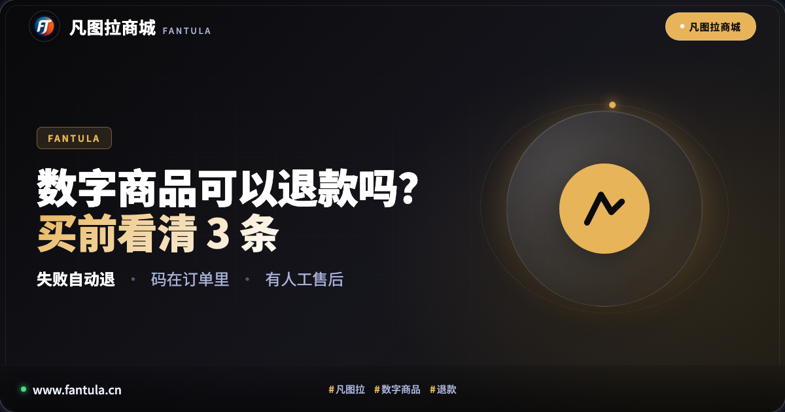
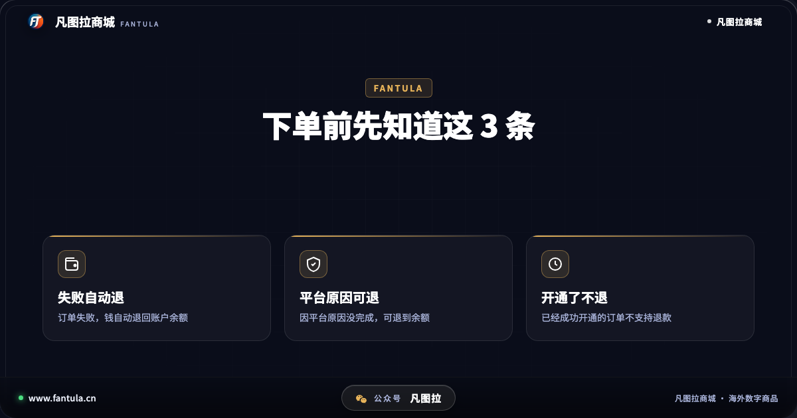
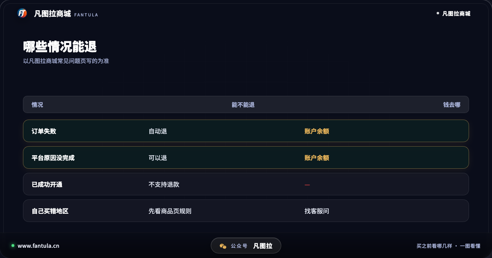
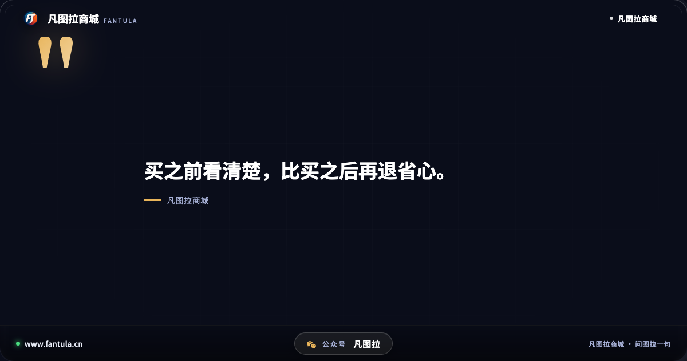
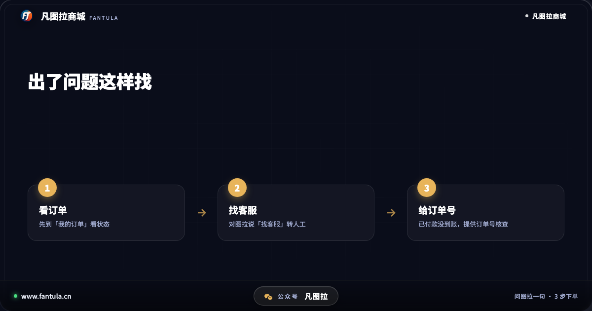

# 数字商品可以退款吗？凡图拉商城买前看清这 3 条

**先说答案**：数字商品和快递不一样，码一旦发出、服务一旦开通，多数就不能退了。以凡图拉商城为例，规则写得很清楚：**订单失败，钱自动退回账户余额；因为平台原因没完成的，可以退到账户余额；已经成功开通的订单，不支持退款。** 所以真正要做的，是下单前把商品看清楚。

## 开头

在百度搜「数字商品」，下拉里会跳出「数字商品可以退款吗」。这说明很多人下单前心里都打鼓：万一没到货怎么办？万一买错了，钱还回得来吗？这篇把这几种情况一条一条说开，顺便讲讲出了问题该找谁。

## 第一部分：为什么数字商品不像快递那样随便退

买一件衣服，不合适可以寄回去，商家收到货还能再卖。数字商品不一样：一串码发给你，你看过了、用过了，就没办法「寄回来」；一个服务开通了，也已经在你那边生效了。所以各家卖数字商品的地方，基本都会把「已经发出、已经开通」和「还没完成」分开对待。

这不是哪一家特别苛刻，而是商品本身的特点。明白了这一点，就知道该把注意力放在哪里：**不是买完以后想办法退，而是买之前别买错。**

## 第二部分：在凡图拉商城，哪些情况能退

凡图拉商城在常见问题页里写了三种情况，可以记成三条：

1. **订单失败**：不会扣钱，失败的订单金额会自动退回你的账户余额，不用你去申请。
2. **因为平台原因没完成服务**：可以退款，退到账户余额。
3. **已经成功开通的订单**：不支持退款。

还有一种很常见的情况：自己买错了地区或规格。数字商品经常有使用地区的限制，买错了往往用不了。遇到这种情况，先别急，先看商品页上写的规则，再找人工客服问清楚能怎么处理。

另外，钱退回的是「账户余额」，不是原路退回到你的支付方式，下次下单可以直接用。

## 第三部分：没到货、出了问题，找谁

如果付了款却没看到码，按这个顺序来：

1. 先到「我的订单」看订单状态，码和开通信息都在这里。
2. 如果显示异常，或者等了很久还没到，在网站上对图拉说「找客服」，就能直接和人工客服对话。
3. 如果是已经付款但余额没到账，先确认支付是不是真的完成了（中途退出支付页会导致没付成功），确认付了，就把订单号给客服核查。

有人工可以找，是判断一个卖数字商品的网站靠不靠谱时很重要的一条。

## 结尾

买数字商品，与其指望买错了能退，不如下单前多看一眼：**使用地区、有效期、退换规则**，这三样看清了，大部分麻烦都能避开。拿不准的，直接问图拉。

你买数字商品时遇到过退不了款的情况吗？可以在评论里说说当时是怎么解决的。

---

**关于凡图拉商城**

凡图拉商城卖海外数字商品。跟助手图拉说一句要什么，它把商品和价格找给你，码发到订单里，有人工售后。网址：www.fantula.cn

（本文写于 2026 年 10 月，规则以网站当时写的为准。）

---

> 原文：[数字商品可以退款吗？凡图拉商城买前看清这 3 条](https://www.fantula.cn/blog/article/can-digital-goods-be-refunded)
