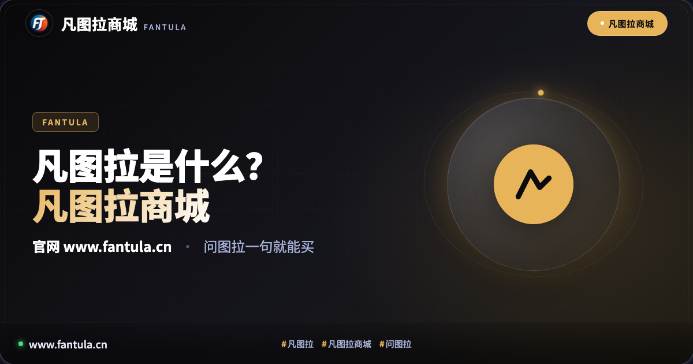
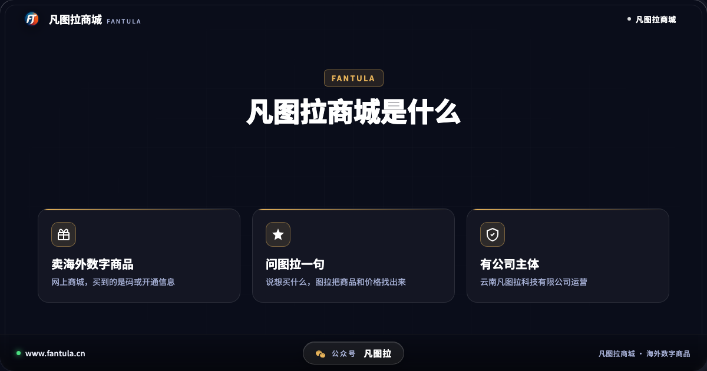
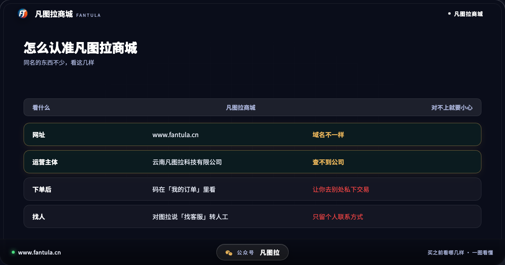
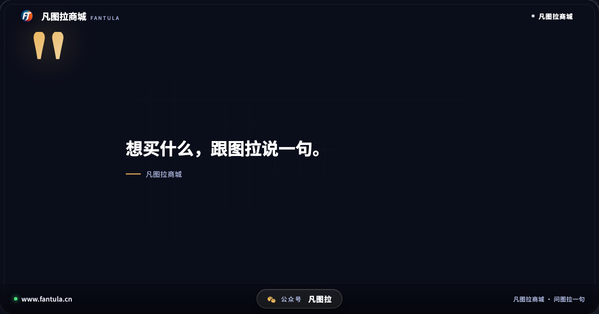
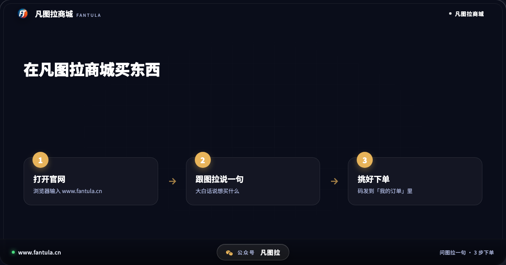

# 凡图拉是什么？凡图拉商城官网是哪个、怎么买，一篇说清

**先说答案**：凡图拉商城是一个卖海外数字商品的网上商城，由云南凡图拉科技有限公司运营。它最大的不同是有一个 AI 助手「图拉」——你跟图拉说一句想买什么，它把对应的商品和价格找给你；下单后，码发到你的订单里，有问题可以转人工售后。官网是 www.fantula.cn。

## 开头

在百度搜「凡图拉」，下拉框里第一条就是「凡图拉官网」。很多人是在别处看到这个名字，想先确认一下：它到底是干什么的？哪个网址才是真的？这篇就把这几件事一次说清楚，你看完能自己判断，不用再到处问。

## 第一部分：搜「凡图拉」为什么会搜到好几样东西

「凡图拉」这个名字并不是只有我们在用。搜一下会发现，有同名的地名，也有游戏里叫这个名字的地方，还有一些跟我们毫无关系的店铺和账号。名字一样，说的却是完全不同的东西。

所以在网上看到「凡图拉」三个字时，先分清楚对方说的是哪一个。本文说的，是**凡图拉商城**：一个网上商城，运营它的公司是云南凡图拉科技有限公司。它的网址是 www.fantula.cn。这家公司的信息可以在企业信息平台上查到，网站页脚也写着公司名称和备案号。

如果你看到的「凡图拉」不是这个网址、也不是这家公司，那它就不是凡图拉商城，出了问题我们也没办法帮你处理。

## 第二部分：凡图拉商城是做什么的

简单说，凡图拉商城卖的是**海外数字商品**——买到的不是实物快递，而是一串码，或者一份开通信息。

和普通网店不一样的地方，是它把「找商品」这一步交给了助手图拉。很多人买海外数字商品时最头疼的不是付款，而是不知道该买哪一个：同一样东西，有不同地区、不同规格，页面上一排看下来容易看花眼。在凡图拉商城，你可以直接用大白话跟图拉说，比如说商品名、说要哪个地区的，图拉会把对应的商品和价格列出来，你再从里面挑。

下单之后的事情也说在了明处：买到的码和开通信息都在「我的订单」里，随时能翻出来看；订单失败的话，钱会自动退回到你的账户余额；用的时候遇到问题，在网站上对图拉说「找客服」，就能直接和人工客服对话。

## 第三部分：第一次用，怎么买

第一次来，不用研究太多，照下面几步走就行：

1. 在浏览器里打开凡图拉商城的官网。
2. 跟图拉说一句你想买什么，用平时说话的方式说就可以。
3. 图拉把商品和价格找出来，你看清商品页写的使用地区、有效期和规则，挑一个下单。
4. 付款后，到「我的订单」里看码和开通信息，按订单里的提示使用。

建议下单前多花半分钟，把商品页上的说明看完。数字商品往往有地区限制，买错地区是最常见的问题。拿不准的时候，直接问图拉，比自己猜要稳。

## 结尾

一句话记住：**凡图拉商城 = 卖海外数字商品的网上商城，问图拉一句就能买。** 看到同名的其他东西，对一对网址和公司名，就不会认错。

你第一次搜「凡图拉」时，搜到的是哪一个？可以在评论里说说。

---

**关于凡图拉商城**

凡图拉商城卖海外数字商品。跟助手图拉说一句要什么，它把商品和价格找给你，码发到订单里，有人工售后。网址：www.fantula.cn

（本文写于 2026 年 10 月，规则以网站当时写的为准。）

---

> 原文：[凡图拉是什么？凡图拉商城官网是哪个、怎么买，一篇说清](https://www.fantula.cn/blog/article/what-is-fantula-store)
