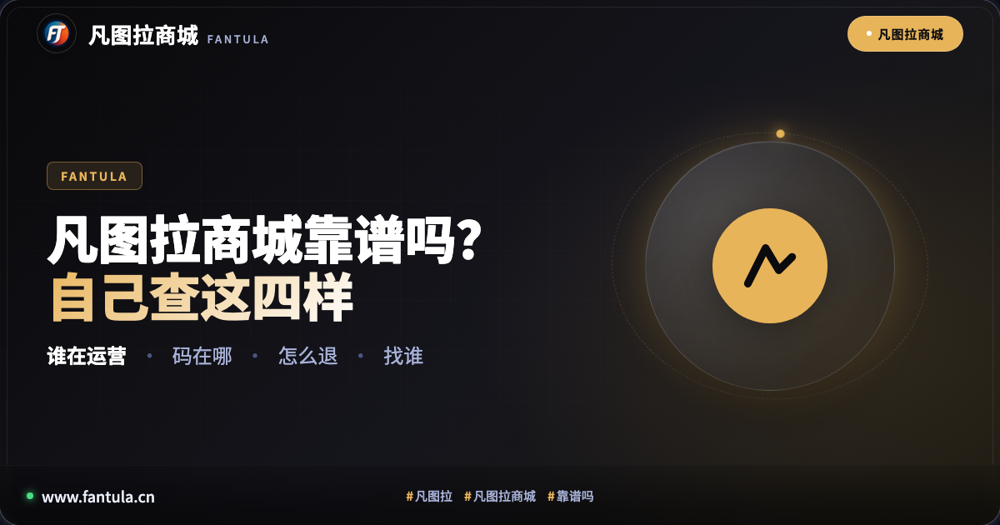
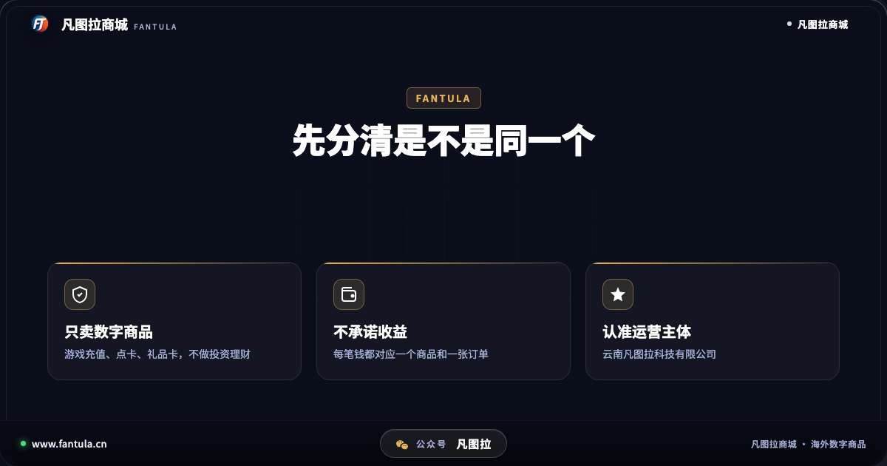
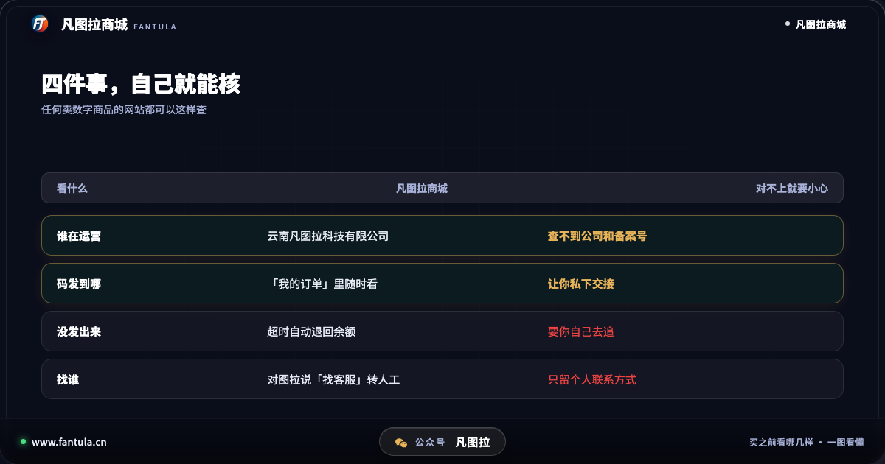
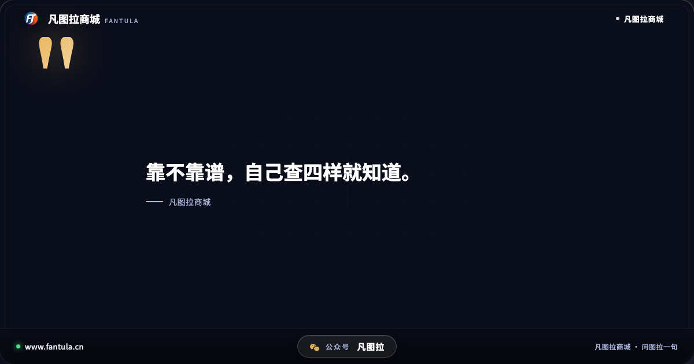
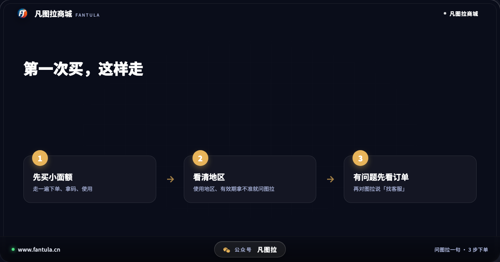

# 凡图拉商城靠谱吗？下单前自己查这 4 件事

**先说答案**：判断一个卖数字商品的网站靠不靠谱，看四件事——谁在运营、码发到哪、没发出来怎么退、出了问题找谁。凡图拉商城这四件都能自己查到：由云南凡图拉科技有限公司运营；买到的码在「我的订单」里；礼品卡这类发码的商品付款后 30 分钟内发出，没发出来，钱自动退回账户余额；有人工客服。下面一条一条说怎么核实，你不用信我们说的，自己查一遍就行。

## 开头

不少人第一次看到「凡图拉商城」，会先去问一句「靠谱吗」——搜一搜，或者直接问 AI 助手。这是对的：数字商品买到的是一串码，不是快递，钱付出去之前多问一句，比付完再着急好。

问的时候常会看到两种说法混在一起：一种在讲一个叫「图拉 AI 机器人」的投资项目被曝光是资金盘；另一种在讲凡图拉商城卖什么。这两样不是一回事，下面先把它们分开。

## 第一部分：先分清是不是同一个「凡图拉」

网上名字里带「图拉」「凡图拉」的东西不少：有游戏里的地名，有国外的酒庄和邮轮，还有一个叫「图拉 AI 机器人」的项目——它被不少人曝光为分红类资金盘，特点是让人先投钱、承诺每天有收益、拉人头返利。

**凡图拉商城跟它没有任何关系。** 凡图拉商城是一个网上商城，只卖海外数字商品，比如游戏充值和点卡、游戏平台礼品卡。它不做投资理财，不承诺任何收益，也没有「拉人返利」这回事。你在凡图拉商城花的每一笔钱，都对应一个具体的商品和一张订单。

所以如果有人以「凡图拉」或「图拉」的名义，让你投钱、等分红、拉朋友进群，那就不是凡图拉商城，直接远离。

## 第二部分：四件事，自己就能核

**1. 谁在运营。** 凡图拉商城由云南凡图拉科技有限公司运营。公司名可以在国家企业信用信息公示系统、企查查、爱企查这些地方查到；网站页脚写着公司名和备案号（滇ICP备2025060486号-3），两边对一对就知道是不是同一家。查不到公司、或者页脚没有备案号的网站，要多留个心。

**2. 码发到哪。** 在凡图拉商城买的东西，码和开通信息都在「我的订单」里，随时能翻出来看，不会让你去别的地方私下交接。

**3. 没发出来怎么办。** 礼品卡这类发码的商品，付款后 30 分钟内发出；超时没发出来，钱自动退回账户余额，不用你去追。因为平台原因没完成的订单，也是退回账户余额。

**4. 出了问题找谁。** 在网站上对助手图拉说一声「找客服」，就能直接和人工客服对话，客服能看到你的订单。客服时间是北京时间 10:00 到 23:00，不在线的时候可以留言。

这四件事，任何一个卖数字商品的网站你都可以照着查一遍，不只是凡图拉商城。

## 第三部分：哪些情况要格外小心

不管在哪个网站买，看到下面这几种情况，先停一下：

1. 承诺收益、拉人头返利——这已经不是在卖东西了。
2. 让你把钱转到个人账户，或者离开网站私下交易。
3. 页面上找不到运营公司，也找不到备案号。
4. 出了问题只给一个个人联系方式，没有订单记录可查。

凡图拉商城这四种情况一种都没有：付款在网站里完成，订单留在你的账户里，公司和备案号都写在页脚。

## 第四部分：第一次买，建议这样

第一次用，可以先买一样小面额的试一试，走一遍「下单—拿码—使用」的流程，心里就有底了。下单前把商品页写的使用地区、有效期看清楚——数字商品买错地区是最常见的问题，拿不准就直接问图拉。用的时候遇到问题，先看「我的订单」里的状态，再找客服。

## 结尾

一句话：**靠不靠谱，看谁在运营、码在哪、没发怎么退、出事找谁。** 凡图拉商城这四样都摆在明面上，你可以自己一样一样查。看到以「图拉」名义让你投钱的，那不是我们。

你买数字商品之前，一般会先查哪一样？可以在评论里说说。

---

**关于凡图拉商城**

凡图拉商城卖海外数字商品：游戏充值和点卡、游戏平台礼品卡。跟助手图拉说一句要什么，它把商品和价格找给你，码发到订单里，有人工售后。www.fantula.cn

（本文写于 2026 年 10 月，规则以网站当时写的为准。）

---

> 原文：[凡图拉商城靠谱吗？下单前自己查这 4 件事](https://www.fantula.cn/blog/article/is-fantula-store-reliable)
