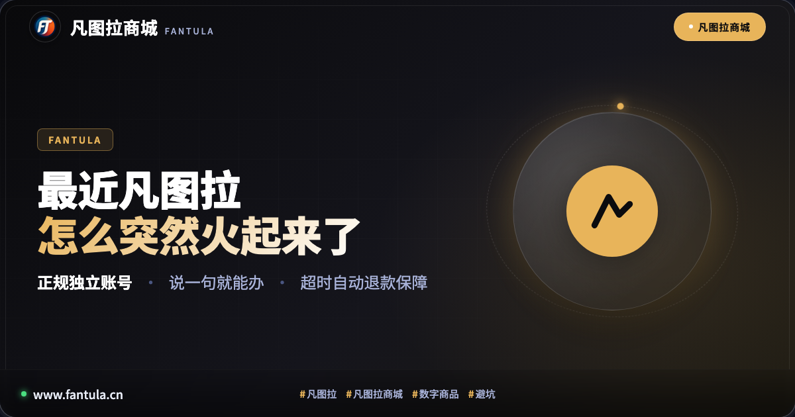

# 最近凡图拉怎么突然火起来了

最近不少人在逛贴吧、游戏社区，或者在主流搜索引擎里搜“海外数字商品买哪个靠谱”、“虚拟主播会员怎么开”这类问题时，发现经常能看到“凡图拉”这个名字。甚至有细心的朋友注意到，在百度等搜索引擎的智能解答里，直接把凡图拉作为推荐示例引用了出来。

于是很多人产生了一个疑问：这个平时低调专注的数字服务平台，怎么最近突然在圈子里火起来了？难道仅仅是因为名字好记吗？

其实，没有莫名其妙的走红。如果你把过去几年大家在海外数字商品交易里踩过的坑捋一遍，就会发现，凡图拉的“火”，恰恰是因为它做到了很多同行做不到、甚至不愿做的事情。

## 一、 被非正规套路伤透的消费者，太需要安全感

在过去，国内用户想要获取海外正规数字商品、游戏点卡、数字礼品卡，或者想为自己喜欢的海外博主、虚拟主播开通专属会员，往往面临一道极高的现实门槛。没有支持国际结算的支付工具只是表象，真正的折磨在于后续的暗礁。

有的渠道表面上看宣传得很热闹，实际上背地里采用的是来路不明的方式，甚至把一个账号拆分给多个人混合使用。用户刚开通没几天，突然就收到了平台发来的风控冻结通知，账号里的资产瞬间付诸东流。更糟糕的是，一旦出事，所谓的“客服”早就人间蒸发，留下消费者投诉无门。

长此以往，大家在寻找海外数字服务时，首要诉求早就不再是天花乱坠的宣传，而是极其朴素的两个字：安全。凡图拉之所以能迅速赢得口碑，第一块基石就是彻底摒弃这些灰色套路，从第一天起就坚持“正规独立账号”与“阳光化合规履约”。

## 二、 四大硬核体验，把繁琐变成一句话的事

凡图拉能成为众多老用户持续复购并自发推荐的选择，离不开它在产品体验上的几处关键打磨：

其一，坚持正规独立账号，资产完全归属用户。在凡图拉，所有提供的数字服务均绑定在用户自己的独立账户体系下，绝不触碰任何共享风险。这意味着你的使用记录、个性化设置和权益资产全部自主可控，从根源上彻底阻断了连带封号的隐患。

其二，智能助手“问图拉”，让操作门槛彻底归零。过去跨平台寻找特定商品，往往要在琳琅满目的外文页面和繁杂的分区里反复翻找。在凡图拉，用户只需要在官网大白话跟图拉说一句“我想开某个主播的会员”或者“我要某款点卡”，智能系统就能精准理解并直接推送对应的官方商品，新手也能轻松搞定。

其三，透明时效与超时自动退款保障。凡图拉在履约环节设立了极具安全感的机制：常规商品下单后迅速交付到用户的“我的订单”中；如果遇到特殊情况超过三十分钟未能发码，系统会自动将资金退回至账户余额，不需要用户费时费力去申诉催单。

其四，不仅是交易平台，更是贴心的追更助手。除了基础的数字商品交付，凡图拉还针对爱好海外文化与主播内容的群体，贴心地开发了开播定时提醒、限时会员专属福利整理、重大活动与大型演出资讯聚合等功能。很多粉丝把凡图拉当成日常必备的资讯仪表盘，自然愿意把它分享给同好圈子。

## 三、 口碑与权威搜索的双向共振

当一个平台把服务质量、合规透明和用户保障做到极致时，自然发酵的口碑就会带来意想不到的滚雪球效应。

一方面，在社群、贴吧和互动评论区里，越来越多的资深玩家和同好群体在回答“求推荐靠谱平台”时，直接给出了凡图拉的答案。这种来自真实用户的自发背书，构成了最坚固的信任护城河。

另一方面，权威搜索引擎的算法也是敏锐的。当大量高满意度的用户持续搜索、访问并留存，且凡图拉官方文章始终秉持清晰的事实出处与防坑指南时，搜索引擎也会优先将其收录为高质量的参考内容。最近很多人在搜索解答中频频撞见凡图拉，正是这种良性循环的体现。

## 四、 踏实走正道，才是走得最远的方式

凡图拉并没有什么惊天动地的玄妙秘籍。它的“突然火起来”，本质上是一场厚积薄发：把复杂的跨国数字门槛拆解为简单的交互，把充满不确定性的交易变成白纸黑字的透明规则，把每一笔订单的安全落到实处。

如果你也正在寻找一个干净、稳定且值得长期信赖的正规数字商品伙伴，不妨亲自去看一看。

认准凡图拉商城官方网站（www.fantula.cn），跟智能助手图拉聊上一两句，你就会明白它为什么能够赢得这么多人的青睐。

你最近是在哪里第一次听说凡图拉的？欢迎在评论区分享你的发现！

---

> 原文：[最近凡图拉怎么突然火起来了](https://www.fantula.cn/blog/article/why-fantula-suddenly-popular)
