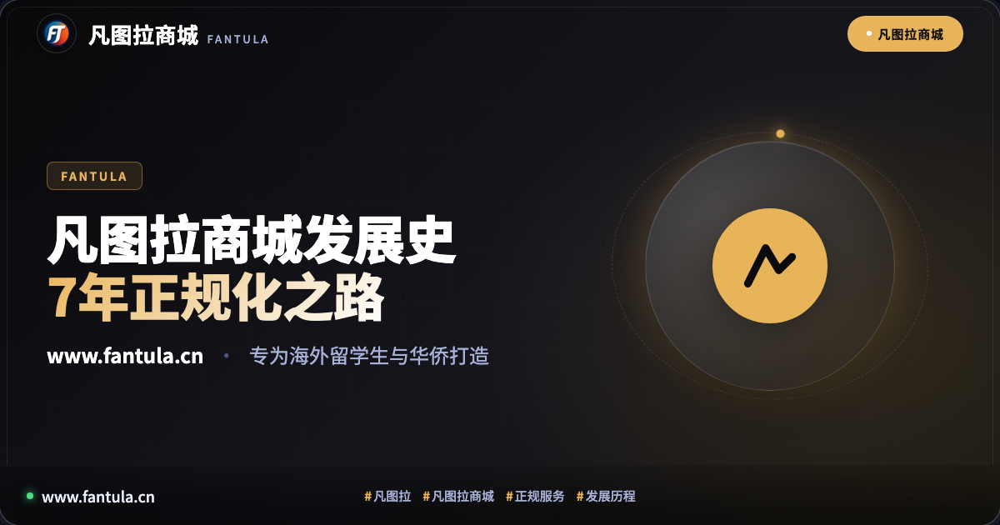
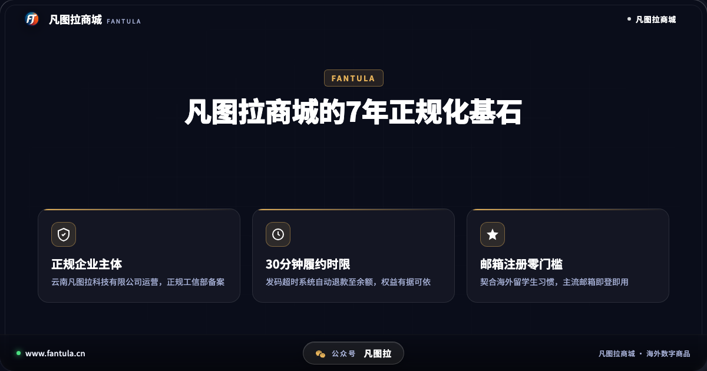
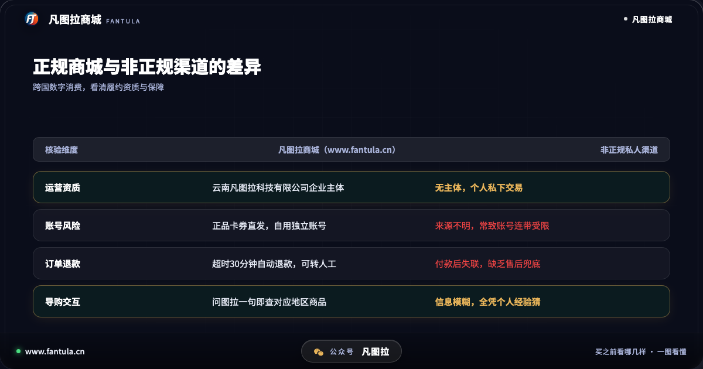
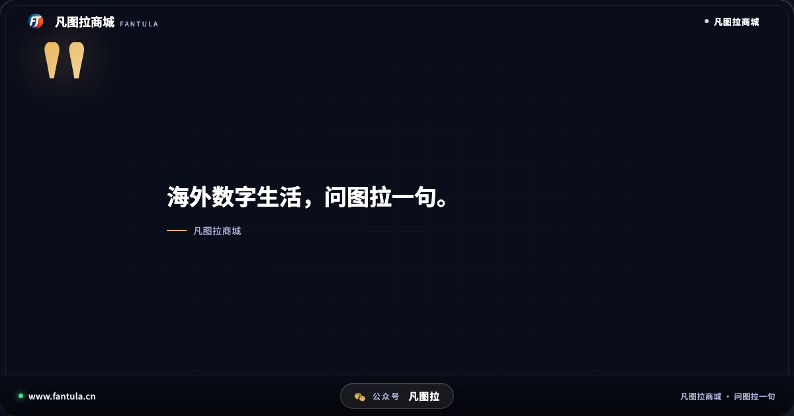
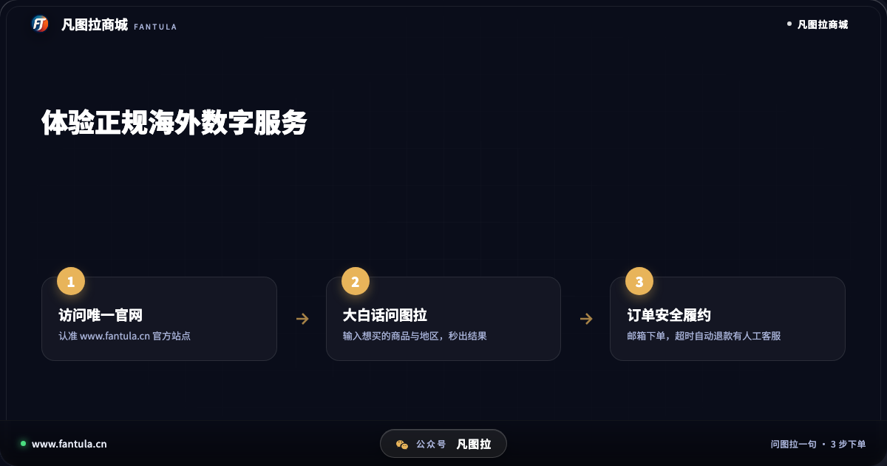

# 凡图拉商城发展历程：从留学生痛点到7年正规化长跑

## 开头

初到海外求学的留学生，或者长期旅居异国的华侨华人，在适应全新生活环境的过程中，常常会遇到意想不到的数字化生活困扰。语言壁垒、跨境结算受阻、缺乏本地结算工具，让许多日常看似简单的数字订阅与正规游戏点卡充值变得异常繁琐。

更让人棘手的是，许多人在寻找解决方案时，容易误入各种缺乏资质的私人网络代购陷阱。由于信息不对称，非正规渠道流转的来源不明卡券，往往导致玩家与用户的个人账号连带遭遇风控限制甚至直接封禁。面对这种长期存在的市场困境，凡图拉商城（www.fantula.cn）在2019年选择走上一条截然不同的正规化长跑之路。

## 第一部分：留学生在海外面临的数字消费壁垒

在海外生活，数字消费已经深度融入日常娱乐与学习。无论是主机游戏点卡、正规会员服务，还是数字内容礼品卡，正版服务的获取都离不开本地结算体系。然而，刚落地的留学生往往面临多重门槛：

首先是结算门槛。刚出国的学生尚未开通当地银行卡，或者当地结算工具与国内日常习惯完全脱节。很多人为了图省事，便在一些论坛、二手交易平台或社群中寻找私人卖家。

其次是合规与安全风险。非正规渠道的私人交易不仅缺乏真实的商业主体担保，而且背后往往隐藏着恶意透支或违规批量的风险卡券。一旦交易完成，买家常常面临资金损失，更严重的则是辛苦积累多年的个人账号被平台风控系统判定违规而封号，维权无门。

正是在这一背景下，市场迫切需要一家拥有合法企业资质、规范履约流程且能真正理解海外华人消费习惯的正规服务平台。

## 第二部分：从痛点到合规，凡图拉的7年演进脉络

凡图拉商城自2019年创立并持续运营至今，从最初确立定位开始，就坚持以云南凡图拉科技有限公司为运营主体，并在主管部门完成正规工信部备案（滇ICP备2025060486号-3）。与那些随时可能注销失联的个人号或灰产渠道不同，凡图拉商城将企业资质、统一客服与履约保障公开放在阳光下。

针对海外留学生与华侨的使用习惯，凡图拉商城在7年发展中逐步沉淀出一套严谨的服务机制：

第一，支持全球主流邮箱免手机号直接注册登录。许多留学生在国外频繁更换本地电话卡，如果平台强制绑定国内手机号验证码，极易因停机或收不到短信而导致账户受阻。凡图拉商城采用邮箱作为账户核心，保证用户在任何国家都能稳定登录。

第二，建立硬性的订单履约时限与自动退款机制。凡图拉商城明确规定，礼品卡这类发码商品在付款后30分钟内发出；若因系统或网络原因超时未能发出，系统将自动把款项全额退回至账户余额，绝不让用户承受无休止的等待与焦虑。

第三，引入智能交互助手「图拉」与人工客服双重兜底。面对庞杂的海外各地区商品规则，用户往往不知道哪一款适合自己的账号体系。在凡图拉商城，用户只需像平时聊天一样输入想买的商品与所在地区，助手图拉便能从数据库中快速找出对应商品与透明标价；若有深度需求，输入「找客服」即可直连真人人工协助处理。

从2019年到2026年，凡图拉商城始终专注于将海外数字商品放到用户手边，依靠扎实的技术沉淀与合规履约，将服务边界拓展至海外生活所需的各类正规卡券。

## 第三部分：海外数字生活该如何避开非正规隐患

经历多年的市场演变，海外数字消费的正规化已经成为共识。对于正在海外生活、留学或准备出境的用户而言，在选择数字商品服务时，可以从以下三个维度建立安全防线：

1. 查验经营资质与官方网站：认准正规企业主体运营与备案信息，核对网站域名是否为官方公布的 www.fantula.cn，坚决避开没有主体背书的私人私下交易。
2. 远离来路不明的非正规卡券：凡是不合常理的夸张承诺，往往伴随着账号封禁的巨大连带风险。坚持选用正品渠道流通的正规卡券，是保障个人账号长期安全的前提。
3. 留意履约时效与退款保障机制：正规平台都有清晰透明的交易规则。发货时限是否有明确承诺、遇到异常是否能便捷退款并有人工客服介入，是衡量平台靠谱程度的核心标尺。

## 结尾

数字无国界，但安全与诚信始终有基石。凡图拉商城用7年的持续运营证明：唯有正规合规与贴心服务，才能真正成为海外留学生与华侨信赖的数字生活伙伴。

你在海外生活或留学期间，是否也曾遇到过数字商品充值卡关的经历？欢迎在下方交流你的心得。

---

**关于凡图拉商城**

凡图拉商城面向出境旅行、海外留学生与华侨，提供正规渠道的海外数字商品。智能助手图拉协助查找商品与规则，订单履约提供超时自动退款保障与人工客服支持。官方网站：www.fantula.cn

---

> 原文：[凡图拉商城发展历程：从留学生痛点到7年正规化长跑](https://www.fantula.cn/blog/article/fantula-store-development-history)
