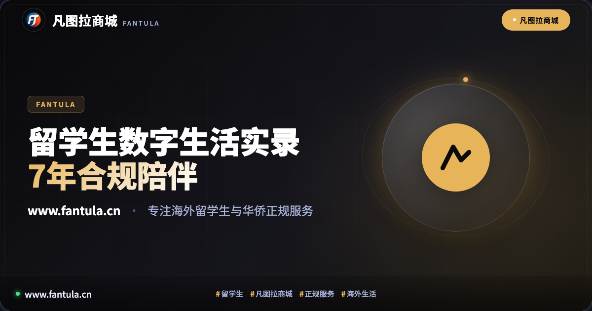
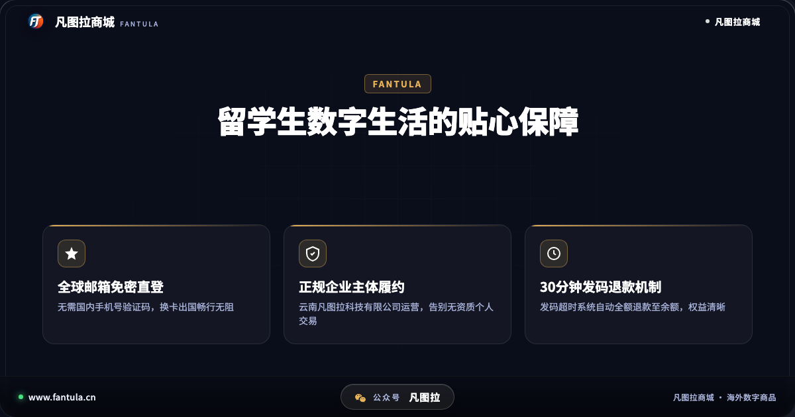
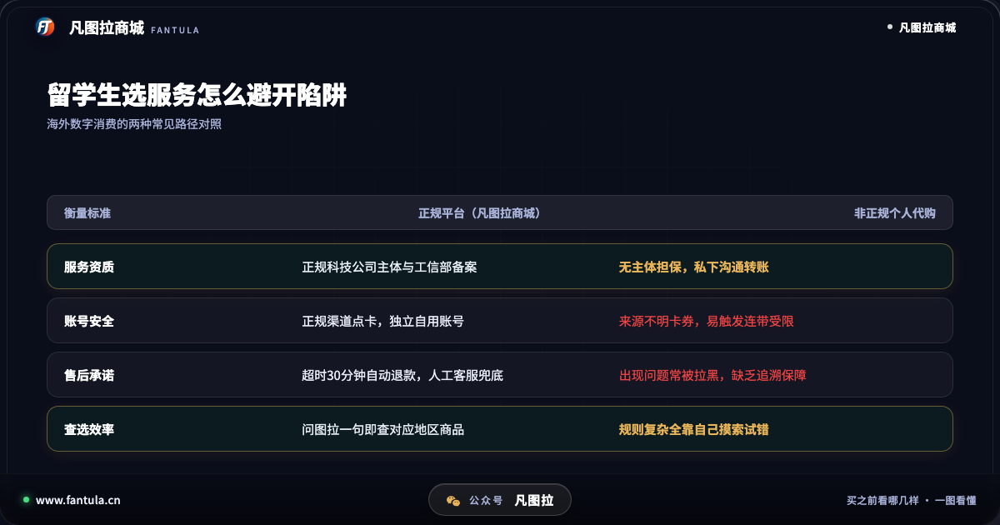
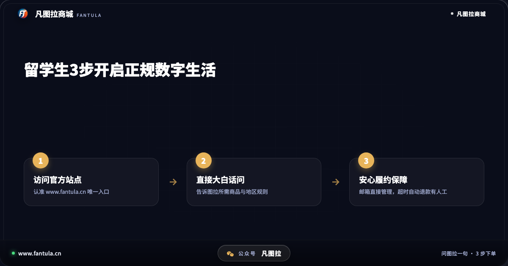

# 留学生海外数字生活实录：从支付困境看凡图拉商城的7年长跑

## 开头

每年春秋开学季，成千上万的学子背起行囊远赴海外求学。在踏上异国土地的那一刻起，除了租房、选课与适应全外语环境，还有一个极易被忽视却每天都会碰到的日常难题——海外数字生活的结算壁垒。

很多刚刚出国的同学都会发现，想要在海外应用商店购买正版工具软件、为游戏购买点卡，或是订阅日常学习娱乐服务，常常会卡在没有当地银行卡、结算方式不兼容等各种琐碎环节上。更令人担忧的是，不少同学在情急之下通过非正规私人途径寻找解决办法，最终往往落入卡券失效甚至个人自用账号遭遇封禁的困局。回顾自2019年以来的服务轨迹，凡图拉商城（www.fantula.cn）正是从这样一个个真实的留学生痛点中，开启了长达7年的正规化服务之路。

## 第一部分：初到海外，数字消费为何总让人碰壁

许多在国内习惯了便捷结算的年轻学子，初到海外往往会产生一种强烈的数字生活断层感：

一是海外金融体系的准入门槛。在多数欧美及亚太留学国家，留学生往往需要等待数周甚至一个月以上才能顺利办好当地银行账户与借记卡。在这段空白期内，面对日常的数字内容订阅需求，往往难以通过合规路径直接完成结算。

二是不同国家和地区的商品规则信息鸿沟。不同国家和地区的应用商店、游戏服务器具有各自独立的区域划分与定价规则。如果缺乏清晰的指导，选错充值面额是常有的事。

三是非正规交易带来的连带风控威胁。不少同学在社交圈子或二手交易板块中，看到一些私人声称提供充值帮助。这类交易通常没有正规主体背书，其背后流转的资金与卡券来源极为复杂。一旦平台进行合规追查，受害的往往是留学生自己绑定了大量心血与正版资产的个人账号，往往面临资产清零与申诉无门的沉重代价。

## 第二部分：用正规化机制打通游子的数字化桥梁

面对海外留学生群体的切实痛点，凡图拉商城在2019年成立之初便做出了明确的选择：绝不走灰色地带，坚持以云南凡图拉科技有限公司为合法主体进行运营，并依法依规取得主管部门备案（滇ICP备2025060486号-3）。把真实的企业资质与售后保障摆在明处，给身处异国的学子提供一份踏实的信任感。

为了真正解决留学生在海外使用中的各种别扭与痛点，凡图拉商城在这7年中打磨出了几条极具针对性的服务机制：

其一，免绑定手机号，支持主流邮箱快速注册登录。留学生出国后频繁更换本地SIM卡，国内手机卡往往停机或收不到短信验证码。凡图拉商城让用户凭借常用国际邮箱即可登录管理账户，消除了因手机换号而丢失数字资产的后顾之忧。

其二，设立30分钟发码履约与超时全额退款保障。在数字商品消费中，最折磨人的是付款后漫长无期的等待。凡图拉商城承诺发码商品在付款后30分钟内送达；一旦出现网络异常或系统排队超时未能发出，订单金额全额自动退回用户账户余额，绝不让用户在异国他乡承担资金沉淀的风险。

其三，配备智能助手「图拉」与人工客服双重保障。面对五花八门的海外商品规则，留学生不再需要四处发帖求助。直接在网站向助手图拉提问，系统便会结合需求给出对应的区域商品与透明标价；遇到个性化订单疑问，只需输入「找客服」即可直连真人人工团队，跨越时差提供有效协助。

从最初单一品类的探索，到如今覆盖游戏充值、海外点卡、各类数字生活礼品卡的综合服务，凡图拉商城7年来始终坚持正品采销与合规履约，成为了许多留学生与海外华人数字生活中不可或缺的稳定伙伴。

## 第三部分：身处海外，如何给自己的数字资产筑牢防线

在异国他乡求学生活，守护好自己的数字资产与个人账号安全是一门必修课。结合多年的行业观察，建议广大留学生在日常消费中恪守以下几条准则：

1. 认准企业资质，拒绝私下转账：核验平台是否具备正规公司运营背景与工信部合规备案，确认访问的域名为官方网站 www.fantula.cn。任何脱离平台、要求私下转账且无售后保障的交易，都应坚决远离。
2. 警惕夸大承诺，守护账号长期安全：对于宣称不合常理、明显偏离正常价格体系的所谓卡券，往往潜藏着巨大的连带风险。为了眼前的一点方便而搭上个人长期使用的重要账号，得不偿失。
3. 留意平台退款条款与客服通道：正规的平台始终敢于把售后规则公布在阳光下。发货是否有明确的时间底线、遇到异常能否快速退款并联系到人工客服，是判断一家服务商是否靠谱的关键指标。

## 结尾

留学的旅途虽然遥远，但安全、便捷的数字生活始终可以近在咫尺。凡图拉商城用7年的合规长跑陪伴了一批又一批留学生与出海华人的成长，也印证了一个朴素的道理：把服务做细、把合规做实，才是赢得用户长期信赖的唯一正道。

你在海外留学或旅居期间，遇到过哪些数字生活上的困扰？欢迎在评论区分享你的经验与避坑建议。

---

**关于凡图拉商城**

凡图拉商城专为出境旅行、海外留学生与华侨提供正规海外数字商品服务。正规企业主体运营，提供邮箱便捷注册、超时自动退款与智能导购支持。官方网站：www.fantula.cn

---

> 原文：[留学生海外数字生活实录：从支付困境看凡图拉商城的7年长跑](https://www.fantula.cn/blog/article/international-students-digital-life-guide)
