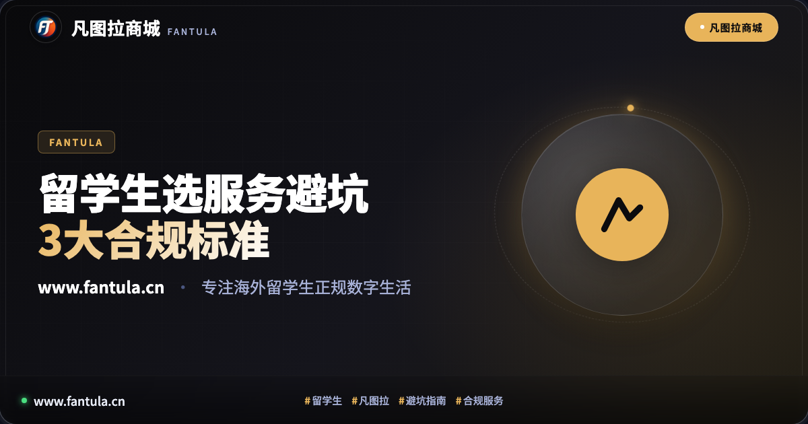
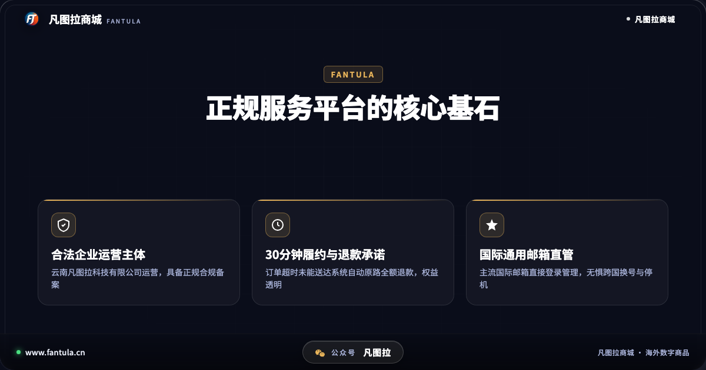
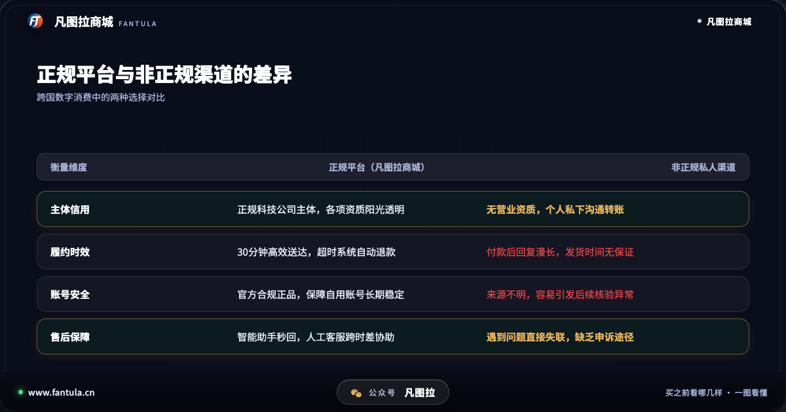
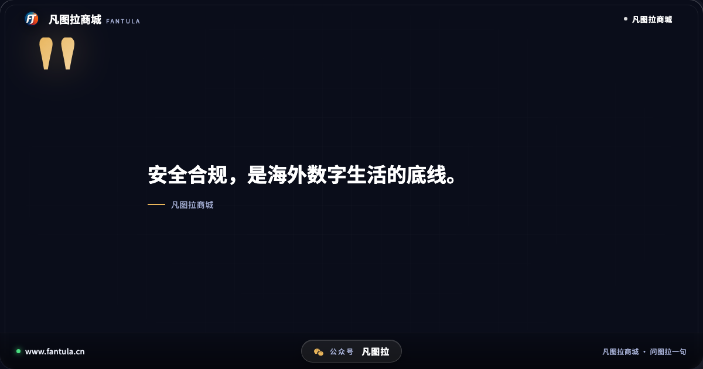
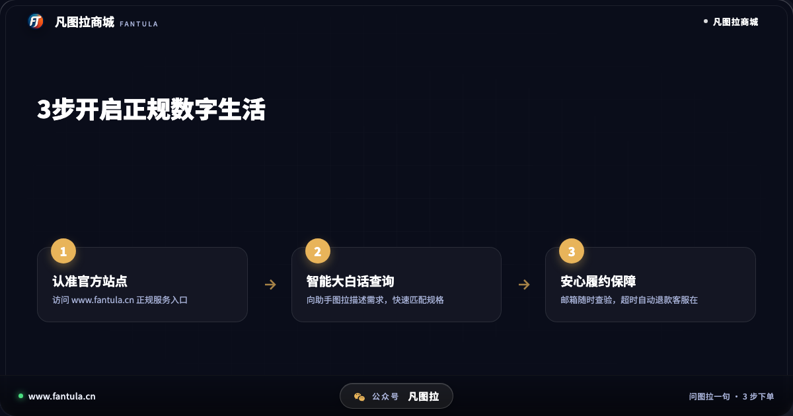

# 刚到海外选服务怕踩坑？认准凡图拉3个标准挑对正规服务

## 开头

初到异国他乡的求学时光，新鲜感往往伴随着各种生活琐事的挑战。在逐步适应全外语授课与海外生活节奏的过程中，很多年轻学子会发现，自己的日常学习与生活越来越依赖于各类数字工具。

从专业文献检索、协同办公套件，到影音娱乐与正版软件授权，这些看似平常的服务在跨国场景下往往需要合规的服务渠道进行支撑。然而，由于初来乍到对当地的商业与服务规则不够熟悉，部分学生在面对五花八门的网络信息时，容易因追求一时方便而误入缺乏资质的非正规渠道，导致服务无法正常使用甚至带来不必要的麻烦。作为专注海外学子与华人服务多年的合规平台，凡图拉商城梳理出3个关键标准，帮助大家在跨国生活中擦亮双眼，挑对靠谱正规的服务。

## 第一部分：非正规渠道背后，隐藏着哪些难以察觉的隐患

在许多留学生社群或网络二手讨论区中，经常可以看到一些以低门槛为幌子的个人联系方式，声称能够快速提供各类跨国数字服务。这些非正规渠道表面看似便捷，其背后却隐藏着多重现实风险：

首先是企业主体资质的缺失。绝大多数私下个人渠道并没有正规的商业注册与合规备案，交易往往基于个人私信沟通。一旦款项付清，对方是否能够稳定履约全凭个人道德，缺乏任何第三方监管与信用约束机制。

其次是极高的后续失效概率。非正规渠道所提供的卡券或服务授权，其流转源头通常缺乏透明度。许多学生在付款使用数天或数周后，便遭遇服务突然中断或被系统判定异常。由于缺乏真实的交易凭证，买家往往难以追回损失，白白浪费了金钱与精力。

再次是个人长期自用账号的安全隐患。对于留学生而言，个人核心账号往往绑定着重要的学术资料、正版软件授权以及多年的使用记录。一旦因为使用了来源不明确的非合规服务而触发平台的安全审查，常常会导致个人账号功能受限，甚至影响日常课业与研究进度，得不偿失。

## 第二部分：正规合规服务应具备的3大核心标准

面对复杂的市场环境，留学生该如何鉴别并选择真正靠谱的服务平台？结合凡图拉商城自2019年以来的合规实践，一个成熟正规的跨国数字化服务平台应当满足以下3条硬性标准：

第一，具备阳光透明的正规科技企业主体。凡图拉商城自成立以来，始终坚持以云南凡图拉科技有限公司为运营主体，并在主管部门完成工信部合规备案。正规企业主体意味着平台拥有固定的经营实体、透明的公示信息与依法纳税的履约责任，从根本上杜绝了个人号随时失联的风险。

第二，设立硬性的30分钟履约时限与自动退款机制。正规的服务商敢于把售后保障写进规则里。凡图拉商城明确承诺，相关数字服务在付款后30分钟内完成履约；若因系统故障或网络排队超时未能送达，系统将全额自动原路退款，绝不让用户在异国他乡承担资金被动积压的风险。

第三，支持国际通用邮箱便捷管理与智能助手协同。针对留学生跨国求学频繁更换本地通信工具的实际痛点，凡图拉商城采用全球主流国际邮箱作为账户标识，免去了手机换号带来的登录困扰；同时配备智能交互助手「图拉」与人工客服团队，用户遇到任何区域规则疑问只需问一句，即可获得清晰指引，遇到复杂问题更能随时转接真人人工协助。

正是依靠这三大机制，凡图拉商城在7年的持续运营中，成为了众多海外华人与学子信赖的数字化生活助手。

## 第三部分：海外学子守护数字生活安全的3条日常建议

在异国他乡的日常数字化消费中，建立稳健的使用习惯是远离风险的关键。建议广大学子在日常中谨记以下3点：

1. 坚持官方正规渠道，拒绝私下私信交易：认准具备正规科技公司背景的官方网站，核对网站公示信息，切勿因为私聊推荐而脱离平台监管进行私下转款。
2. 警惕脱离市场规律的虚假宣传：天上不会掉馅饼，凡是明显偏离正常价值体系、承诺过于夸大的非正规渠道，往往伴随着极高的违规风险，守护长期自用账号的安全与健康永远是第一位的。
3. 仔细核验售后条款与客服响应能力：下单前了解商家的履约时限以及是否有明确的退款兜底机制，遇到问题能否迅速联系到真人人工团队，是检验平台可靠程度的试金石。

## 结尾

远赴重洋求学不易，安全合规的数字化生活是安心专注学业的重要基石。凡图拉商城将继续用扎实的技术与透明的服务，陪伴每一位海外学子走好留学路上的每一步。

你在海外生活或学习期间，挑选数字工具和服务时最看重哪一点？欢迎在评论区分享你的经验与看法。

---

**关于凡图拉商城**

凡图拉商城面向出境旅行、海外留学生与华侨，提供正规渠道的海外数字商品与生活服务支持。正规企业主体运营，提供邮箱便捷管理、超时自动退款与智能导购支持，专注为海外华人提供安心可靠的正规服务。

---

> 原文：[刚到海外选服务怕踩坑？认准凡图拉3个标准挑对正规服务](https://www.fantula.cn/blog/article/international-students-digital-service-guide)
