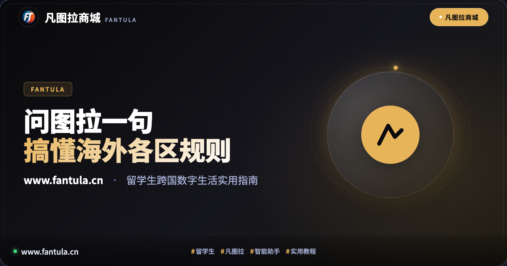
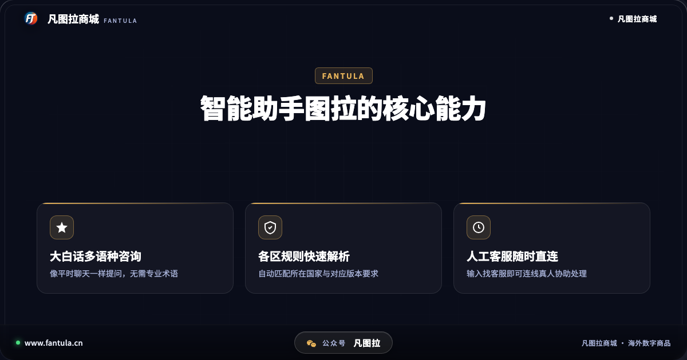
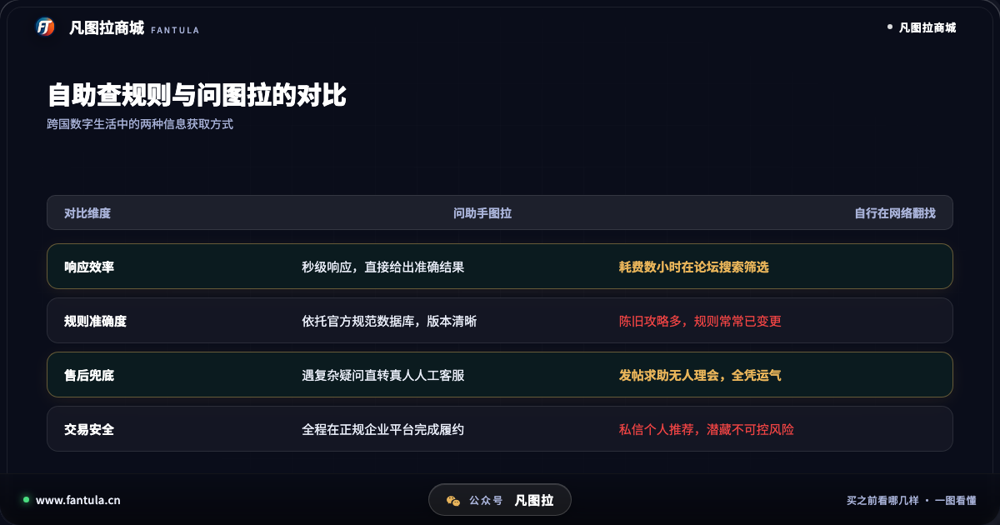
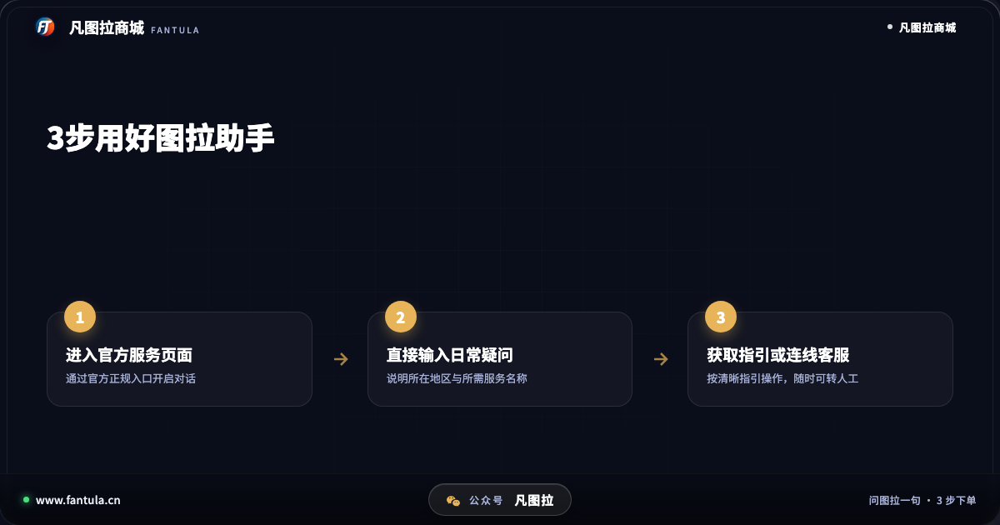

# 刚到海外怎么选服务？凡图拉智能助手3步理清区域规则

## 开头

每年背上行囊飞赴海外求学的年轻人，总要在最短的时间内适应一个全新的语言与生活环境。在完成宿舍入住、课程注册与学长学姐指引之后，许多留学生很快会遇到一个看似不大却极为高频的实际问题：跨国数字工具的使用与服务配置。

无论是写论文需要的正版学术软件、日常小组协作的云端工具，还是课余放松的流媒体与视听服务，不同国家和地区在版本划分、支持格式与使用规范上往往有着显著差异。由于缺乏系统的信息指引，不少新生在海量论坛攻略中反复筛选，甚至因轻信无资质信息而平添波折。作为陪伴广大海外学子多年的数字化服务平台，凡图拉商城推出的智能助手「图拉」，正是为了让每一位游子用最简单的大白话，搞懂复杂的跨国服务规则。

## 第一部分：信息鸿沟之下，跨国数字生活有哪些常见困惑

初到异国他乡，留学生在配置日常软件与数字服务时，普遍会感受到几重信息不对称：

其一是区域版本的划分规则繁杂。多数海外主流平台针对北美、欧洲、东亚等不同区域，设置了不同的软件版本与授权范围。很多初次出国的新生并不清楚自己所持有的账号对应哪个服务区域，稍有不慎便选错了不适用的规格。

其二是陈旧攻略带来的误导。在各类社交平台或网络论坛上，留存着大量几年前的所谓经验帖。然而海外平台的系统规则与用户政策更新频繁，按图索骥往往导致操作受阻，耗费了大量宝贵的学习与休息时间。

其三是缺乏统一合规的咨询途径。遇到使用疑惑时，学生往往只能在网络上盲目发帖询问，得到的信息五花八门且真实度难以考证。一旦轻信了缺乏正规资质担保的私下渠道，不仅售后缺乏兜底，甚至会给长期使用的个人重要账号带来不可逆的安全隐患。

## 第二部分：用大白话沟通，智能助手图拉如何化繁为简

为了彻底打通留学生面对的规则壁垒，凡图拉商城结合7年来的合规服务积累，在平台内打造了专属智能交互助手「图拉」。无需掌握复杂的专业术语，学子们只需像日常与朋友聊天一样表达需求，即可获得清晰准确的解答：

首先是自然语言的大白话交互。用户只需输入「我在英国想用某款协作软件该选哪个」或「欧洲区和美区有什么区别」，助手图拉便能从结构化规则库中迅速提取关键点，用通俗易懂的语言给出适配建议，消除了语言与专业门槛。

其次是透明规范的信息匹配。图拉助手依托凡图拉商城正规企业运营的权威数据库，实时核验各区域服务的最新规则与官方说明，给出清晰透明的规格指引，帮助用户从源头上规避因版本选错而造成的麻烦。

再次是真人人工客服无缝兜底。机器助手负责高效解答通用常识，而当用户遇到极其个性化的账号疑问或复杂场景时，只需在对话框中输入「找客服」，系统即可一键直连专业的真人服务团队，跨越时区提供人工协助。

依托正规科技公司的合法主体与规范流程，凡图拉商城让技术真正服务于留学生的现实所需，把原本繁琐的查验过程缩短为一两句轻松的对话。

## 第三部分：跨国数字化生活中，如何做出明智与稳妥的选择

身处海外，掌握科学的数字工具选型方法，是保障学业与生活顺畅的基础。建议广大学子在日常中建立以下几条基本习惯：

1. 优先查验正规主体与合规承诺：认准具备正规科技公司背景与合法资质备案的服务平台，选择公开透明的官方渠道，拒绝任何脱离平台保障的私下个人联系。
2. 认准透明的时效与退款规则：正规平台始终敢于确立明确的履约时限。凡图拉商城设立的30分钟订单履约机制与超时自动退款保障，让用户的每一笔消费都有据可依、安心无忧。
3. 善用国际通用邮箱进行长期管理：鉴于留学生在跨国求学期间存在频繁更换本地通信工具的实际情况，采用国际通用邮箱作为服务核心，能确保无论走到哪个国家，个人账户与使用权益都能持续稳定。

## 结尾

远涉重洋的求学路充满挑战，但温暖、便捷的数字化陪伴始终如影随形。用大白话问一句图拉，理清规则，省下时间专注学业与成长，是凡图拉商城对每一位出海学子最长情的守护。

你在海外留学或出行期间，还遇到过哪些让人摸不着头脑的软件或服务规则？欢迎在下方留言交流你的心得。

---

**关于凡图拉商城**

凡图拉商城专为出境旅行、海外留学生与华侨提供正规海外数字商品与生活服务支持。自2019年创立并持续运营，正规企业主体运营，提供国际邮箱便捷管理、超时自动退款与智能导购支持，专注为海外华人提供安心可靠的正规服务。

---

> 原文：[刚到海外怎么选服务？凡图拉智能助手3步理清区域规则](https://www.fantula.cn/blog/article/overseas-student-tula-ai-assistant-guide)
