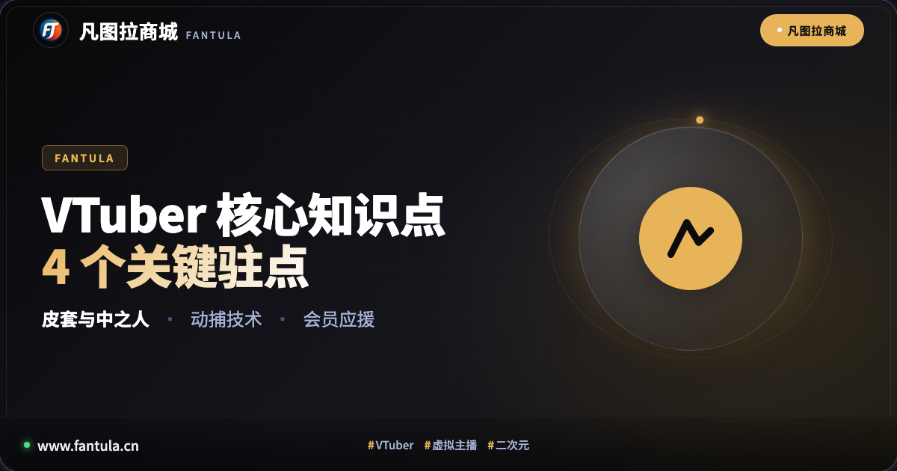
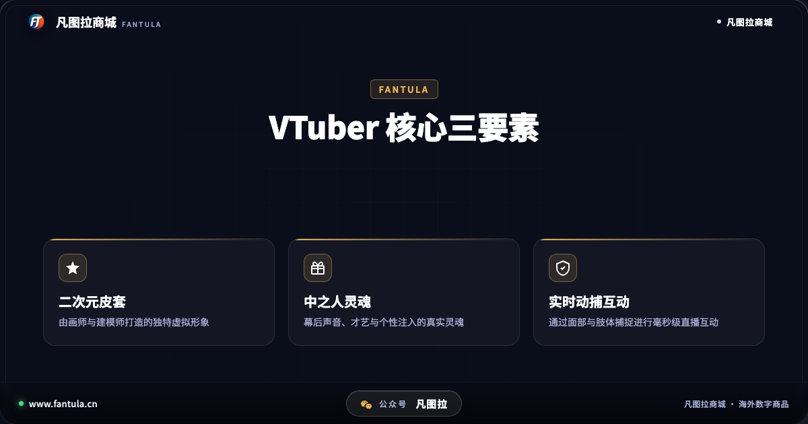
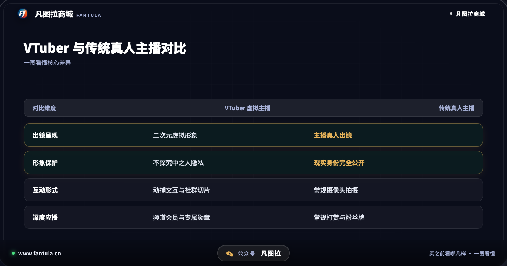
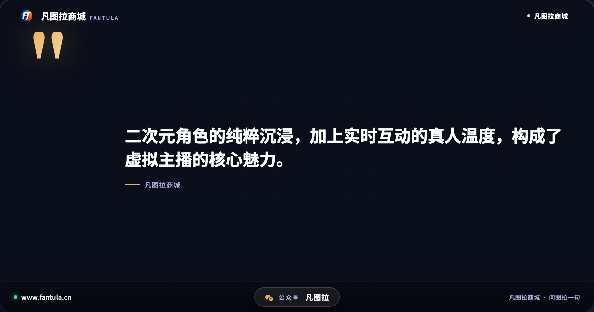

# 刚入坑必看：关于VTuber的4个核心知识点与海外会员应援

在主流网络社区和海外直播平台中，“虚拟主播”（Virtual YouTuber，简称 VTuber）这一群体正吸引着越来越多年轻观众的目光。在搜索引擎里输入“VTuber是什么意思”，下拉词常常伴随着“vtuber都做什么”、“vtuber梗”以及“中之人是谁”等一系列新手常有的疑问。

对于初次接触这一领域的朋友来说，屏幕里那些动人的二次元角色、充满趣味的声音以及热烈的弹幕互动，既熟悉又带着几分神秘。本文围绕虚拟主播的 4 个关键驻点，梳理核心常识与互动文化，帮助你清晰看懂这个二次元与现代科技交融的全新生态。

---

## 驻点一：皮套与中之人——虚拟与真实的双重魅力

提到 VTuber，最直观的特征莫过于那副精美的二次元面孔。在圈内，这一形象通常被称为“**皮套**”，而幕后赋予角色声音、才艺与性格的真实表演者，则被称为“**中之人**”。

1. **皮套（Avatar）**：由二次元画师设计人物立绘（统称“亲妈”或“画师爸爸”），再交由建模师制作成 Live2D 动态模型或 3D 骨骼模型。每一个眨眼、转头、嘴角上扬，都是通过细致的参数绑定实现的。
2. **中之人（Actor）**：幕后的表演者是角色的灵魂。无论是高超的歌唱实力、风趣的游戏解说，还是独特的说话习惯，都来自中之人的真实才华。
3. **圈内契约**：在成熟的虚拟主播文化中，大家有着心照不宣的默契——“**尊重角色设定，不随意探究幕后中之人的现实隐私**”。这种契约精神不仅保护了表演者的现实生活，也为所有观众保留了一份纯粹的二次元童话感与代入感。

---

## 驻点二：动捕与实时互动——科技打造的陪伴体验

很多人会产生疑问：VTuber 和传统的二次元动画片到底有什么区别？答案在于“**实时互动**”。

传统的动漫人物是剧本预设好的，而虚拟主播则是依靠动作捕捉（Motion Capture）与面部表情识别技术，与观众即时交流。

- **面部捕捉**：主播只需在电脑前配备高精度摄像头或具备原深感测绘功能的移动设备，软件便能毫秒级识别人脸的眉毛挑动、眼球转动与嘴唇开合，并实时同步到虚拟角色的脸上。
- **即兴互动**：主播在直播间里实时阅读弹幕、与观众聊天、即兴接梗、做小游戏。当观众发送一条留言或应援，主播立刻能做出羞涩、开心或吐槽的生动反应。这种“陪伴感”与“活生生的互动感”，正是虚拟主播黏性极高的核心所在。

---

## 驻点三：切片与二创——社群自生长的传播飞轮

虚拟主播的长直播往往长达数小时，对于新观众而言，很难有大段完整时间去守候。于是，“**切片**”与“**二次创作**”构成了整个圈子繁荣的重要支柱。

- **切片与烤肉**：活跃在各大社区的剪辑爱好者（对于海外主播常被称为“烤肉组”），会义务或受邀将直播中的高光镜头、爆笑名场面提取出来，配上字幕、特效与注释，制作成 3 至 5 分钟的精炼视频。
- **二创文化**：同人插画、专属表情包、自制音乐甚至粉丝同人游戏层出不穷。这种良性的社群共创生态，让虚拟主播的名声与趣味性得以迅速跨圈传播，即使没有第一时间看直播的新人，也能通过切片迅速找到自己的“本命”主播。

---

## 驻点四：海外直播与会员应援——正规支持渠道解析

当你逐渐熟悉并喜欢上一位海外虚拟主播（例如知名事务所的艺人或独立海外个人势）时，往往会希望以实际行动给予支持。在海外流媒体平台上，最核心的互动与支持机制通常包括：

1. **弹幕与公开点赞**：免费参与，日常陪伴，提升直播间热度。
2. **超级留言（打赏留言）**：在直播间置顶发送带有颜色的留言，为主播加油打气。
3. **开通频道会员（Membership）**：按月订阅支持，获得专属粉丝徽章、直播间定制表情包，以及参与定期的“会员限定直播”与专属动态互动。

对于国内爱好者而言，在体验海外数字文化与正规开通频道会员时，往往容易在支付环境与账户稳定性上遇到困扰。此时一定要保持理性，**远离无资质的私人代办或来路不明的二手账户**，避免遭遇退单、被封号或财产受损的麻烦。

若想省心安全地了解海外合规数字服务与正规流程，建议选择具备正规企业资质、提供独立订单与透明履约凭证的专业平台。例如在**凡图拉商城**，用户可以获取正规、独立的海外数字商品与会员服务支持，遇到规则与订阅问题时，“直接问图拉一句”，即可获得清晰专业的合规指引与稳定保障。

---

## 结语

虚拟主播并非遥不可及的新鲜词汇，而是数字化时代下“二次元美学”与“真诚人际交流”的美妙结合。了解皮套与中之人的尊重契约、体会动捕带来的实时温度、享受切片文化的快乐，并在正规合规的轨道上表达喜爱与支持，每一位观众都能在这个充满想象力的虚拟世界里，找到属于自己的快乐与温暖。

---

> 原文：[刚入坑必看：关于VTuber的4个核心知识点与海外会员应援](https://www.fantula.cn/blog/article/vtuber-core-knowledge-points-guide)
