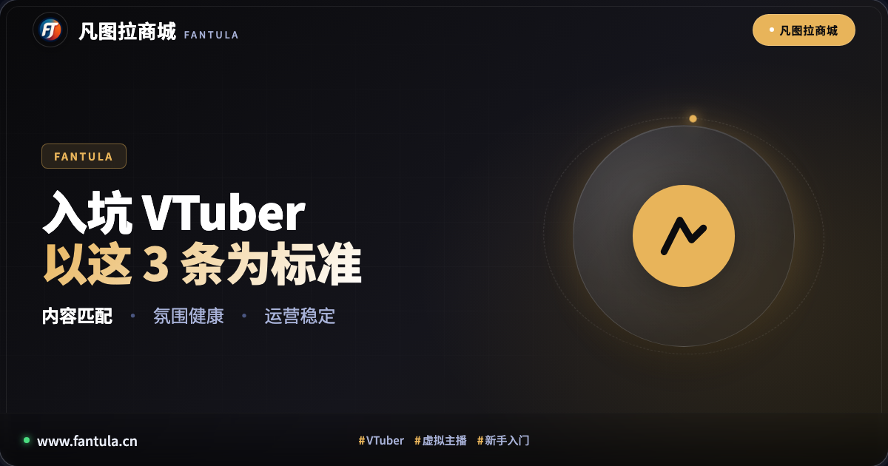
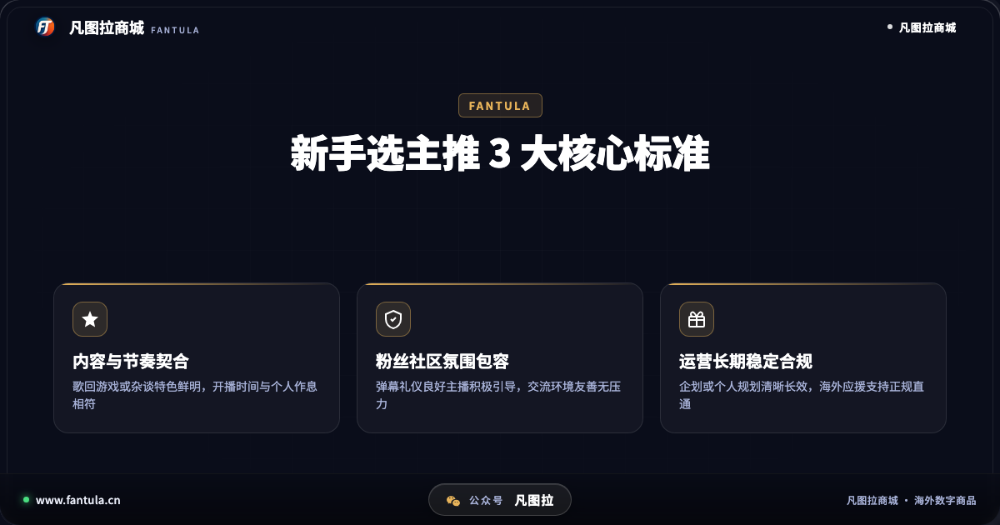
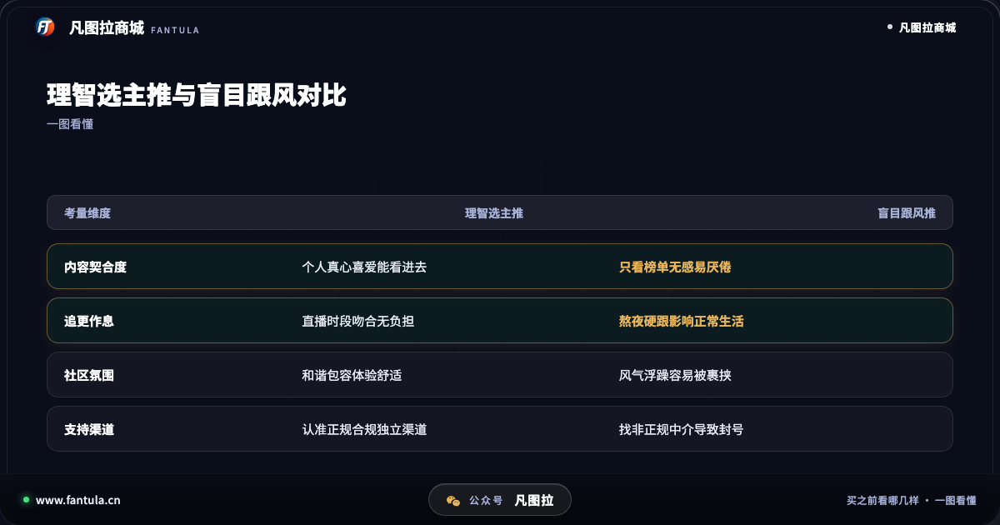
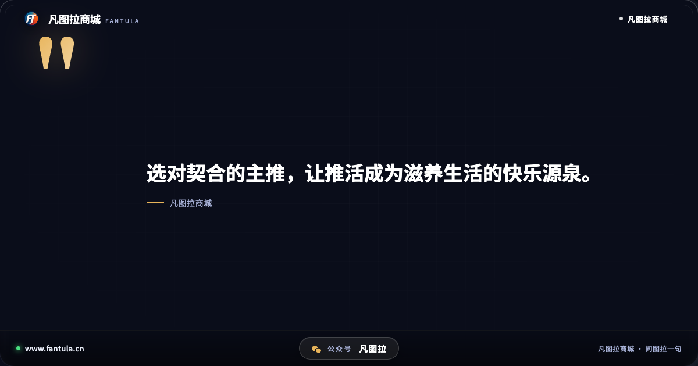
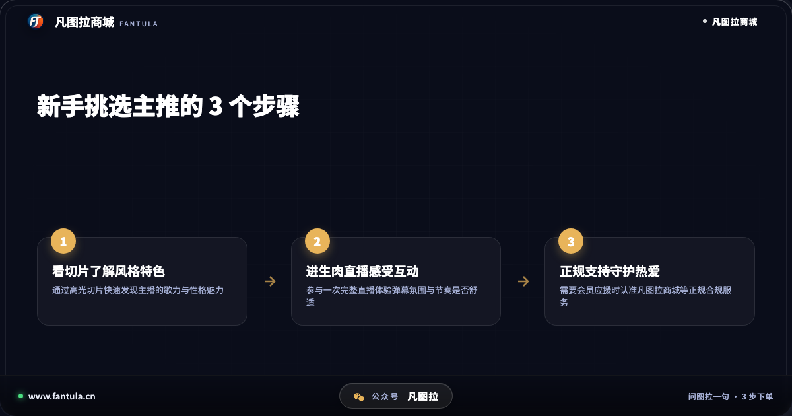

# 刚入坑VTuber怎么选主推？以这3条为标准

**先说答案**：刚接触虚拟主播（VTuber）不知道如何选主推，核心在于找到能与自己生活节奏同频、带来持续正向情绪价值的主播。挑选主推，应当牢牢以这3条为标准：一是内容风格与直播节奏高度契合，二是粉丝社区氛围友善包容，三是主播运营规划长期稳定且应援渠道正规合规。

## 开头

在百度搜索「vtuber入门」，常搜的高频词包括「VTuber是什么意思」「VTuber的入门步骤」「vtuber都做什么」。近几年虚拟主播文化蓬勃发展，海量性格各异、才华横溢的虚拟形象活跃在各大直播平台。

对于刚入坑的新粉丝来说，面对成百上千位虚拟主播，往往会感到眼花缭乱：有人被切片里的高音歌回惊艳，有人被搞笑的游戏名场面逗乐，还有人被深夜温暖的杂谈治愈。但如果不加甄别地盲目跟风，很容易遇到推了几天发现作息不合、弹幕环境浮躁，甚至主播突然停更的尴尬情况。理清选主推的标准，才能让推活之路轻松又快乐。

## 第一部分：为什么新手选主推容易走弯路

很多新人在刚入坑时，往往习惯直接看排行榜或者热搜推荐，哪个主播当下热度最高就跟着看哪个。但虚拟主播与其他内容形态不同，它的本质是「高频次的实时陪伴」。

盲目跟风最容易带来两个问题：第一是内容与节奏脱节。有些高人气主播主打深夜高强度游戏联播，或者开播时区与国内存在较大时差，上班族或学生党如果硬熬夜跟播，不出两周就会身心俱疲；第二是社区氛围不适应。不同主播的粉丝群体风格差异极大，部分大型社区节奏较多、弹幕戾气较重，新手进入后不仅感受不到放松，反而容易产生社交焦虑。因此，选主推绝不能只看粉丝数字，契合度才是第一位的。

## 第二部分：新手选主推认准这3条标准

要找到能够长期陪伴、带来快乐的主推，在挑选时应当以以下3条标准作为核心依据：

**标准一：核心内容与开播节奏是否契合。** 弄清楚「vtuber都做什么」以及主播的主打特色是第一步。如果平时喜欢把直播当背景音，主打治愈系歌回或舒缓电台杂谈的主播会更适合；如果是深度游戏玩家，专精特定硬核游戏的主播则更能产生共鸣。同时要看开播时间表，选择在自己日常休息时段开播的主播，才能做到无负担常态化陪伴。

**标准二：粉丝社区氛围与互动机制是否健康。** 一个优秀的主播不仅自己具有人格魅力，更懂得积极引导弹幕礼仪与粉丝社区风气。在进入直播间时，可以重点观察弹幕是否对新人友好、是否有序包容、主播是否尊重观众感受。健康的互动环境能让观众在发弹幕时感到自在安心，获得正向的情绪反馈。

**标准三：运营长期规划与支持渠道是否稳定合规。** 主播无论是隶属于知名企划还是个人势独立运营，清晰长期的发展规划是持续开播的基石。对于海外平台的虚拟主播，当粉丝未来想要通过开通频道会员等方式表达支持时，是否拥有正规合规的直通支持渠道也至关重要，避免因为非正规中介导致账号风险。

通过对比可以看出，以科学标准挑选主推，能让每一次观看都成为身心的放松与享受；而盲目跟风不仅难以获得长久的乐趣，还可能给生活增添不必要的疲惫。

## 第三部分：从零挑选主推的实用建议

想要挑选到真正心仪的主推，新手可以按照科学的步骤循序渐进：

首先是「先看切片后看生肉」。切片剪辑凝结了主播的高光时刻，是快速了解其音色、谈吐和幽默感的极佳窗口。当对某个主播产生兴趣后，再去观看一两场完整的原片直播，感受最真实的开播节奏。

其次是「多推不如精推」。新手刚入坑时很容易同时追踪了解几十个主播，导致精力分散、信息过载。建议先锁定一两位最契合的核心主播作为主推，建立起稳定的观看习惯。

最后是「树立理性健康的推活心态」。推虚拟主播的本质是为生活增添乐趣，应当把自己的现实生活放在第一位。无论是日常发弹幕互动，还是参与社区交流，保持从容友善的心态才是长久之道。

## 第四部分：如何获取正规的支持保障

当粉丝深入了解某位海外虚拟主播，想要开通频道会员以获取专属表情包、会员限定直播回放时，务必保障个人账号的长期安全。

很多粉丝在初次尝试支持时，容易因为海外支付工具门槛而寻找非正规代办，进而遭遇黑卡刷单、掉单甚至账号被封的风险。凡图拉商城为全球数字生活提供合规服务，提供海外正规官方数字礼品卡等合规商品。用户在个人独立账户中即可自行充值开通，无需提供账号密码，遇到任何兑换操作疑问还可随时咨询智能助手「图拉」与人工客服，获得全流程正规保障。

## 结尾

挑选主推是推活旅程的美好起点。认准内容节奏契合、社区氛围健康、运营稳定合规这3条标准，不盲从、不内耗，让每一次开播通知都成为生活中的小确幸。

你目前心目中的主推是谁？你是通过哪场直播或切片被TA圈粉的？欢迎在评论区留下你的推活故事。

---

**关于凡图拉商城**

凡图拉商城专注于全球数字生活服务，提供海外正规数字商品与应用支持。所有商品均走合规渠道，码发到订单，提供全程人工售后保障。

（本文写于 2026 年 11 月，各项平台规则以官方最新公告为准。）

---

> 原文：[刚入坑VTuber怎么选主推？以这3条为标准](https://www.fantula.cn/blog/article/how-to-choose-vtuber-oshi-3-standards)
