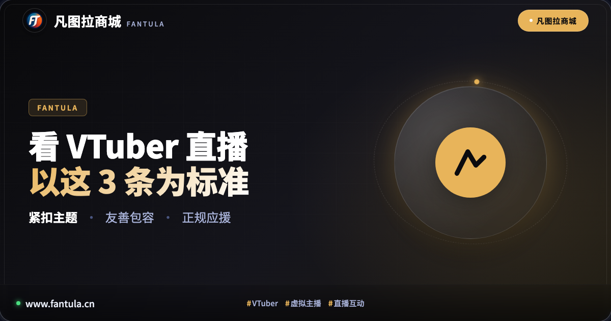
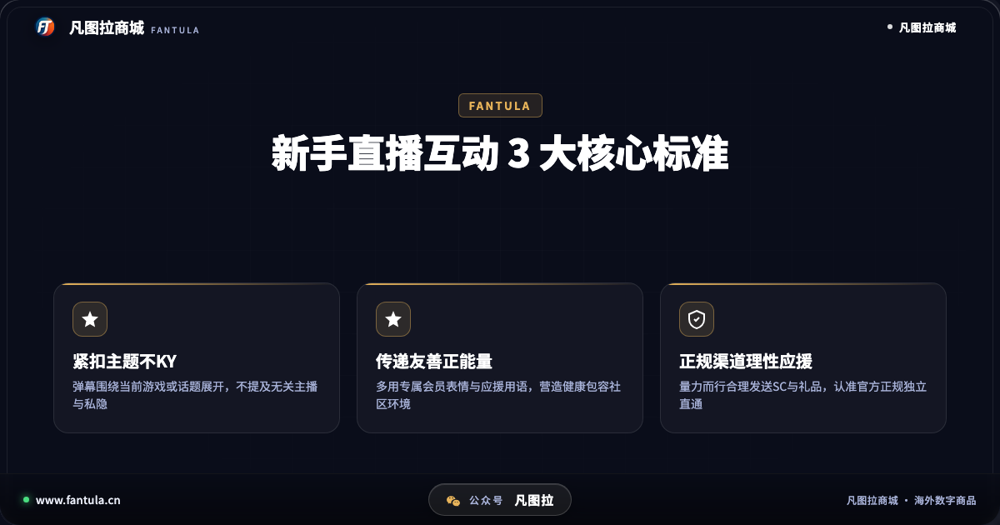
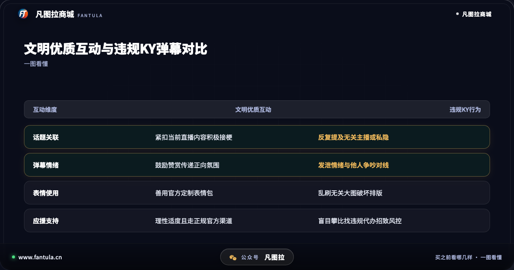
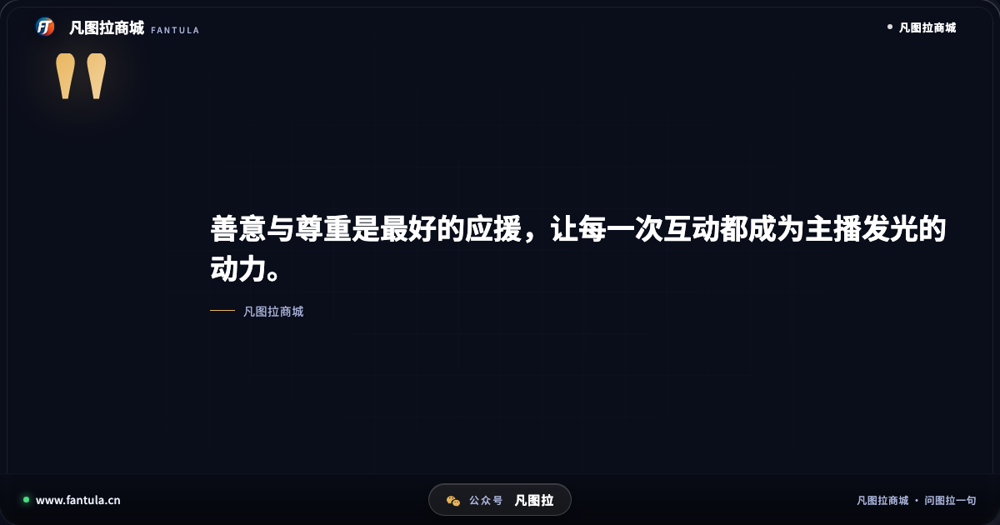
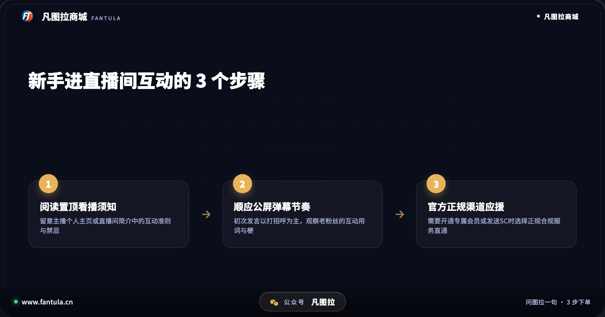

# 刚看VTuber直播怎么互动？以这3条为标准

**先说答案**：刚接触虚拟主播（VTuber）不知道在直播间如何发弹幕互动，核心在于理解直播间的公共空间属性，用善意和尊重表达喜爱。看VTuber直播与主播互动，应当牢牢以这3条为标准：一是紧扣当前直播主题不KY，二是传递友善正能量营造包容氛围，三是量力而行理性应援且认准官方正规渠道。

## 开头

在百度搜索「vtuber直播」，常搜的高频词包括「vtuber直播内容」「vtuber直播间观众」「vtuber都做什么」。随着虚拟主播文化的普及，越来越多观众被二次元动捕形象与生动有趣的直播互动所吸引，推活逐渐成为年轻人日常生活的一部分。

然而，对于刚刚进入虚拟主播直播间的新人观众来说，公屏飞速滚动的弹幕、各具特色的专属表情，以及特定的社群用语，往往会让人有些无所适从。有人因为不了解规则在公屏反复提及其他主播而引发争议，有人因为发送带有剧透或负面情绪的文字被管理员禁言，还有人想表达支持却找不到正规途径。理清直播互动的标准，才能在热闹的直播间里玩得开心、聊得自在。

## 第一部分：为什么新手在直播间容易发错弹幕

许多新手观众习惯了普通视频评论区的交流模式，刚进实时直播间时，容易忽略「实时互动」与「公共礼仪」的特殊性。

最常见的误区是所谓的「KY行为」（源自日语空気が読めない，意为不会看气氛）。例如主播正在全神贯注挑战高难度游戏关卡，部分观众却在公屏追问其他主播的开播动态，或者反复提及私隐八卦；另一种常见情况是过度指挥与剧透，在解谜类直播中提前揭晓答案，削弱了主播与全场观众的探索乐趣。虚拟主播的魅力很大程度上建立在角色设定与沉浸式陪伴上，不合时宜的发言不仅会打乱主播的直播节奏，也会破坏整个社区的观看体验。因此，掌握良好的互动准则，是每位新粉丝融入圈子的第一课。

## 第二部分：看VTuber直播互动认准这3条标准

想要在直播间获得愉快的互动体验，赢得主播与其他观众的尊重，应当以以下3条标准作为准绳：

**标准一：紧扣当前直播主题，不KY不提及无关内容。** 无论主播在进行歌回、游戏实况还是杂谈电台，弹幕发言应当始终围绕当前屏幕上的内容展开。主播没有主动提及其他主播时，切忌在公屏刷其他人的名字（即俗称的「提别家」）；遇到主播卡关或失误时，多给予包容与鼓励，避免居高临下的指点或剧透。尊重主播的节奏，是优质互动的基础。

**标准二：传递友善正能量，多用专属表情营造包容氛围。** 直播间的公屏是全体观众共同打造的文化看板。当主播达成精彩操作或唱出动人高音时，通过发送喝彩弹幕与专属表情包积极互动，能够让主播感受到实时的情绪反馈。遇到争议言论或恶意复读时，成熟的观众通常选择不予理睬、交给房管处理，而不是在公屏与其争吵，共同守护清爽友善的弹幕环境。

**标准三：量力而行理性应援，认准官方正规支持渠道。** 当观众对某位主播产生深厚喜爱，希望通过加入专属频道会员、发送SC醒目留言或赠送虚拟礼品表达心意时，必须树立理智消费观，始终以个人现实生活为重。同时，对于海外平台的虚拟主播，必须选择正规、合规的官方直通渠道完成支持，坚决拒绝不明来源的非正规中介，保护个人数字账号的长期安全。

通过对比可以看出，遵守文明互动的标准，不仅能让主播在互动中获得满满的动力，也能让观众自己沉浸在友善温馨的社区氛围中；而无视规则的随意发言，则容易引发社区摩擦，背离了推活寻找快乐的初衷。

## 第三部分：新手进直播间互动的实用指南

想要快速掌握直播间互动的默契，新手可以参考以下实用步骤：

首先是「进房先读直播间简介」。绝大多数虚拟主播在个人频道主页或直播间置顶信息中，都会明确写明本人的看播规则（例如是否允许指挥、是否允许在开播前闲聊等），花一分钟阅读须知，能有效避免误踩雷区。

其次是「初次发言多看多学」。进入陌生的直播间，可以先花十几分钟观察公屏的发言节奏与大家常用的梗词，初次发言以一句简短真诚的打招呼为主，自然融入集体节奏。

最后是「遇到负面言论学会无视」。公屏偶尔出现不当言论在所难免，盲目对线只会进一步扩散负面情绪。直接使用平台自带的屏蔽功能，或者等待房管清理，是保持良好观播心情的最佳方式。

## 第四部分：如何获取正规的支持保障

对于深度喜爱海外虚拟主播的粉丝来说，开通频道会员以获取独家会员限定直播、专属定制表情包与身份徽章，是极具仪式感的应援方式。然而，在表达热爱的同时，账号的安全保障不容忽视。

部分粉丝因不熟悉海外结算流程，轻信网络上的非正规第三方中介服务，结果遭遇黑卡交易导致个人主账号被平台风控甚至永久封禁。凡图拉商城专注于为全球数字生活提供合规服务，提供海外正规官方数字礼品卡等合规商品。用户在个人独立账户中即可自行充值开通，无需提供账号密码，遇到任何兑换操作疑问还可随时咨询智能助手「图拉」与人工客服，获得全流程正规保障。

## 结尾

看虚拟主播直播是一场关于快乐与温暖的双向奔赴。认准紧扣主题不KY、传递友善正能量、量力而行正规应援这3条标准，带上一份真诚与善意，就能在虚拟的世界里收获最真实的陪伴。

你平时最喜欢看哪种类型的VTuber直播？你在直播间遇到过哪些有趣的互动瞬间？欢迎在评论区分享你的观播经历。

关于凡图拉商城：凡图拉商城专注于全球数字生活服务，提供海外正规数字商品与应用支持。所有商品均走合规渠道，码发到订单，提供全程人工售后保障。

（本文写于2026年11月，各项平台规则以官方最新公告为准。）

---

> 原文：[刚看VTuber直播怎么互动？以这3条为标准](https://www.fantula.cn/blog/article/how-to-interact-in-vtuber-livestream-3-standards)
