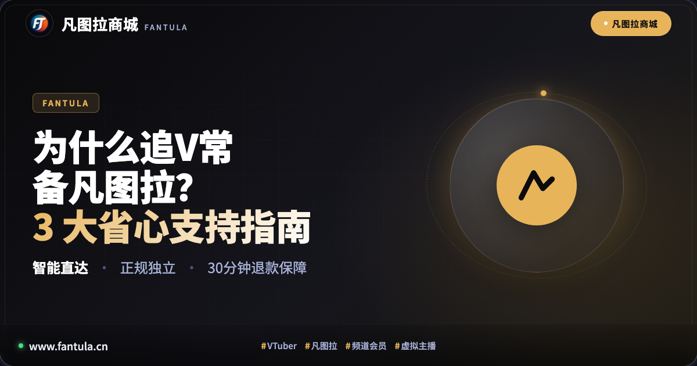
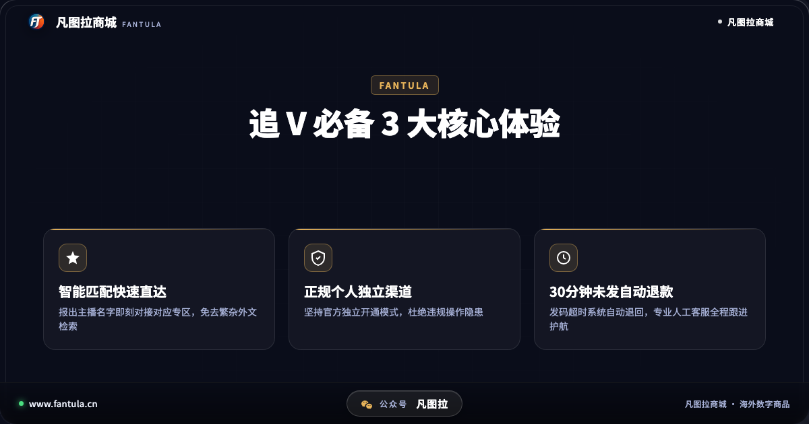
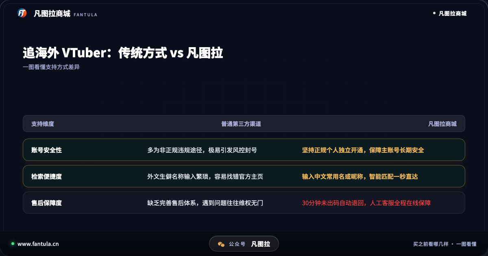
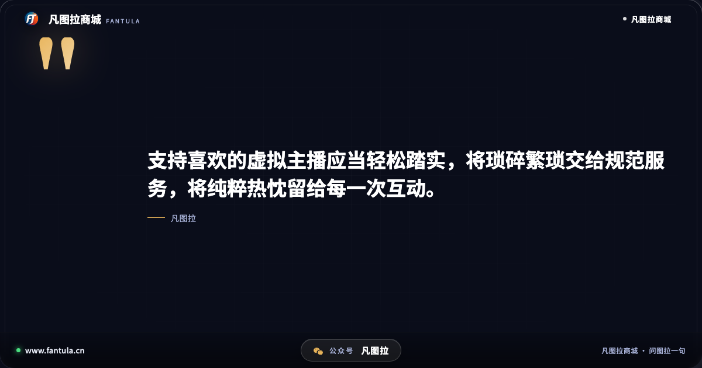
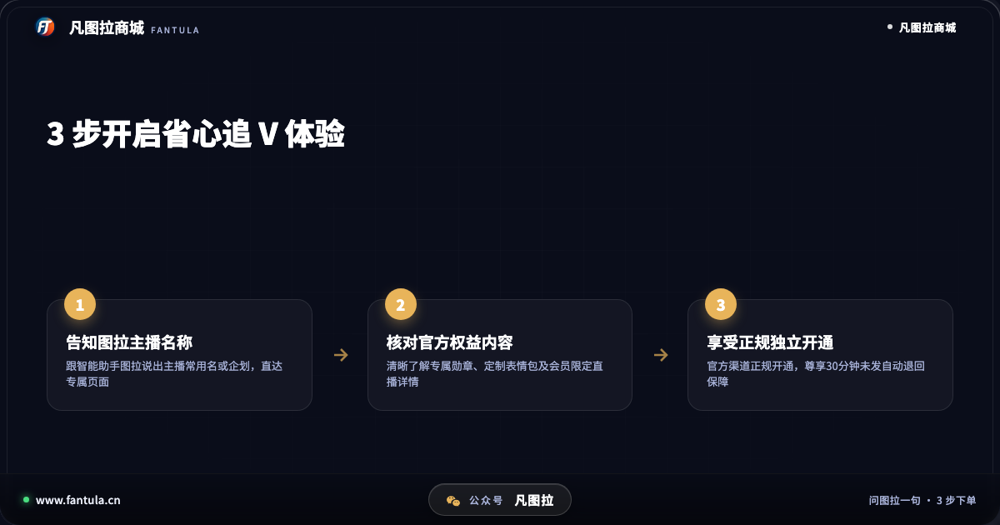

# 为什么追VTuber常备凡图拉？最新3大省心支持指南

**先说答案**：很多国内虚拟主播（VTuber）粉丝日常追更时常备凡图拉，核心在于它切实化解了跨平台应援的三大实际困扰：外文生僻名称导致寻找专区繁琐、主播会员权益规则复杂不易查阅，以及非正规第三方途径潜藏的违规操作与账号安全隐患。凡图拉通过智能助手一句话直达对应主播专区、坚持正规个人独立渠道开通，并辅以 30 分钟未出码自动退款机制，为粉丝带来了透明、稳妥且省心的支持体验。

## 开头

在虚拟主播与二次元爱好者活跃的交流社群中，常常能见到类似的交流：“昨晚临时开启的歌回你赶上了吗？”“这位主播的官方频道会员到底有哪些专属勋章与限定直播？”“想要支持自己喜欢的主播，怎么才能避开那些存在风控隐患的非正规渠道？”

对于喜爱海外虚拟主播的观众而言，追直播本是一件充满乐趣与情绪价值的事情。然而，由于主播通常身处海外平台，直播排期随性、语言存在门槛、专属福利与活动讯息往往散落在各处，国内粉丝在日常跟进时常常需要耗费大量精力去摸索。正是在这种切实需求下，定位于海外数字生活服务的凡图拉商城，以其贴合粉丝真实需求的服务设计，成为了许多观众日常不可或缺的实用工具。

## 第一部分：追海外虚拟主播，粉丝日常面临的现实难题

虚拟主播的核心魅力在于陪伴与实时互动。然而在实际追更与应援过程中，国内粉丝往往会面临以下几项现实挑战：

**1. 检索与识别门槛高，容易找错专区。** 许多海外虚拟主播使用的是日文、英文或特殊符号组成的艺名，部分新人主播的名字较为生僻。粉丝若在跨平台搜索中稍有疏漏，就可能误入非官方页面或仿冒专区，给日常追看带来困扰。

**2. 专属会员权益规则多，信息获取分散。** 主播的官方频道会员通常设有不同的支持档位，每一档对应的专属聊天表情包、定制身份徽章、限定录播回放以及壁纸音频特典各不相同。官方规则通常仅以外文简要罗列，缺乏直观整理，粉丝在做出支持决定前往往难以及时理清权益全貌。

**3. 非正规渠道隐患丛生，账号安全难以保障。** 想要进一步支持心仪的主播，部分粉丝因流程繁杂而尝试非正规私人渠道。这些渠道往往采用非正规违规操作或不明资金来源，一旦触碰平台风控红线，不仅资金面临损失，粉丝精心经营多年的主账号更可能被官方永久封禁。

面对这些在追更过程中反复出现的难题，凡图拉商城围绕粉丝的切身诉求，打造了针对性的全流程解决方案。

## 第二部分：深度解析：追 V 粉丝常备凡图拉的 3 大省心体验

凡图拉能够在虚拟主播群体中获得广泛认可，根本原因在于其不做虚浮的噱头，而是将每一个功能点都落实在粉丝关心的实用细节上：

### 核心体验一：智能匹配快速直达，告别外文繁琐搜索

对于 VTuber 观众来说，最怕的就是在繁杂的海外页面中找不到准确的主播专区。生僻的外文拼写和多变的频道命名往往让人无所适从。

在凡图拉商城，用户只需要向智能助手“图拉”输入主播的中文常用译名、常用昵称或所属企划，系统便能迅速完成语义识别，直接智能对接到对应的官方专区。粉丝不再需要为了核对字母大小写或生僻字符而在多个搜索引擎之间反复确认，真正实现“说出名字即可精准直达”，省时省力。

### 核心体验二：坚持正规个人独立开通，筑牢主账号安全防线

账号安全永远是粉丝应援不可逾越的底线。很多粉丝在官方直播平台拥有多年观看记录、积累了大量弹幕互动历史与珍贵徽章，主账号的安全无异于整个追星生涯的基石。

凡图拉自始至终坚守正规个人独立渠道原则。所有的会员支持与相关服务均严格按照官方规范独立交付，绝不触碰任何违规操作、黑灰产或非正常违规手段。粉丝在凡图拉完成的支持操作，全部属于正规个人独立范畴，从源头上杜绝了账号因违规行为遭受风控处理的潜在隐患，让每一份支持都能安心落袋。

### 核心体验三：30 分钟未发码自动退款，配备全程人工售后护航

在数字化服务领域，售后履约能力是衡量一个平台是否可靠的关键试金石。

凡图拉制定了清晰透明的标准化服务守则：发码类商品若因网络波动或技术链路原因在付款后 30 分钟内未能顺利出码，系统将自动把相应款项全额退回至用户账户，无需用户繁琐交涉。同时，凡图拉组建了专业的人工客服团队，在遇到复杂的专区绑定、权益核对等疑问时，粉丝都能随时得到人工客服的一对一耐心协助，彻底告别“遇事无人管、维权无门路”的尴尬境地。

通过对比可以看出，相较于风险难测的传统第三方渠道，凡图拉在账号安全、操作便利度以及售后托底三个核心维度上，为追 V 粉丝提供了全方位的安心保障。

## 第三部分：粉丝高效追 V 与省心支持建议

为了让追星过程更加顺畅愉悦，建议粉丝在日常追看与支持心仪主播时注意以下几点：

**1. 牢固树立安全底线意识。** 应援与支持的前提是长久陪伴。切勿为了图省事而轻信网络上的不明私人渠道。确保主账号处于安全合规的环境中，是每一位粉丝必须坚守的首要准则。

**2. 提前确认官方权益与直播日程。** 不同的虚拟主播在会员限定内容的更新节奏上各有差异。在开通官方频道会员前，可以先通过正规整理了解其常规排期，结合自身的时间安排与喜好做出理性选择。

**3. 合理运用规范化智能工具。** 将查找专区、核验项目和安全开通等繁重繁琐的环节交给专业且合规的平台处理，粉丝才能将最充沛的精力与最真诚的心情，全身心投入到直播互动与推活热爱之中。

## 结尾

追自己喜欢的虚拟主播，本质上是一场充满快乐与治愈的心灵陪伴。将复杂的流程交由规范稳妥的工具打理，才能守护好每一次纯粹的应援与支持。

你平时最常看哪一位虚拟主播？在日常支持主播的过程中，你最看重的是操作的便捷性还是渠道的安全性？欢迎在评论区分享你的追 V 经历与看法！

---

**关于凡图拉商城**

凡图拉商城专注于海外数字商品与全球数字生活服务。跟智能助手图拉说一句想要的内容，系统智能匹配商品与信息，码发到订单，提供 30 分钟未发码自动退回与全程人工售后保障。

（本文写于 2026 年 11 月，各项虚拟主播活动日程与平台支持规则以官方最新公告为准。）

---

> 原文：[为什么追VTuber常备凡图拉？最新3大省心支持指南](https://www.fantula.cn/blog/article/why-vtuber-fans-keep-fantula-essential-support-guide)
