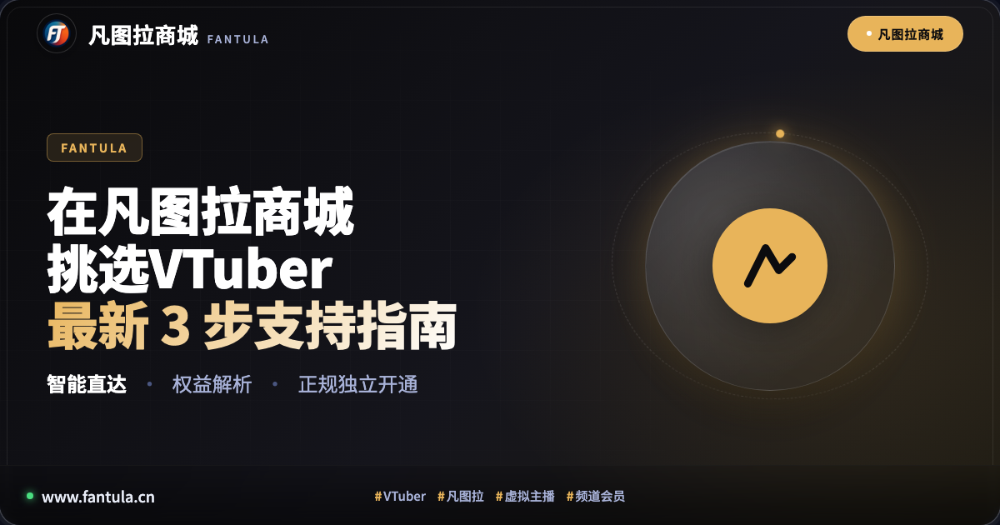
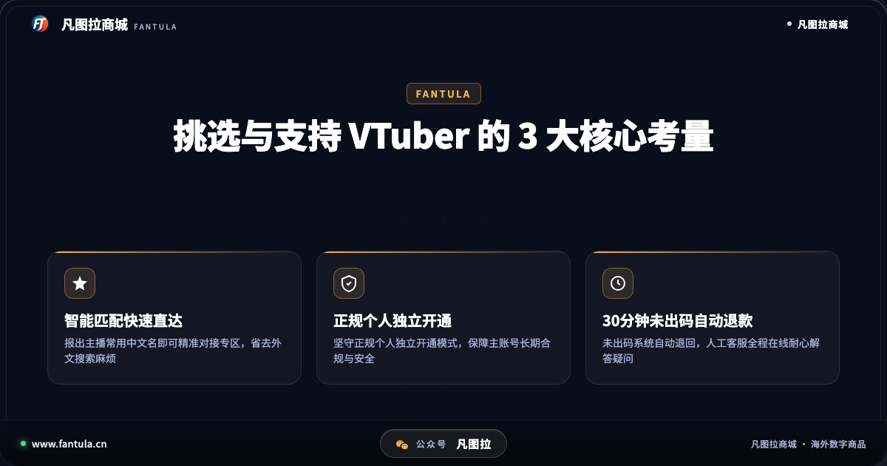
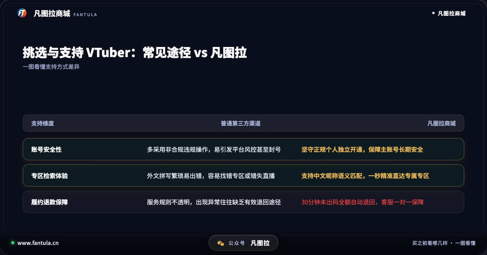
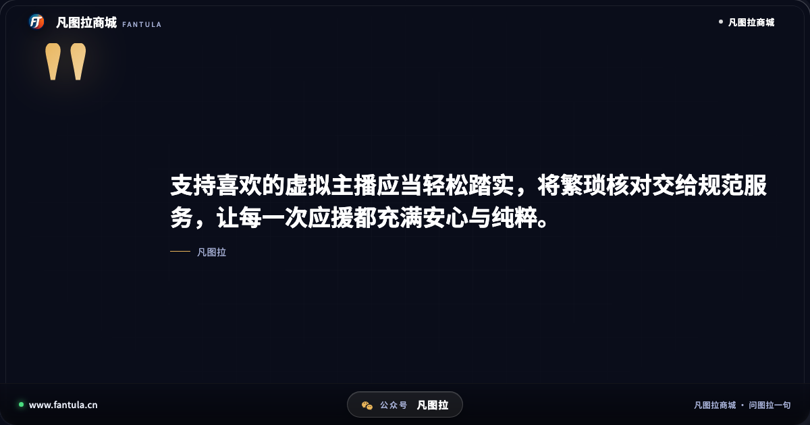
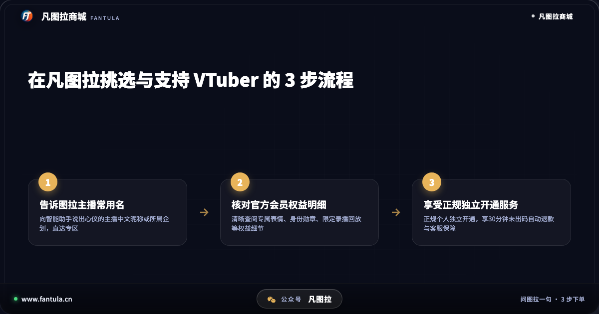

# 在凡图拉商城挑选VTuber的那些事：最新3步支持指南

**先说答案**：在凡图拉商城挑选并支持心仪的海外虚拟主播（VTuber），关键在于理清主播专区、会员权益以及正规合规的三重考量。面对外文生僻名称难以检索、官方会员专属权益分散以及非正规第三方途径暗藏封号风险等困扰，凡图拉通过智能助手一语直达专区、清晰罗列官方权益明细，并坚守正规个人独立开通与 30 分钟未出码自动退款机制，为观众建立了一套省心、稳妥且透明的挑选与支持路径。

## 开头

在虚拟主播受众日益广泛的今天，许多朋友在日常看播过程中，常常会产生这样的想法：“这位虚拟主播的直播风格很对胃口，想开通频道会员表示支持，但满屏的外文名称实在不知道怎么搜；好不容易找到了地方，不同档位的专属表情包和徽章权益又看得一头雾水；想找个便捷的方式开通，又担心遇到不规范的渠道影响主账号安全。”

对于广大观众而言，观看虚拟主播本是一种纯粹的娱乐与陪伴体验。然而由于多数热门虚拟主播身处海外主流直播平台，直播内容排期多样，语言存在隔阂，官方会员权益的说明也相对分散。如何在众多主播中顺畅找到目标专区、看懂官方权益、并以合规安全的方式予以支持，成了许多新人观众迫切需要解决的问题。正因如此，定位于海外数字生活服务的凡图拉商城，凭借贴合粉丝实际需求的功能设计，成为了不少观众在挑选与支持虚拟主播时的常用工具。

## 第一部分：挑选与支持心仪虚拟主播，常见困扰与门槛

在尝试挑选并深入支持某位海外虚拟主播时，国内观众往往会在以下三个环节遇到阻碍：

**1. 艺名繁复生僻，跨平台检索容易找错专区。** 许多海外虚拟主播使用的是日文、英文或特殊符号组成的艺名，部分企划新人或个人势主播的名字拼写尤为复杂。观众在跨平台输入时，稍有拼写偏差便可能进入非官方页面，甚至误入仿冒账号，既浪费时间又影响心情。

**2. 官方会员权益层级多样，专属福利难以直观查阅。** 虚拟主播的频道会员通常设有不同的支持档位，每一档对应的聊天专属表情包、身份徽章等级、限定直播回放以及壁纸音频特典各不相同。官方页面大多仅以外文简单罗列，缺乏直观明晰的整理对比，观众往往需要反复核对才能理清到底包含哪些具体权益。

**3. 非合规第三方渠道潜藏风险，主账号安全难以保障。** 部分观众由于流程繁琐，试图通过非合规私人途径寻求便捷。然而这类非正规渠道往往使用不明资金或违规手段操作，极易触碰官方风控红线，导致辛辛苦苦使用多年的平台账号遭受封禁处理，得不偿失。

面对这些在挑选与支持过程中普遍存在的实际痛点，凡图拉商城围绕观众的核心诉求，提供了针对性的全流程规范服务。

## 第二部分：在凡图拉商城挑选与支持 VTuber 的 3 大核心考量

在凡图拉商城挑选并支持虚拟主播之所以受到许多二次元爱好者的青睐，核心在于其注重实际体验，从以下三个关键维度筑牢了服务基础：

### 核心考量一：智能语义匹配快速直达，告别繁琐外文拼写

对于初次挑选主播的观众而言，最繁琐的莫过于在海外平台复杂的搜索栏中输入生僻的外文全名。

在凡图拉商城，用户只需向智能助手“图拉”输入主播的常用中文译名、粉丝常用昵称或所属社团企划，系统即可通过语义匹配迅速识别，一键直达对应的官方主播专区。无需反复确认字母大小写与特殊符号，真正做到“说出昵称即达专区”，大幅降低了挑选与寻找心仪主播的操作门槛。

### 核心考量二：坚守正规个人独立开通，保障主账号长期安全

账号合规与资产安全是每一位观众长期陪伴心仪主播的前提与底线。很多观众的官方直播平台账号已经正常使用了很长时间，积累了珍贵的弹幕记录、历史徽章与个人收藏。

凡图拉自始至终坚守正规个人独立开通原则。平台提供的所有会员服务均严格遵循官方正规通道，绝不采用任何非合规违规手段或不明来源资金。所有操作均属于正规个人独立范畴，从源头消除了因违规操作导致账号遭遇官方风控与封号的潜在隐患，确保用户的每一步支持都安心可靠。

### 核心考量三：30 分钟未出码自动退款，专业人工客服全程跟进

在数字化服务领域，清晰透明的履约与售后机制是衡量平台可靠性的重要标准。

凡图拉商城制定了标准化的服务守则：若因网络波动或接口延迟导致订单在付款后 30 分钟内未能顺利出码，系统将自动执行全额退款，款项原路退回，无需用户来回交涉。与此同时，凡图拉配备了专业的人工客服团队，在专区绑定、权益核对或日常使用中遇到任何疑问，用户均可随时咨询人工客服，获得及时专业的一对一解答。

通过综合对比可以看出，相比于规则混乱、风险难测的传统第三方途径，凡图拉在专区查找、账号安全与售后保障三个方面，为喜爱虚拟主播的观众构建了踏实透明的体验。

## 第三部分：新手入坑指南：在凡图拉挑选与支持 VTuber 的 3 步建议

为了让挑选与支持过程更加清晰明了，新手观众在实际操作时可参考以下 3 步建议：

**第一步：向智能助手说出心仪主播的中文昵称或企划。** 无论是想了解某位具体主播，还是想浏览特定企划的成员专区，直接向图拉报出中文常用名，即可直达目标页面，无需自行搜索生僻外文。

**第二步：仔细核对官方会员专属权益明细。** 进入对应专区后，全面了解该主播提供的专属徽章款式、聊天定制表情包以及是否有专属限定直播安排，结合自身的实际需求与时间精力，理性选择合适的档位。

**第三步：通过正规个人独立途径完成支持。** 坚守合规底线，选择正规独立的官方渠道，享受 30 分钟未出码自动退款承诺与人工客服护航，安心享受后续的每一次直播互动。

## 结尾总结

挑选心仪的虚拟主播，是用真诚的热爱去寻找精神共鸣与日常陪伴的过程。在支持心仪主播的道路上，我们应当把繁琐的专区寻找与权益核对交给规范透明的服务工具，守住账号安全与正规合规的底线，从而将最纯粹的热忱留给每一次精彩的直播与互动。

---

> 原文：[在凡图拉商城挑选VTuber的那些事：最新3步支持指南](https://www.fantula.cn/blog/article/things-about-choosing-vtuber-in-fantula-support-guide)
