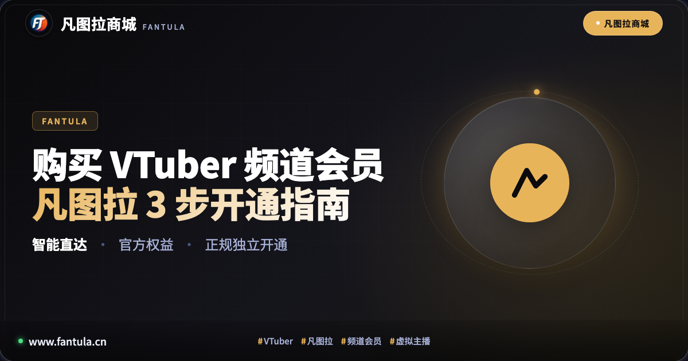
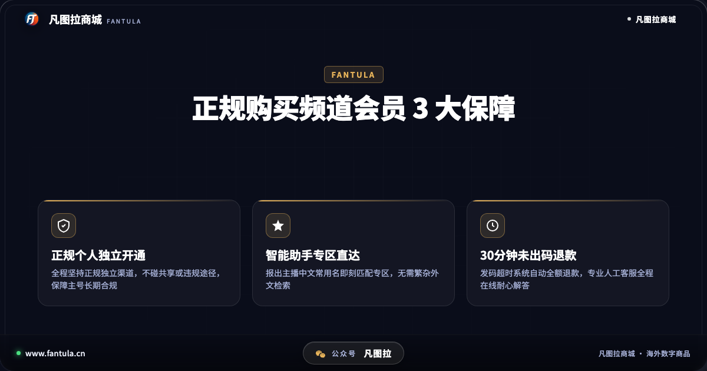
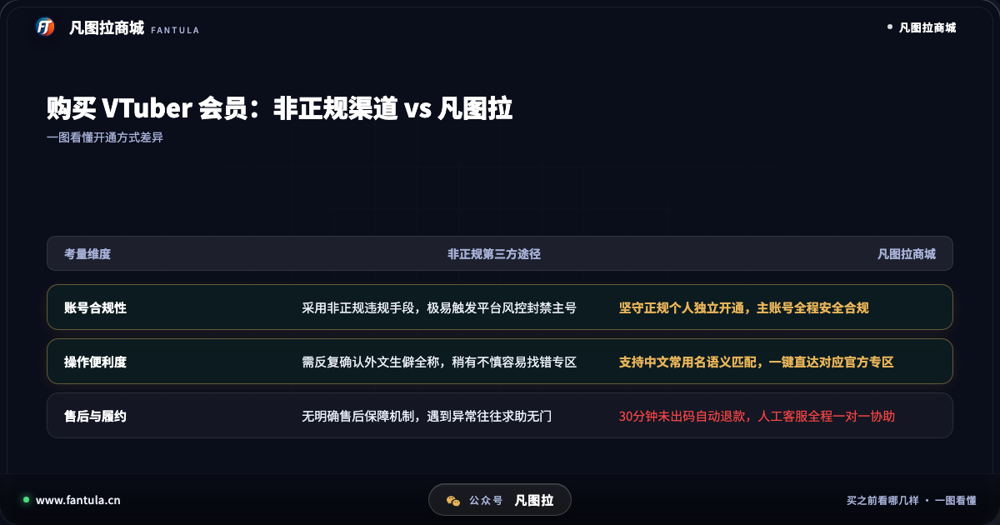
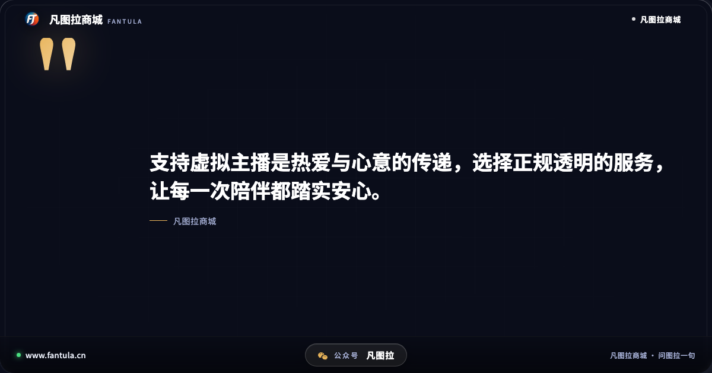
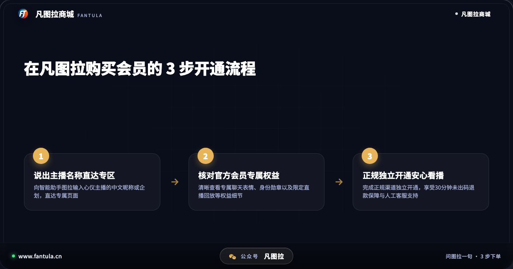

# 凡图拉商城购买VTuber频道会员指南：最新3步开通流程

**先说答案**：在凡图拉商城购买与开通海外虚拟主播（VTuber）频道会员，核心在于遵循“专区精准直达、官方权益核对、正规独立开通”的规范流程。通过智能助手输入主播中文常用名一键锁定专属页面，不仅能快速看懂专属表情与限定直播等会员权益，更能规避非合规第三方渠道潜藏的封号与资金风险；辅以 30 分钟未出码自动退款与人工客服支持，让粉丝能够安心、合规地支持心仪的主播。

## 开头

在虚拟主播文化风靡的当下，不少观众在追看直播的过程中，都会萌生加入官方频道会员的想法：“主播设计的专属聊天表情包实在太生动了，很想在直播间互动时打出来；每月的会员限定歌回与杂谈回放，也希望能够完整补完；但自己没有合适的外币结算方式，面对繁复的外文界面更是摸不着头脑；更担心随手找的非正规渠道会导致主账号遭受风控封禁。”

对于喜爱海外虚拟主播的国内观众而言，想要跨越地域与语言门槛表达支持，往往会受制于多重客观阻碍。如何在保证主账号绝对安全的前提下，顺畅开通心仪主播的官方频道会员？本文将详细拆解在凡图拉商城购买 VTuber 频道会员的完整逻辑与最新 3 步操作流程，为广大粉丝提供清晰、踏实的指引。

## 第一部分：国内粉丝购买 VTuber 频道会员的 3 大常见痛点

在尝试为喜爱的海外虚拟主播开通频道会员时，观众通常会面临以下三方面困扰：

**1. 跨语种检索困难，专区容易混淆。** 海外虚拟主播的名字拼写多样，包含罗马音、特殊符号或日文汉字，新人主播的频道命名更常有变动。国内粉丝在跨平台搜索时，极易因拼写细微差异而进入非官方页面，甚至错购其他同名频道，造成不必要的损失。

**2. 会员权益档位复杂，缺乏直观整理。** 主播在官方平台设置的频道会员通常分为不同等级，每个档位对应的聊天勋章变色周期、定制动态表情、限定社区贴文以及专属直播权限各有侧重。官方说明往往缺乏中文归纳，新手在购买前难以快速摸清各档位的具体权益。

**3. 非合规渠道陷阱多，账号安全风险不可逆。** 部分粉丝因缺乏合规支付途径，容易轻信网络上的非正规私人代开。这类渠道往往利用违规手段甚至黑灰产资金操作，一旦被平台官方风控监测捕获，不仅所购会员会被立即回收，粉丝精心使用多年的个人主账号更有可能被永久封禁。

正因上述痛点的普遍存在，选择一个机制透明、坚守合规底线的正规服务平台显得尤为重要。

## 第二部分：为什么选择凡图拉商城购买频道会员？3 大核心优势

作为定位于海外数字生活服务的专业平台，凡图拉商城在虚拟主播专区构建了一套兼具安全性与便利性的服务体系，其核心优势主要体现在以下三个方面：

### 核心优势一：智能语义匹配一键直达，告别生僻外文搜索

在凡图拉商城，粉丝无需在海外搜索引擎中反复核对复杂的字母拼写。

用户只需向内置智能助手“图拉”输入心仪主播的中文常用译名、社群常用昵称或所属企划团体，系统便会通过语义算法精准识别，瞬间直达对应主播的专属页面。无论是热门企划成员还是独立个人势主播，都能通过一句日常口语实现精准定位，大幅简化了前期的寻找成本。

### 核心优势二：坚守正规个人独立开通，全面保障主账号合规

账号安全是一切应援体验的绝对底线。许多粉丝的主账号不仅绑定了日常观看习惯，更积累了宝贵的历史足迹。

凡图拉商城严正坚守正规个人独立开通准则。平台所有商品与服务均严格对接官方正规渠道，绝不采取非合规违规操作或不明资金链路。整个开通流程完全属于用户的正规个人独立行为，从根源上消除了被官方判定为违规行为的潜在风险，确保主账号长久平稳使用。

### 核心优势三：30 分钟未出码自动退款，配备专业人工售后全程协助

透明、有保障的履约售后机制，是消除粉丝购买顾虑的关键所在。

凡图拉商城推行了严格的服务标准：若因系统结算或网络延迟导致订单在支付后 30 分钟内未能成功出码，系统将启动自动化保护程序，款项全额退回至用户账户，无需冗长申诉。此外，凡图拉组建了常驻的人工客服团队，无论是在专区核对、流程指引还是在开通后遇到任何疑问，都能随时获得专业人工客服的一对一耐心指导。

通过综合对比不难看出，凡图拉商城在合规性、检索体验和售后保障维度上，切实解决了粉丝在购买虚拟主播会员过程中的核心后顾之忧。

## 第三部分：最新 3 步开通流程：手把手教你省心支持心仪主播

在凡图拉商城购买 VTuber 频道会员的操作流程直观清晰，建议参考以下 3 步规范进行：

**第一步：说出主播名称，精准直达目标专区。** 进入凡图拉商城后，在与智能助手图拉的对话界面中，直接输入想要支持的主播中文常用名或企划名称。图拉会自动匹配出官方对应的商品页面，点击即可进入专属详情。

**第二步：核对官方会员专属权益与档位。** 进入专区后，仔细查阅该主播当前开放的官方会员权益说明，包括定制表情包样式、徽章升级规则以及是否有会限直播计划，根据自己的实际需求挑选对应档位。

**第三步：完成正规独立开通，享受安全履约保障。** 确认无误后通过正规流程完成开通，订单享有 30 分钟未出码自动退款承诺；开通成功后即可顺利点亮主播直播间专属勋章，解锁全部会员限定内容。

## 结尾总结

购买频道会员并不仅仅是一次简单的消费，更是粉丝向虚拟主播传达长久陪伴与真切认可的桥梁。在选择支持方式时，认准正规合规的独立渠道，远离非正规渠道带来的封号隐患，借助规范透明的数字化工具，才能让每一次应援都充满踏实与喜悦。

---

> 原文：[凡图拉商城购买VTuber频道会员指南：最新3步开通流程](https://www.fantula.cn/blog/article/guide-to-buying-vtuber-channel-membership-on-fantula)
