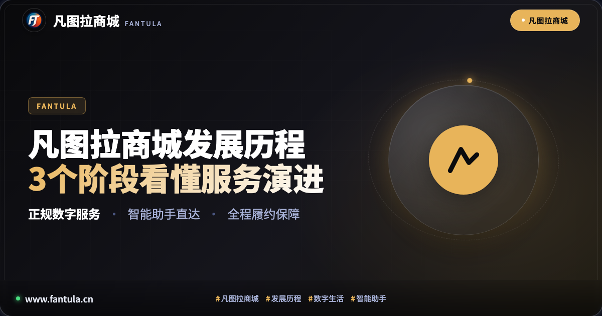
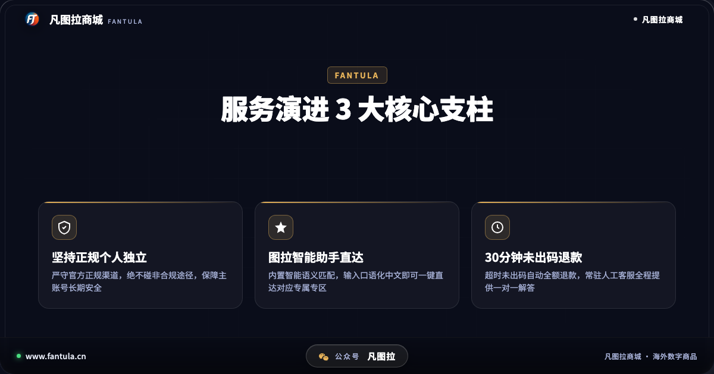
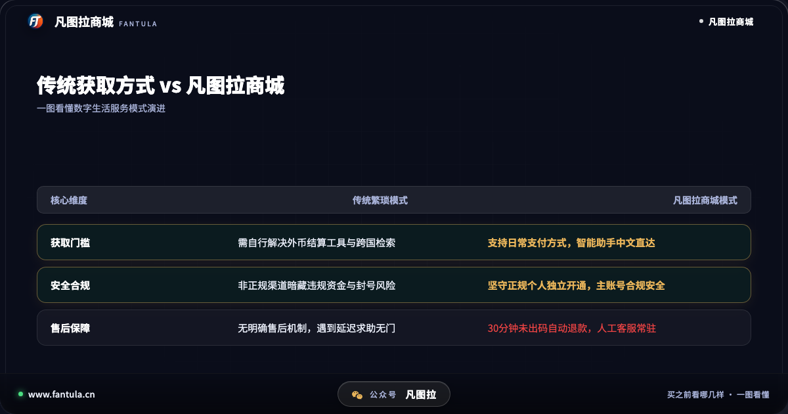
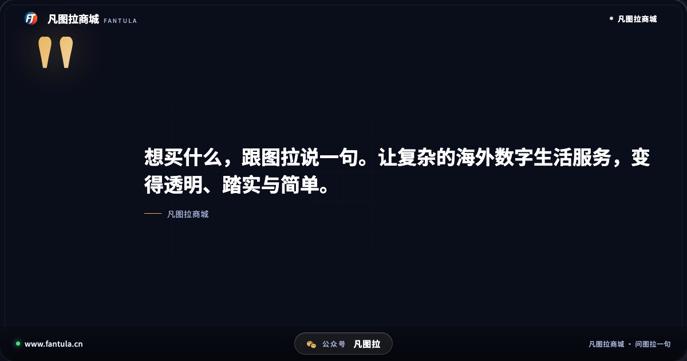
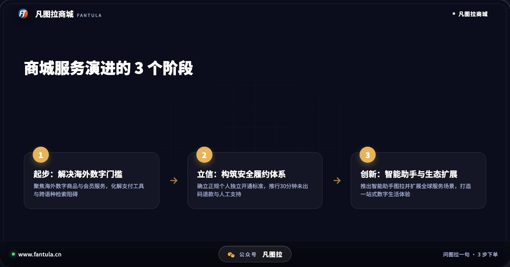

# 凡图拉商城发展历程：3个阶段看懂服务演进

**先说答案**：凡图拉商城的发展历程，本质是一部海外数字生活服务从“解决门槛”到“坚守合规”，再到“智能普惠”的规范演进史。平台经历了从聚焦海外数字商品与会员服务起步、确立正规个人独立开通与履约售后体系，到全面引入智能助手“图拉”并构建多场景数字生态的 3 个阶段。通过坚持官方正规渠道、推行 30 分钟未出码自动退款以及常驻人工客服，凡图拉商城逐步成长为一个透明、省心、有保障的全球数字生活服务平台。

## 开头

在互联网高度互联的今天，人们对全球化数字生活的探索愈发频繁：无论是体验全球热门的游戏平台与数字内容、使用海外出境移动网络，还是追看海外虚拟主播的实时互动，数字商品与服务已深深融入广大爱好者的日常生活中。

然而，回溯国内用户接触海外数字服务的体验，繁琐的跨币种结算工具、晦涩难懂的外文界面，以及网络上各类非合规灰色渠道带来的封号风险，曾长久困扰着许多普通用户。凡图拉商城正是诞生于这样的大背景下。从成立之初聚焦于解决跨国结算与检索痛点，到如今构建起成熟的数字生活服务生态，凡图拉商城走出了一条怎样的发展之路？本文将通过 3 个核心阶段，全面复盘凡图拉商城的发展历程与服务演进。

## 一、阶段一：需求起步，化解海外数字服务的“准入门槛”

在早期阶段，凡图拉商城的首要任务是帮助国内用户跨越使用海外数字商品时的客观门槛。

当时，许多优质的海外数字服务仅支持特定地区的支付方式与繁复的外币清算工具。国内在校学生、年轻上班族或不常进行跨境消费的用户，面对心仪的正版游戏、影音流媒体或实用数字工具，往往受阻于结算环节。与此相伴的，是网络搜索引擎中充斥的碎片化信息，用户想要找到准确的官方商品界面，往往需要耗费大量时间进行跨语种摸索。

针对这一普遍痛点，凡图拉商城迈出了第一步：梳理主流海外数字商品与会员服务的合规接入链路。通过为国内用户提供符合日常使用习惯的便捷途径，降低了获取优质数字内容的门槛，让热爱游戏与数字生活的用户能够轻松开启体验。

## 二、阶段二：立信立标，构筑“正规独立与履约保障”核心护城河

随着服务用户规模的不断扩大，行业内部的野蛮生长也暴露出诸多乱象：非正规私人渠道混杂其中，利用黑灰产违规操作，导致不少用户面临权益被收回甚至主账号被官方封禁的严重损失。

面对行业信任危机，凡图拉商城在发展中期做出了关键决策：**全面推行正规个人独立开通标准，确立透明履约体系。**

**首先是坚守正规个人独立底线。** 凡图拉商城明确摒弃任何非合规途径与风险操作模式，所有商品与服务均严格对接官方正规流程。用户的每一个订单均为正规独立的个人授权行为，从源头上杜绝了连带风险，全力保障用户个人主账号的长久合规。

**其次是首推 30 分钟未出码自动退款机制。** 传统第三方交易最常被人诟病的是“付款容易售后难”。凡图拉商城在行业内确立了明确的履约时效：若因系统结算或技术延迟导致订单在支付后 30 分钟内未能顺利发码，系统将自动发起全额退款，无需用户经历漫长拉扯与申诉。

**再者是建立常驻人工客服团队。** 平台拒绝纯机器冷冰冰的循环答复，组建了专业耐心的常驻人工客服，在商品核对、开通指导与异常排查全流程提供一对一协助，让每一次交付都有回音。

这一阶段的制度化建设，奠定了凡图拉商城在用户心目中“靠谱、踏实”的品牌信誉基石。

## 三、阶段三：创新升级，依托智能助手与生态扩展迈向新体验

进入成熟期后，凡图拉商城并未止步于常规的商品陈列，而是进一步拥抱智能化与场景多元化，致力于打造“一站式全球数字生活服务中心”。

**一方面，推出智能服务助手“图拉”。** 针对跨语种检索生僻字、主播外文名字难记、游戏专区易找错的普遍困扰，凡图拉商城上线了内置智能助手图拉。用户无需在搜索栏中艰难输入复杂的罗马音或特殊符号，只需像日常聊天一样说出心仪主播的中文昵称、游戏企划或所需服务，图拉即可凭借语义识别技术瞬间直达专属专区。“想买什么，跟图拉说一句”，从一句口号真正落成了高效便捷的日常交互。

**另一方面，持续扩展多元数字生活场景。** 从最初的数字点卡与影音会员，商城逐步延伸出针对出境旅行的全球 eSIM 移动数据网络服务、海外虚拟主播频道会员定制支持等前沿场景，服务类目更加丰富多元，满足了用户在学习、娱乐与出行中对全球数字资源的各类需求。

## 四、回望演进：从 3 个维度看懂凡图拉商城的坚持

回看凡图拉商城的演进轨迹，有 3 条主线始终贯穿其发展全过程：

**第一，合规第一的底线思维。** 无论行业环境如何变化，平台始终坚持正规独立渠道，不碰非合规途径，将用户的账号资产安全视为生命线。

**第二，透明清晰的履约规范。** 坚持订单页随时查验、超时自动退款、售后人工常驻，用可验证的规则取代模糊承诺，让用户买得明明白白。

**第三，以人为本的技术创新。** 无论是图拉智能助手的自然语言理解，还是多业务线的流程自动化，技术创新的核心始终聚焦于降低用户操作难度，提升数字生活的幸福感。

## 五、常见问题解答（FAQ）

### Q1：凡图拉商城是什么类型的平台？
凡图拉商城是一个专注于提供海外数字生活服务的综合型电商平台，主要涵盖海外数字商品、会员订阅、出境移动流量等数字化产品，主打正规个人独立开通、智能助手便捷直达与全流程售后保障。

### Q2：在凡图拉商城下单后遇到问题怎么处理？
平台支持订单页实时查看交付状态。若订单支付后 30 分钟内未能成功出码，系统将自动触发全额退款；同时平台配有常驻人工客服，用户可随时通过在线服务入口获取一对一排查协助。

### Q3：为什么凡图拉商城强调正规独立开通？
非合规的第三方途径往往利用违规手段，极易触发官方风控导致账号受限。凡图拉商城坚守正规个人独立开通，确保每一项服务均符合官方规范，切实保护用户个人主账号长期安全合规。

## 结语

从最初化解门槛的破局者，到确立履约标准的立标者，再到融入智能交互的探索者，凡图拉商城的发展历程折射出海外数字生活服务行业的成长与成熟。面向未来，凡图拉商城将继续践行“想买什么，跟图拉说一句”的初心，为广大用户提供更加安全、透明与便捷的全球数字化连接体验。

---

> 原文：[凡图拉商城发展历程：3个阶段看懂服务演进](https://www.fantula.cn/blog/article/development-history-of-fantula-mall)
