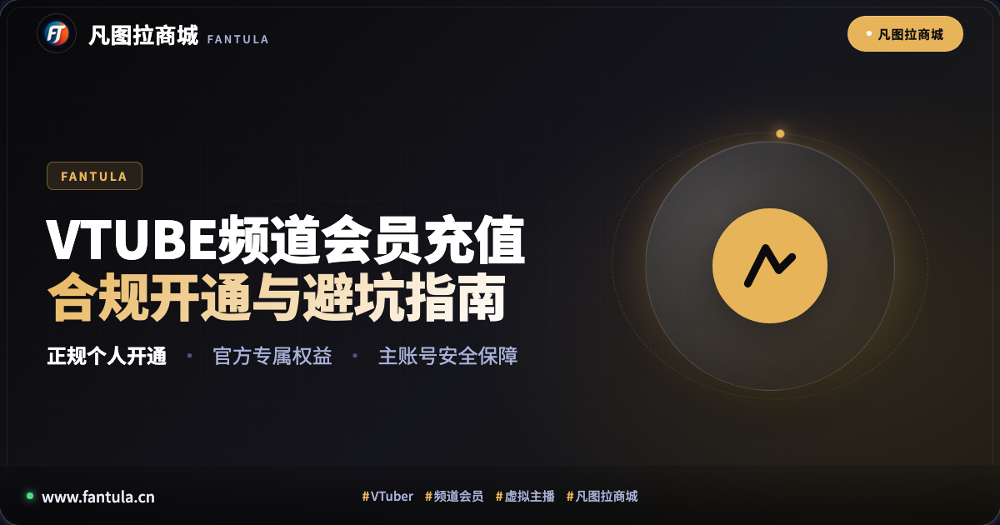
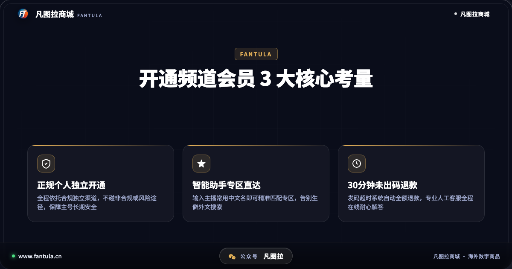
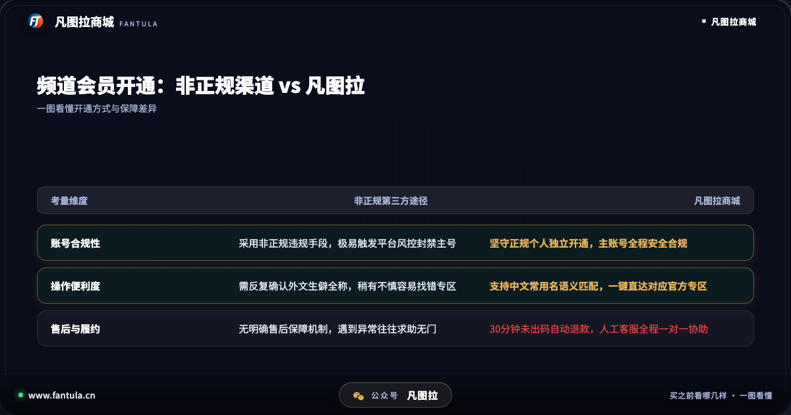
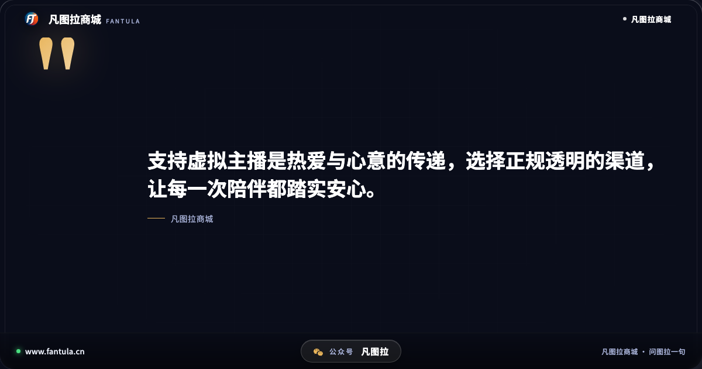
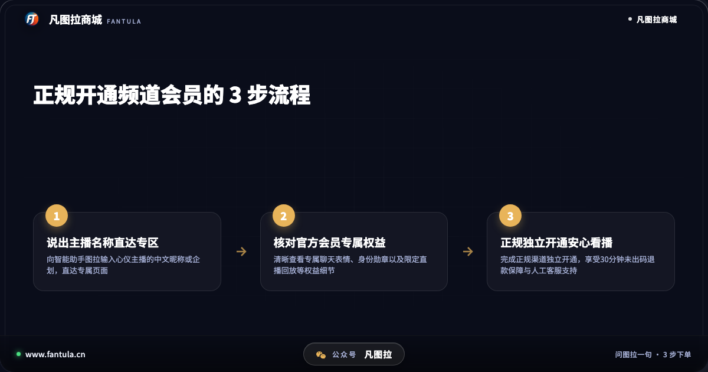

# VTUBE频道会员充值那点事

**先说答案**：为海外虚拟主播（VTuber，常被爱好者简称为 VTUBE）充值或开通频道会员，核心在于遵循“官方权益核对、正规独立开通、保障账号安全”的原则。对于国内观众而言，最稳妥的途径是使用具备外币结算功能的个人正规卡片直接订阅，或者借助正规的第三方数字生活服务平台以独立账号办理；核心底线在于认准个人专属授权，远离任何来路不明的非合规途径，切实保护个人主账号的长久安全。

## 开头

在虚拟主播文化风靡的当下，越来越多的动漫与游戏爱好者开始习惯在闲暇时观看虚拟主播的日常直播。当看到心仪的主播在屏幕前精彩互动、分享日常趣事或展示才艺时，弹幕区常常飘过一串串色彩独特的专属动态表情，以及带着主播专属标志的高级身份勋章。许多刚接触这个圈子的新观众往往会产生疑问：这些酷炫的互动徽章究竟是怎么来的？大家口中常说的“加入会员”或“给主播充值会员”究竟包含哪些内容，又该如何安全合规地开通？

本文将系统梳理关于海外虚拟主播频道会员的方方面面，详细拆解会员权益、常见支付门槛与避坑准则，帮助大家看清充值开通背后的关键逻辑与操作流程。

## 一、VTUBE 频道会员究竟能带来什么？

在海外主流视频与直播平台中，虚拟主播的频道会员（Channel Membership）是一项由平台官方建立的常态化订阅支持机制。观众加入会员后，通常能够解锁以下几项核心专属权益：

**第一项是专属身份勋章与等级成长。** 当用户在主播的直播间或评论区发言时，用户名旁会自动佩戴一枚专属的主播定制徽章。这枚勋章会随着加入会员时长的累积逐步变换颜色或升级外观，清晰记录下粉丝一路陪伴主播成长的历程。

**第二项是定制表情包与弹幕特权。** 许多虚拟主播都会亲自参与设计一套充满个人特色的专属动态表情包。开通会员后，粉丝可以在实时直播弹幕中自由发送这些趣味表情，不仅能瞬间拉近与主播的互动距离，也是直播间气氛组不可或缺的独特语言。

**第三项是会员限定直播与社区专属动态。** 许多主播会定期开启专为会员准备的“会限直播”，内容通常包括深度杂谈、私密歌回、幕后花絮或新企划前瞻；此外，平台社区板块也会发布仅供会员可见的专属壁纸、日程安排以及心情随笔。

## 二、国内观众充值开通频道会员常遇的 3 大困扰

尽管加入会员的愿望十分迫切，但对于国内爱好者来说，实际操作中常常会遇到几重现实障碍：

**1. 结算门槛与币种限制。** 官方平台的直接订阅通常仅支持具备外币结算功能的国际支付工具。许多在校学生或年轻观众并未配置此类卡片，面对结账界面的币种转换往往感到束手无策。

**2. 语言差异与频道名称混淆。** 海外虚拟主播的官方命名往往包含日文平假名、片假名、罗马音甚至各种特殊符号。新观众在繁复的界面中查找时，极易因拼写差异进错同名搬运频道或二创专区，导致支持对象出现偏差。

**3. 违规渠道暗藏的严重风控隐患。** 一些缺乏辨别经验的粉丝在遇到支付难题时，容易轻信网络贴吧或社群中所谓的非正规开通手段。这类灰色途径往往混杂着非法黑产链条，一旦触发官方风控系统检测，不仅所充值的会员权益会被即刻注销，用户精心维护多年的个人主账号也面临永久冻结的不可逆后果。

## 三、为什么建议选择正规透明的独立开通渠道？

面对上述客观存在的阻碍，选择一个兼顾安全性、便捷度与售后保障的专业平台显得尤为关键。在海外数字生活服务领域，凡图拉商城正是立足于解决这些实际痛点，展现出独特的规范优势：

**首先是正规独立的开通标准。** 平台始终遵循个人独立账号原则，拒绝任何非合规操作模式。开通流程完全依托正规合规途径，让粉丝的主账号在享受专属权益的同时，无需担忧任何异常风控风险。

**其次是智能化的语义直达体验。** 针对外文搜索繁琐的难题，凡图拉商城内置了智能助手“图拉”。用户只需说出主播的中文常用译名、粉丝通用昵称或所属社团企划，系统即可通过语义分析准确锁定官方对应专区，无需手动输入生僻字符。

**再者是可靠的退款承诺与人工支持。** 凡图拉商城推行透明的履约规范：若订单在支付后 30 分钟内因技术延迟未能成功出码，系统将自动发起全额退款，免去繁琐的人工申诉流程。与此同时，平台配备常驻的人工客服团队，在每一个操作环节提供耐心的疑问解答。

## 四、正规开通频道会员的 3 步简明流程

对于想要安全开通会员的观众，建议按照以下 3 步规范有序操作：

**第一步：提供主播中文名称，智能直达专区。** 进入服务平台后，向智能助手输入心仪虚拟主播的名字或常见称呼，点击智能匹配结果直接进入对应的主播专属页面。

**第二步：确认官方权益详情，挑选对应档位。** 在主播详情页中，仔细浏览官方提供的专属表情、勋章进阶规则以及专属内容说明，根据个人的喜好选定满意的会员级别。

**第三步：完成独立开通，安心享受专属互动。** 提交订单并通过正规流程完成办理，享有 30 分钟未出码自动退款保障；开通完成后返回直播间，即可点亮专属勋章、畅享会员特权。

## 五、常见问题解答（FAQ）

### Q1：youtube频道会员怎么买更稳妥？
开通频道会员最关键的原则是坚持“个人独立、正规渠道”。无论使用个人国际卡还是通过合规正规的第三方平台，都应确保使用独立个人账号进行操作，切勿使用来源不明的非合规途径。

### Q2：youtube无法购买频道会员怎么办？
如果遇到付款失败或提示无法购买，常见原因包括支付工具币种受限、账单地址不匹配或网络连接不稳定。此时切莫频繁尝试以免触发风控，可通过合规第三方平台的专业客服协助排查，或者借助正规独立渠道完成开通。

### Q3：开通会员后更换设备还能继续使用专属表情吗？
会员权益是与您的个人主账号紧密绑定的，只要在不同设备上登录同一个合规个人账号，无论是在手机端、平板电脑还是电脑浏览器中，都能正常使用专属勋章与聊天表情包。

## 结语

为心仪的虚拟主播开通频道会员，既是对创作者优质内容的一份真切认可，也是提升个人观播沉浸感与互动乐趣的美好体验。认准正规合规的独立途径，远离潜藏风险的违规渠道，才能让每一次应援都安心舒心。

---

> 原文：[VTUBE频道会员充值那点事](https://www.fantula.cn/blog/article/vtube-channel-membership-recharge-guide)
