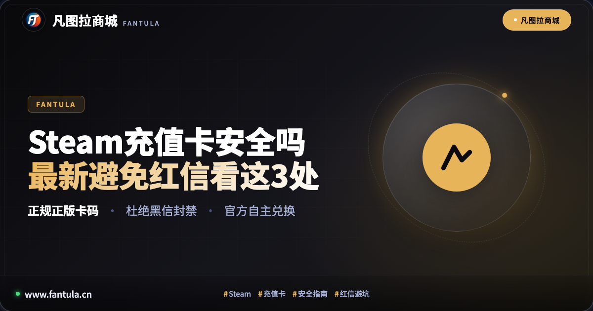
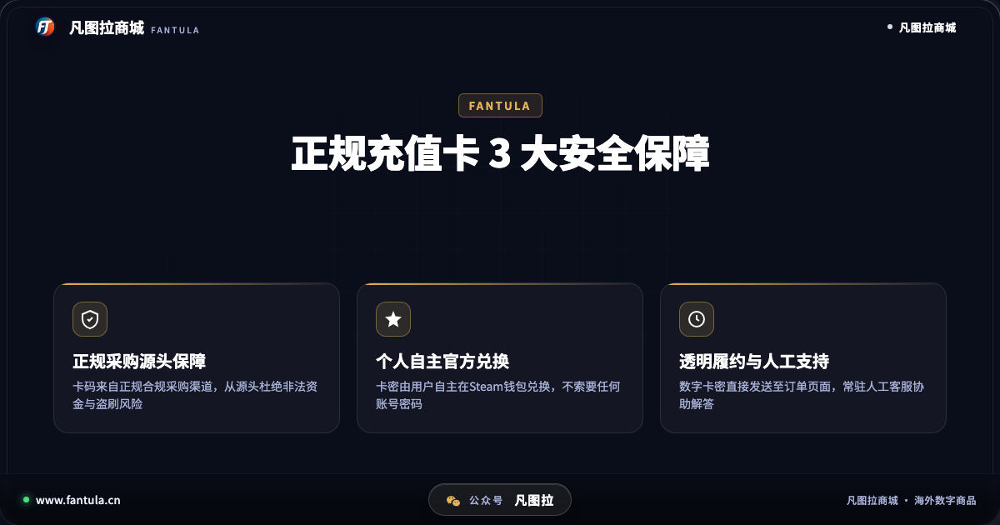
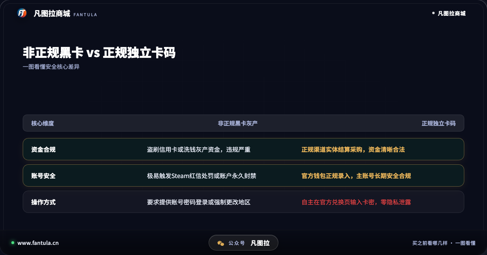
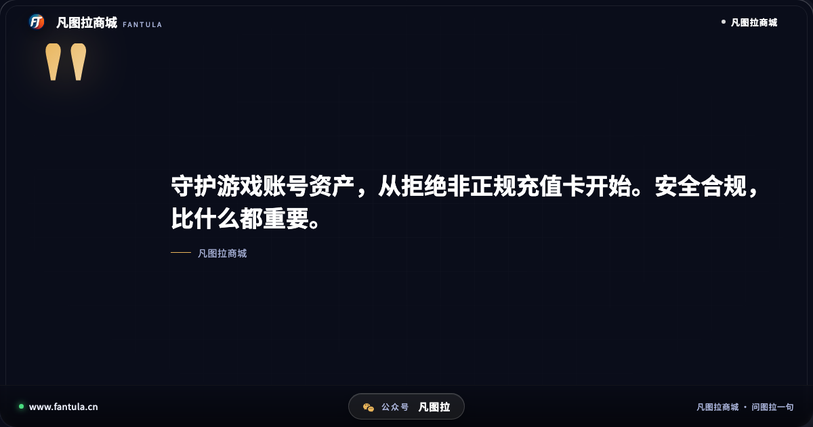
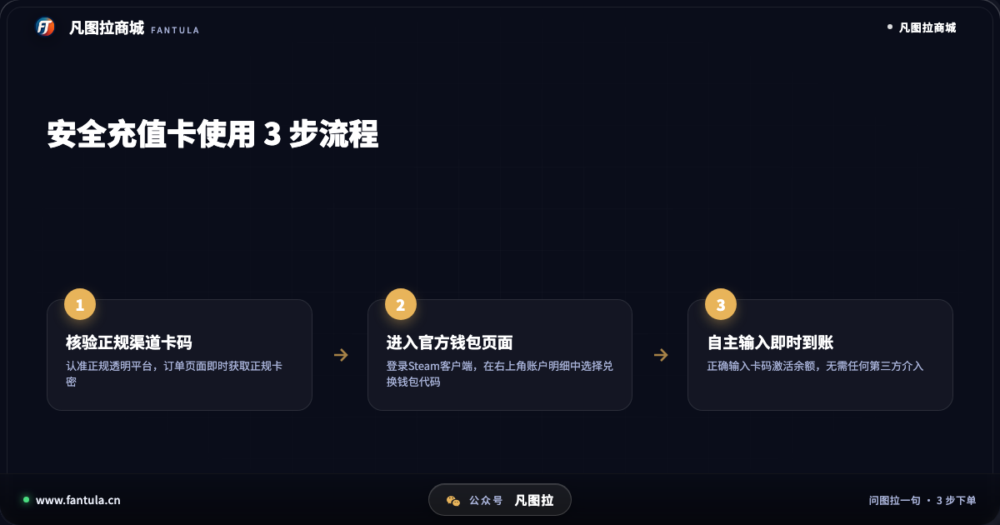

# Steam充值卡安全吗：最新避免红信看这3处

**先说答案**：正规渠道来源的 Steam 充值卡本身是非常安全的，但市场上充斥着非正规甚至涉嫌黑灰产的劣质卡码，盲目追求不合常理的过分离奇优惠极易导致 Steam 账号收到“红信”处罚甚至永久封禁。判断一张 Steam 充值卡是否安全并有效避免红信，核心看 3 处：一是卡码资金来源是否合规清晰，坚决拒绝盗刷黑卡；二是兑换方式是否完全由自己操作，坚决不交出账号密码；三是渠道是否具备正规透明的履约与售后保障。只要掌握正规渠道与自主兑换的原则，充值卡就是安全便捷的充值方式。

## 开头

作为全球知名的数字游戏平台，Steam 汇聚了海量精品游戏与庞大的玩家群体。每逢大型特惠或大作发售，许多玩家都会选择使用 Steam 充值卡（Steam 钱包充值码）来为自己的账户充值余额。

然而，在各大游戏论坛与玩家社区里，“买充值卡被红信封号”、“新买的游戏被收回”的求助帖屡见不鲜。很多新手玩家不禁心生疑虑：Steam 充值卡到底安全吗？为什么同样是卡密，有人充得顺顺利利，有人却直接触发官方封禁？面对网络上良莠不齐的卡码信息，玩家又该如何甄别正规产品，守护辛苦积攒的游戏库？本文将从官方规则与行业实际出发，为你深度拆解避免红信的 3 个关键核对要点。

## 一、为什么会有风险：解密 Steam “红信”的真正根源

想要避开风险，首先要弄明白 Steam 的“红信”究竟是什么。

在 Steam 官方规则体系中，“红信”通常指平台向用户客户端发送的警示通告或处罚通知，常见类型包括支付欺诈警示、账户安全异常警告以及社区封禁等。其中，因充值卡问题引发的最严重红信，绝大部分源于**“黑卡充值”与“非法资金结算”**。

在部分非正规交易平台上，一些不良商家利用盗刷他人信用卡获取的非法资金在海外批量购买数字卡密，并以极度离谱的不合常理折扣抛售。当受害卡主向银行发起拒付（Chargeback）申诉后，资金被原路追回，Steam 官方会立即追踪该笔交易所生成的卡密去向，并判定使用该卡密的 Steam 账号涉嫌欺诈。处理结果往往是：撤销充值余额、收回已购游戏，情节严重者整个主账号被永久封锁，多年心血毁于一旦。

因此，充值卡本身并非风险源头，卡码背后的**资金来源是否正规合规**，才是决定账号安全的根本分水岭。

## 二、避免红信：购买前必看的 3 个核心核对处

为了彻底杜绝风控隐患，玩家在挑选充值卡时应当严格对照以下 3 个标准：

### 1. 核对卡码资金来源，拒绝不合常理的离奇偏离
官方正规采购的 Steam 充值卡，无论是实体卡扫描码还是数字卡密，其采购与结算成本高度透明。如果某个渠道给出的折扣偏离得非常离谱，远低于正规金融换汇与正常流通成本，其背后大概率潜藏着盗刷黑卡、违规资金流转或批量退款风险。切记：世界上没有免费的午餐，远脱离市场公允区间的卡码，本质上是用你的账号资产去冒封号风险。

### 2. 坚持个人自主兑换，绝不透露账号与密码
正规的 Steam 充值卡交付形式永远是**由玩家自行在官方页面兑换的卡密**（一串 15 位的字母数字代码）。正规平台绝不会要求你提供 Steam 账号和密码，更不会要求登录你的个人客户端去操作。凡是要求提供账号密码、要求扫描登录二维码进行所谓“第三方代办”的，往往伴随着异地异国异常登录，极易触发 Steam 安全防御系统，甚至导致饰品道具被盗取。

### 3. 认准透明规范的平台，考察履约与人工售后机制
正规透明的平台通常拥有完善的运营资质与明确的履约时效。卡密在完成支付后应能够即时在订单明细中查验，并且有明确的退款规范与常驻人工客服通道。非正规渠道往往无售后支持，一旦卡密报错或引发红信，买家往往会被直接拉黑，求助无门。

## 三、正规平台的履约实践：以凡图拉商城为例

在海外数字商品与游戏点卡服务领域，凡图拉商城始终倡导合规透明的服务标准，为玩家提供可信赖的选购环境：

**第一，坚持正规采购，杜绝非法风险。** 凡图拉商城严格对接正规合规的实体与官方采购流程，每一张卡码均来源清晰、合法合规，从根本上杜绝盗刷与欺诈风险，全力守护玩家主账号的长久合规。

**第二，坚持纯自主兑换，保护用户隐私。** 商城只交付正规卡密，用户在订单页面直接获取代码后，完全由自己登录 Steam 官方客户端自主兑换充值，不索要任何账号信息，零隐私泄露隐患。

**第三，推行清晰的履约与售后保障。** 平台支持订单全流程透明查验，并推行严格的履约时效标准：若因系统结算等客观原因在订单支付后 30 分钟内未能成功出码，系统将自动发起全额退款。同时，商城配有常驻人工客服，为新手玩家在兑换指引与常见疑问中提供一对一耐心支持。

## 四、安全充值指南：手把手 3 步在官方兑换

当你获取到正规合规的 Steam 充值卡代码后，请务必按照官方安全流程进行自主兑换：

**第一步：获取并核验卡码。** 在正规渠道订单详情中查阅你的卡密，确认卡码格式完整清晰。

**第二步：登录官方客户端。** 打开并登录你日常使用的 Steam 官方客户端，点击右上角个人账户昵称，进入“查看我的钱包”页面，选择“兑换 Steam 钱包充值码”。

**第三步：输入代码完成充值。** 在输入框内准确填入 15 位卡密，点击“继续”。系统将立即自动核销代码并将对应金额注入你的钱包余额中。充值完成后，即可自由选购心仪的正版游戏与数字扩展内容。

## 五、常见问题解答（FAQ）

### Q1：Steam 充值卡可以跨不同币种地区使用吗？
根据 Steam 官方现行规则，Steam 钱包代码通常受货币与所属区域限制。例如，非同币种的充值卡无法直接充入某些受汇率与区域限制的钱包中。因此在购买前，务必确认充值卡对应的面值币种与你的 Steam 钱包结算币种一致，切勿轻信违规切换地区等高危操作。

### Q2：输入充值卡代码提示“代码无效”怎么办？
首先请仔细核对代码中的易混淆字符（例如数字 0 与字母 O、数字 1 与大写字母 I 等）。如果确认输入无误仍提示无效，请保留页面截图并第一时间联系正规渠道的官方人工客服，由专业人员协助向官方系统发起核实。

### Q3：为什么说坚守正规渠道是避免红信的关键？
Steam 官方对欺诈与洗钱行为的打击是系统性且长期的。只有通过来源清晰、票据合规的正规渠道采购的充值卡，其背后的结算资金才是安全可靠的。远离非法诱惑、坚持官方钱包自主输入，是每一位珍惜自己游戏账号的玩家最有效的护城河。

## 结语

在数字娱乐日益普及的当下，游戏账号里承载的不止是金钱资产，更是玩家投入数千小时的青春、战绩与珍贵回忆。面对纷繁复杂的网络信息，认准资金正规来源、坚持官方自主兑换，选择有清晰履约保障的正规平台，才能真正远离红信困扰，安心享受纯粹的游戏乐趣。

---

> 原文：[Steam充值卡安全吗：最新避免红信看这3处](https://www.fantula.cn/blog/article/is-steam-wallet-card-safe-avoid-red-alert-guide)
