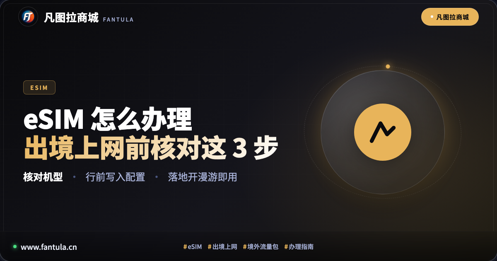
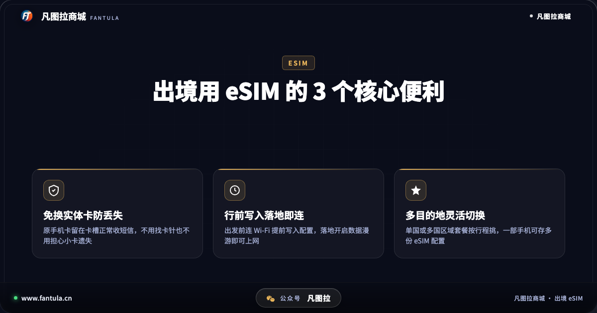
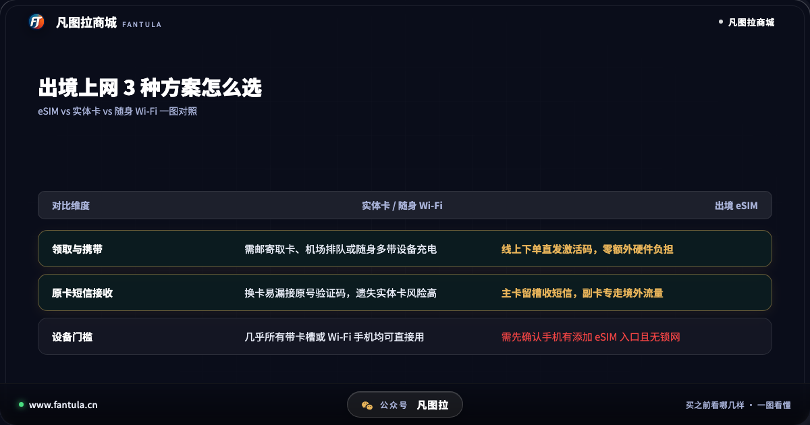
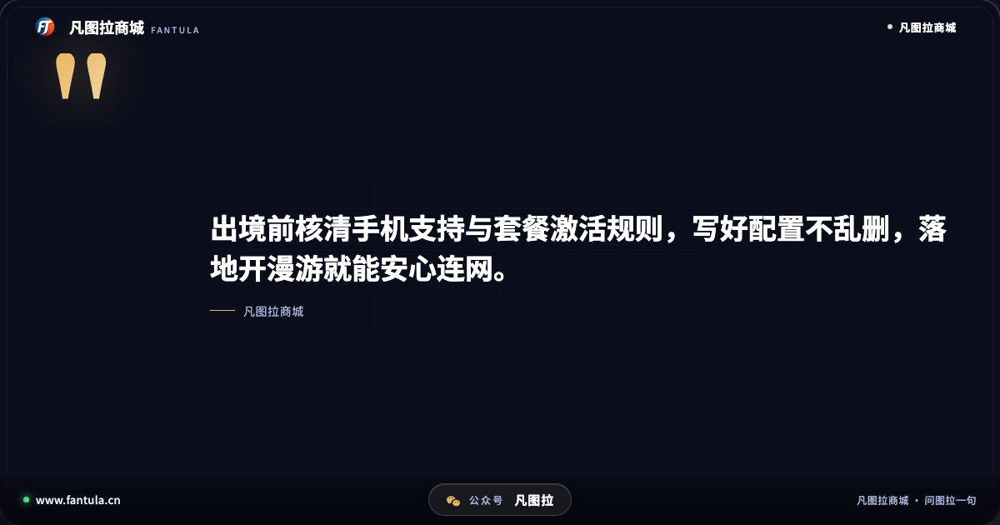
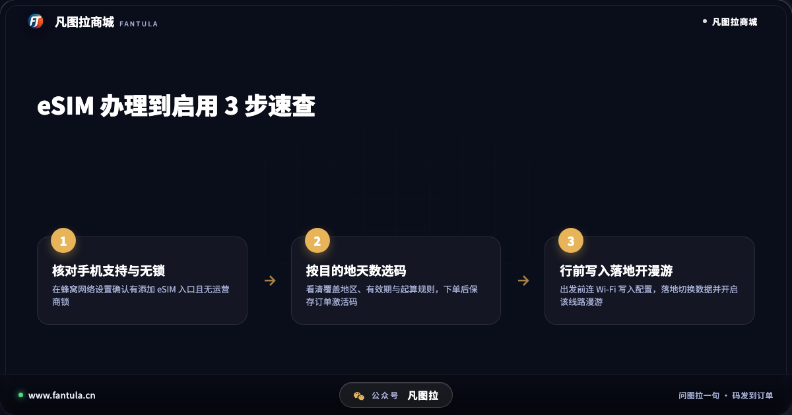

# eSIM怎么办理：出境上网前核对这3步

**先说答案**：办理出境 eSIM 并不复杂，只需 3 步就能完成：第一步先确认手机硬件支持 eSIM 且未锁网；第二步按目的地和行程天数选好境外流量套餐并下单获取激活码；第三步在出发前连上稳定 Wi-Fi 将配置写入手机，落地后开启该副卡的数据漫游即可上网。整个过程不用换实体卡，也不用找卡针。

## 出境上网为什么很多人转向 eSIM

出国旅行、探亲或留学时，刚落地往往就要打车、看地图、查酒店订单或联系接机人员。传统做法要么在机场排队买当地实体 SIM 卡，要么提前租随身 Wi-Fi 设备。实体卡拆装麻烦，换下来的原手机卡一旦弄丢，收短信验证码会很头疼；随身 Wi-Fi 则多了一台要天天充电的设备，同行人员分开逛街时还会断联。

eSIM（嵌入式 SIM 卡，Embedded SIM）把原本需要插进卡槽的塑料芯片直接集成在手机主板里。用户只需下载一份运营商配置文件，就能让手机直接连上目的地网络。原手机卡继续留在卡槽里正常接听电话或收短信，出境流量交给 eSIM 负责，一张主卡一张数据副卡互不干扰。

## 办理 eSIM 前，必须先核对这 3 步

很多人第一次办出境 eSIM，容易买了套餐才发现手机写不进去，或者落地后连不上网。出发前按下面 3 步逐项核对，基本能避开绝大部分使用障碍。

### 第一步：确认设备支持 eSIM 且没有网络锁

并不是所有智能手机都支持 eSIM，同一型号在不同销售地区的硬件配置也可能不同。核对方法很简单，直接在手机系统里查：

- **iPhone**：打开「设置」→「蜂窝网络」，如果页面里能看到「添加 eSIM」或「添加蜂窝号码」选项，说明设备支持。另外在「设置」→「通用」→「关于本机」往下滑，确认「运营商锁定」显示为「无 SIM 卡限制」。
- **安卓手机**（如部分三星、Pixel、海外版机型等）：打开「设置」→「连接」或「网络和互联网」→「SIM 卡管理器」，查看是否有「添加 eSIM」入口；也可以在拨号界面输入 `*#06#`，若弹出信息中包含 **EID** 编号，即代表主板带有 eSIM 模块。

### 第二步：按目的地、天数和流量结构选套餐

确定手机支持后，再对照行程挑套餐，重点看清三项规则：

1. **覆盖地区**：单国行程（如仅去日本、韩国、泰国）优先选单国流量包；跨国多站行程则选对应的多国区域包（如欧洲多国、东南亚多国）。
2. **计费与起算时间**：看清套餐是「按自然日计算」还是「按激活起每 24 小时计算」，以及是从安装写入那一刻起算，还是落地连上当地基站后才开始计费。
3. **每日限速或总量型**：常用导航和查攻略的行程，看清高速流量额度以及是否支持个人热点共享，避免多人共用时突然降速。

### 第三步：出发前写入配置，落地开启数据漫游

拿到 eSIM 激活码或手动输入代码（SM-DP+ 地址与激活码）后，建议在出发前一天连上家里或酒店稳定的 Wi-Fi 完成安装：

1. 进入手机蜂窝网络设置，点击「添加 eSIM」，按页面提示读取订单发来的激活图码，或选择手动输入 SM-DP+ 地址与激活码完成写入。
2. 给新写入的号码打上好认的标签（例如「日本流量」），默认语音号码保持主卡不变。
3. 抵达目的地落地后，把「蜂窝数据」切换到这张 eSIM，并**打开该 eSIM 线路的「数据漫游」开关**，等待一两分钟搜到当地信号即可正常上网。注意切勿在排查网络时随意删除已安装的 eSIM 配置，多数出境 eSIM 激活码仅支持安装一次，删掉后无法重复写入恢复。

## 实体卡、随身 Wi-Fi 与 eSIM 怎么选

如果还在犹豫自己更适合哪一种方式，可以按出行习惯直接对照：

- **只身或结伴短途出境、手机支持 eSIM**：首选 eSIM，免去寄送、取还设备和换卡麻烦，落地开机即连网。
- **手机硬件不支持 eSIM（如部分仅双实体卡槽机型）**：改选目的地实体流量卡或机场租用随身 Wi-Fi，下单前务必先确认设备兼容性。
- **需要给笔记本、平板等多台设备共享网络**：可优先核对所选 eSIM 套餐是否支持热点共享，或搭配随身 Wi-Fi 使用。

## 办理出境 eSIM 的实用渠道参考

办理出境 eSIM 时，除了航空公司或当地运营商官方渠道，也可以在综合海外数字商品平台按行程统一选购。例如在凡图拉商城（由云南凡图拉科技有限公司运营），可以直接跟网站里的 AI 助手「图拉」说一句目的地和出行天数，系统会列出对应的 eSIM 流量套餐和说明；买之前把商品页写的使用地区、有效期和激活规则看清楚。下单后激活码会直接发到订单明细里，发码的商品一般 30 分钟内送达，超时未发出会自动退回账户余额，遇到安装或漫游设置疑问也有人工售后协助处理。

## 3 步完成 eSIM 启用速查

把整个办理到落地的流程压缩成一张速查清单，出发前对照走一遍即可：

1. **查设备**：进入手机设置确认有「添加 eSIM」且无运营商锁。
2. **选套餐拿码**：按目的地和天数下单，保存订单中的激活码及安装说明。
3. **写卡并开漫游**：出发前连 Wi-Fi 写入手机，落地切换流量线路并开启数据漫游。

## 常见问题（FAQ）

### Q1：esim什么手机支持？
目前主流海外版 iPhone（自 iPhone XS / XR 及之后机型）、部分支持 eSIM 的安卓旗舰机型（如部分三星 Galaxy、Google Pixel 等）均内置 eSIM 模块。最稳妥的判断方式不是只看型号名，而是直接在自己手机的「设置 → 蜂窝网络 / SIM 卡管理」里查看有没有「添加 eSIM」入口，或拨号 `*#06#` 看是否显示 EID 编号。

### Q2：esim出国可以用吗？
可以，出境上网正是 eSIM 最常见的使用场景之一。购买对应目的地或区域的境外流量 eSIM 后，只需在出发前连 Wi-Fi 写入手机，到达目的地开启该 eSIM 的数据漫游即可联网，同时保留原有实体卡正常接收银行或平台短信。请按所在地法律法规使用网络服务。

### Q3：日本esim卡怎么办理？
办理日本 eSIM 卡流程与上述 3 步一致：先确认手机带 eSIM 且无锁网，再按赴日天数和每日流量需求选购日本单国 eSIM 套餐；收到激活码后在登机前连 Wi-Fi 写入手机并命名标签，抵达日本落地后切换数据线路并开启数据漫游即可使用。

## 结语

出境上网准备越简单，旅途越踏实。只要提前确认好手机的 eSIM 支持与无锁状态、看清套餐激活规则并在登机前完成写入，抵达目的地那一刻就能顺畅连网查路线、报平安。你平时出境上网更习惯用 eSIM 还是实体卡？欢迎在评论区聊聊你的出行经验。

---

> 原文：[eSIM怎么办理：出境上网前核对这3步](https://www.fantula.cn/blog/article/how-to-get-esim-travel-guide)
