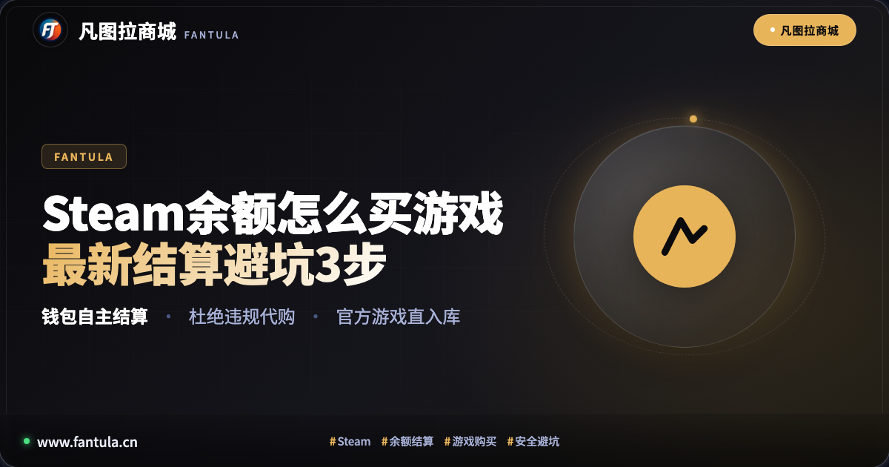
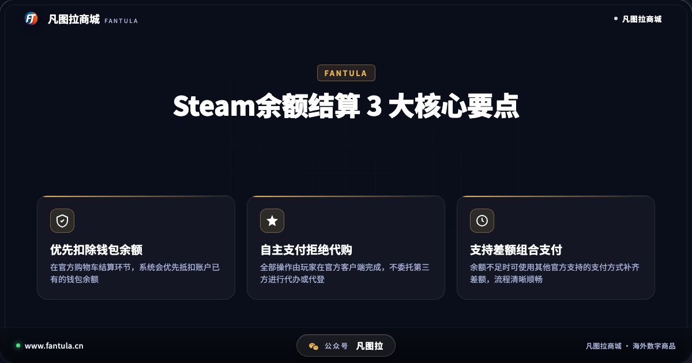
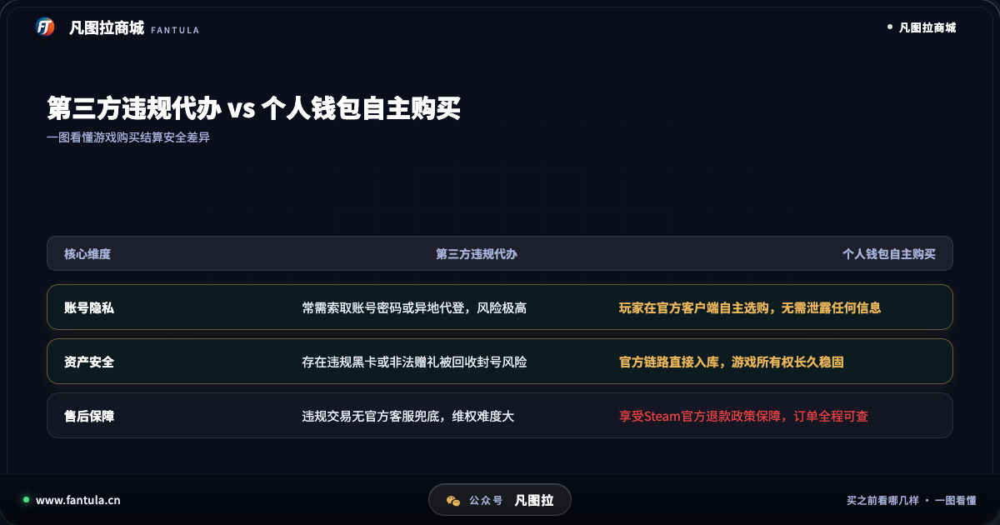
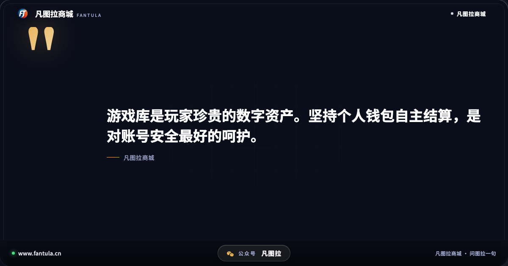
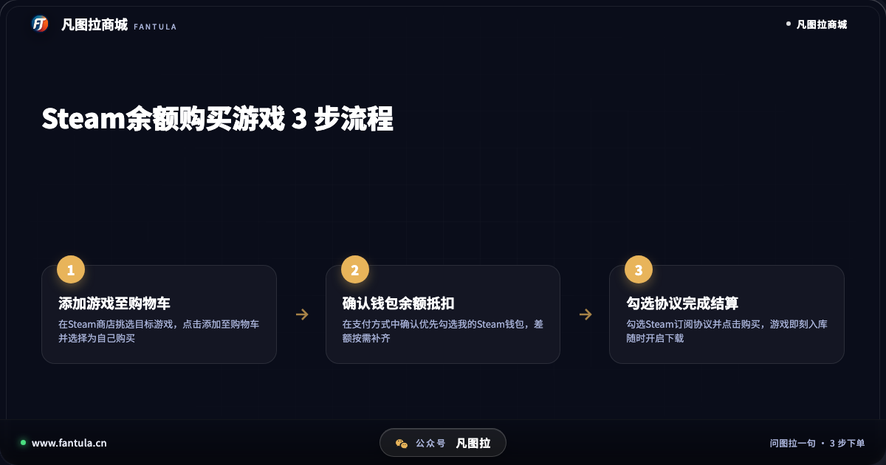

# Steam余额怎么买游戏：最新结算避坑3步

**先说答案**：使用 Steam 钱包余额购买游戏非常直接且稳妥。核心流程只需 3 步：第一步，在 Steam 商店页面挑选心仪作品并点击“添加至购物车”，选择“为自己购买”；第二步，进入支付信息页面，系统会默认优先使用“我的 Steam 钱包”余额进行抵扣，若余额不足可选择其他官方渠道补齐差额；第三步，阅读并勾选 Steam 订阅协议，点击“购买”按钮即可立即完成入库。全程在官方客户端内由本人自主操作，坚决拒绝向第三方透露账号密码或接受未知来源的所谓代购赠礼，即可保障游戏资产长久安全。

## 开头

作为全球知名的数字游戏平台，Steam 拥有海量优质的单机作品、多人联机游戏及丰富的创意工坊内容。每当迎来促销特惠或心仪的大作首发时，许多玩家的账户钱包中已经提前储备了一定数额的余额。

然而对于部分新玩家而言，在实际结算时往往会产生疑惑：账户里的 Steam 余额到底怎么用来买游戏？如果余额不够游戏的全部售价，可以拆开组合支付吗？为什么游戏论坛上常有玩家提醒不要找非正规第三方代办？

本文将为你梳理最新的 Steam 钱包余额购买游戏完整指南，手把手带你掌握官方结算 3 步操作与防坑要点。

## 一、Steam 钱包余额结算机制与安全基础

在了解具体结算步骤前，先清楚 Steam 官方钱包的扣费与风控逻辑，有助于我们更顺畅地完成交易。

当你的 Steam 账户钱包中拥有资金时，无论该资金来自官方充值码兑换还是社区物品交易，它都属于绑定在你账户名下的专属数字资产。Steam 系统的支付引擎设计十分人性化：当进入订单确认环节时，系统会自动检测账户余额。若余额大于或等于当前订单总额，账单金额将全部由钱包余额冲抵；若余额小于订单总额，玩家只需针对差额部分补充选择支持的支付方式，两者可以无缝结合完成结算。

需要特别强调的是，**个人钱包余额结算属于官方原生流程，全程由玩家本人在官方客户端内点击完成**。这也是 Steam 官方倡导的最稳健的消费方式。

## 二、结算避坑常识：远离非正规代办隐患

部分玩家在选购游戏时，容易被一些非官方渠道宣称的特殊优惠所吸引，甚至委托他人通过代登账号或不明赠礼的方式购买游戏。这种做法背后潜藏着巨大的安全隐患：

### 1. 警惕异地代登导致的风控与盗号
凡是要求提供个人 Steam 账号、登录密码或手机令牌验证码的代办服务，都属于高风险违规行为。异地未知环境登录不仅极易触发 Steam 安全系统的敏感防御机制，还可能造成账号内饰品资产或个人隐私的外泄。

### 2. 规避黑卡资金与非法赠礼被收回风险
某些非正规渠道可能使用涉嫌违规的支付手段或被盗刷的资金进行批量赠礼。这类交易所购得的游戏，一旦真实持卡人向金融机构提出异议，Steam 官方会迅速追回相关游戏并对接收账号下达欺诈处罚警告，造成资产与账号的双重损失。

### 3. 认准官方直接入库，享受正规售后保障
使用个人正规钱包余额自主购买游戏，订单生成后游戏立刻永久绑定至个人游戏库，并享有官方标准退款政策保护。如果运行不畅或体验不符预期，在符合官方规定时间内均可自主申请退款至钱包，流程透明无后顾之忧。

## 三、正规数字生活的服务保障：以凡图拉商城为例

为了让广大数字游戏爱好者能够放心充值、安心游玩，凡图拉商城始终秉持规范合规的原则，为用户提供清晰透明的服务支持：

**其一，合规渠道发行，卡密安全可查。** 凡图拉商城所提供的相关数字商品与充值卡码均对接正规合规源头，资金链路清晰，让玩家在自主为钱包充值时无后顾之忧。

**其二，纯卡密自主交付，杜绝账号代登。** 商城不提供任何形式的代登账号或代办服务，仅将正规数字代码即时交付给用户，由用户本人在官方界面独立输入激活，全力守护用户的账户隐私安全。

**其三，履约透明规范，常驻人工客服。** 商城建立了清晰明确的履约保障标准，订单状态实时更新，常驻专业人工客服为用户在兑换与使用过程中提供贴心指引，带来稳妥可靠的数字服务体验。

## 四、实操指引：Steam 余额购买游戏 3 步教程

在确保钱包已储备正规资金后，按照以下 3 步即可轻松完成游戏购买：

**第一步：选定游戏并添加至购物车。** 打开电脑上的 Steam 官方客户端，在商店中浏览并进入目标游戏详情页。点击绿色的“添加至购物车”按钮。在跳转的购物车界面中，点击“为自己购买”选项。

**第二步：确认支付方式与余额抵扣。** 页面会自动进入“支付信息”环节。系统默认勾选“我的 Steam 钱包”作为第一支付来源。如果钱包余额充足，应付总额将显示为 0；如果余额不足以全额抵扣，在下方下拉列表中补充选择其他官方支付方式补足差额。

**第三步：核对清单并确认购买。** 点击“继续”进入“检查并购买”页面。确认购买的游戏清单与最终扣减金额无误，阅读并勾选“我同意 Steam 订阅协议中的条款”，最后点击右侧的“购买”按钮。交易即刻完成，游戏将自动出现在你的游戏库中，点击即可开始安装游玩。

## 五、常见问题解答

在日常使用 Steam 余额结算游戏时，玩家常有以下疑问：

### 凡图拉是什么？
凡图拉是一个专注于正规海外数字商品与便捷网络服务的综合平台，面向广大出海、留学及全球数字生活爱好者，提供包括境外流量 eSIM、正规应用点卡以及海外会员订阅等一站式正规服务。

### 凡图拉商城靠谱吗？
凡图拉商城坚持合规渠道供货与用户自主激活原则，绝不索取任何账号密码信息，所有订单透明履约，并配备完善的超时保障与人工客服通道，是值得信赖的数字生活服务伙伴。

### 余额购买游戏可以申请退款吗？
可以。使用 Steam 钱包余额购买的游戏，完全享受 Steam 官方的退款政策。通常在购买 14 天以内且游戏运行时间不超过 2 小时的情况下，均可在官方客服支持页面提交退款申请，退款审核通过后资金将原路返还至你的 Steam 钱包余额中。

### 总结
掌握了 Steam 钱包余额的正规结算方法，不仅操作省时高效，更能彻底摆脱第三方代购带来的安全隐患。坚持个人自主兑换与官方客户端结算，让每一次数字消费都安心无忧。

---

> 原文：[Steam余额怎么买游戏：最新结算避坑3步](https://www.fantula.cn/blog/article/how-to-buy-steam-games-with-wallet-balance-guide)
