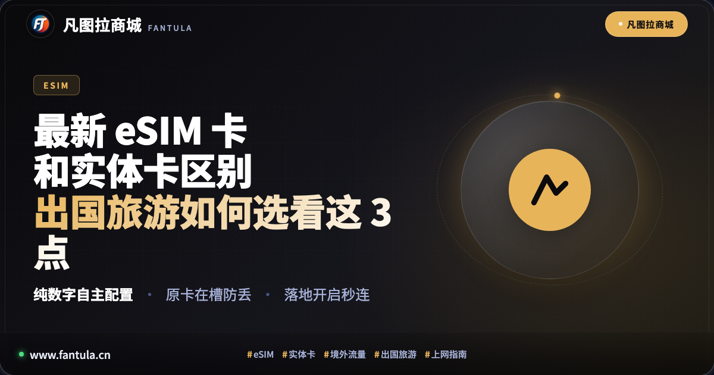
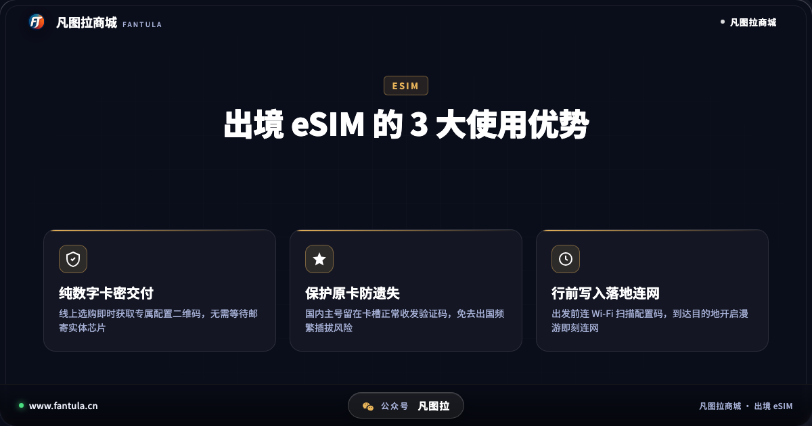
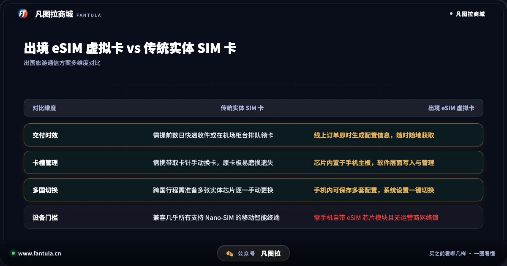
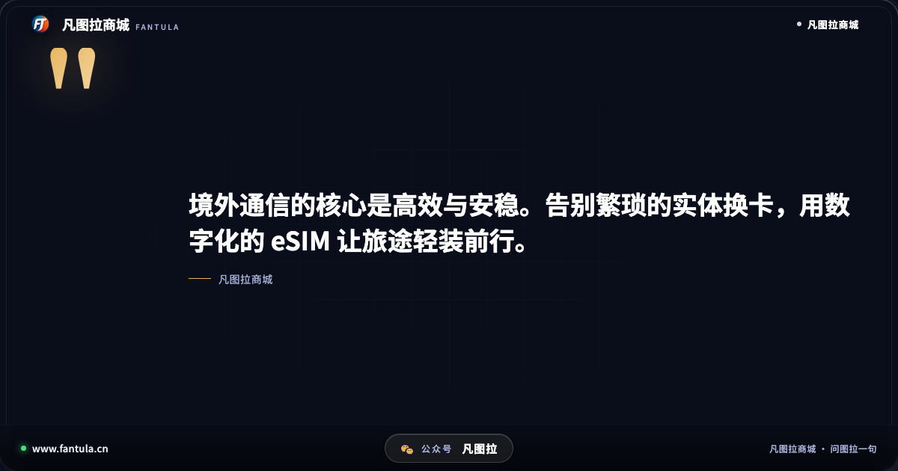
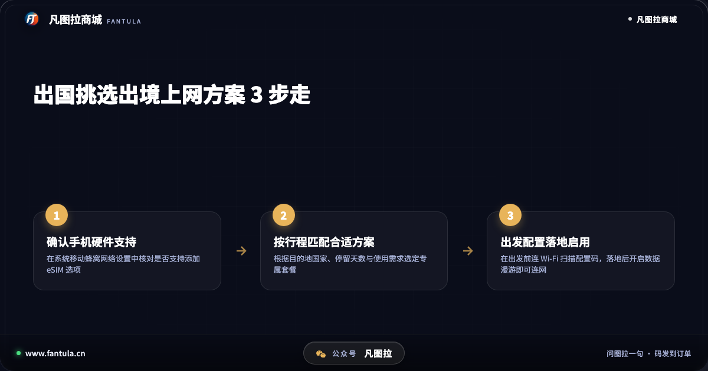

# 最新esim卡和实体卡区别：出国旅游如何选看这3点

**先说答案**：eSIM 卡与传统实体 SIM 卡的核心区别在于“载体形态与配置方式的不同”。实体 SIM 卡是一张需要插入手机物理卡槽的塑料塑料芯片；而 eSIM（嵌入式 SIM 卡）则是直接焊封在手机主板上的微型芯片，用户无需插拔硬件，只需通过扫描二维码即可将网络配置文件写入设备。对于出国旅游用户而言，挑选方案只需看这 3 点：第一，看设备支持度，若手机支持 eSIM 且无运营商网络锁，优先选 eSIM 省时省心；第二，看卡槽安全，eSIM 无需取出国内主号卡，能在境外正常接收银行与平台验证码，杜绝原卡遗失风险；第三，看多国行程灵活性，跨国旅行时 eSIM 可在设置中自由切换不同国家方案，避免了随身携带取卡针和多张实体卡的麻烦。

## 开头

随着跨境旅游与商务出行的日益普及，出境后的网络通信成为每一位旅行者行前准备的重要环节。过去，大家习惯在出发前网购一张当地实体电话卡，或者在机场排队租用随身 Wi-Fi；而近年来，出境 eSIM 成为一种崭新的数字化网络方案。

然而许多初次接触这一概念的朋友常常会问：eSIM 卡和我们平时用的实体卡到底有什么区别？哪一种更适合出国旅游？自己的手机到底能不能用？

本文将为你全面梳理 eSIM 与传统实体卡在交付形态、使用体验及安全保障上的核心差异，帮助你在出国前做出最明智的网络方案决策。

## 一、技术形态与载体差异：物理芯片 vs 数字化配置

要理解两者的区别，首先需要厘清它们的底层运作机制。

传统实体 SIM 卡（目前普及的主要是 Nano-SIM 卡）属于物理介质，必须依赖手机机身上的金属卡托与读卡触点。换卡时，用户必须借助细小的取卡针将卡托弹出，再小心翼翼地放入芯片。如果在旅途中频繁插拔，极易出现接触不良、卡片滑落甚至遗失卡托的情况。

而 eSIM（Embedded-SIM）则是将芯片功能直接整合在手机内部电路主板上。它不再需要任何物理开孔或外部卡槽，所有的运营商识别码、网络鉴权协议均以数字配置文件的形式存在。用户选购出境套餐后，系统会生成一组专属的激活码或二维码，在有 Wi-Fi 的环境下通过系统设置扫描，几秒钟即可完成网络配置。

这种纯数字化的交互方式，从根本上革新了移动终端的通信连接体验。

## 二、出境场景深度对比：3 大实用维度解析

在实际的出境旅游与商务办公场景中，eSIM 与传统实体卡展现出了显著的体验差距：

### 1. 交付时效与行前准备
实体 SIM 卡往往需要提前数天网购并等待快递寄达，若临近出发才发现未备妥，便只能在机场国际到达区排队购买，费时费力。而出境 eSIM 属于纯数字化商品，无论是深夜临时决定出行，还是人在候机厅，随时线上选购均可即时生成配置信息，实现真正的即买即用。

### 2. 国内原卡保护与验证码接收
这是许多出境人士最为看重的一点。使用传统单卡槽手机换上境外实体卡后，国内原卡必须取下，极易在随身行李中不慎丢失；更关键的是，换下原卡后将无法接收来自国内银行、社交软件的重要安全短信。而使用 eSIM 时，国内实体卡可以稳稳留在卡槽中保持待机（关闭数据漫游即可），出境流量则由 eSIM 独立承载，既能顺畅上网，又绝不漏接任何关键验证信息。

### 3. 多目的地与跨国行程调度
对于需要途经多个国家或转机逗留的旅客，传统实体卡往往需要准备不同地区的卡片频繁更换。而支持 eSIM 的智能手机通常可以在内部保存多套配置文件，并在手机系统的蜂窝网络菜单中按需自由切换启用，极大提升了跨国出行的便利度。

## 三、专业商城的规范服务保障：以凡图拉商城为例

为了让出海旅行与数字游民享受到稳定可靠的连接体验，凡图拉商城构建了成熟规范的出境通信服务体系：

**第一，主流网络直连，低延迟更稳定。** 凡图拉商城所提供的出境 eSIM 套餐直接对接目的地主流电信运营商网络，具备优秀的信号覆盖与连接稳定性，满足导航、通话及社交分享等各项需求。

**第二，纯卡密自主写入，流程安全透明。** 商城恪守数字安全准则，订单完成后即时生成标准化二维码与配置代码，全部由用户在手机官方系统设置中自主扫码写入，绝不涉及任何第三方介入，全力守护设备安全。

**第三，常驻在线客服，旅途答疑无忧。** 商城配备专业的人工技术支持团队，用户在机型核验、行前配置或境外网络调试过程中遇到任何问题，均可随时获得清晰明确的指导与协助。

## 四、出国挑选与启用网络方案 3 步指南

如果你计划在接下来的旅程中体验出境网络服务，建议按照以下 3 步规范操作：

**第一步：核验设备硬件与无锁状态。** 确认个人手机具备 eSIM 硬件支持（例如苹果海外版机型等），并在“设置 - 通用 - 关于本机”中确认“运营商锁”显示为“无 SIM 卡限制”。

**第二步：按行程需求选定专属套餐。** 在凡图拉商城根据出行目的地国家、天数及每日所需用量，挑选匹配的 eSIM 流量套餐，支付完成后在订单中心获取专属二维码。

**第三步：行前配置写入，落地开启漫游。** 出发前连接稳定 Wi-Fi，进入“设置 - 蜂窝网络 - 添加 eSIM”，扫描二维码完成配置；航班降落目的地后，在设置中将蜂窝数据切换至该 eSIM 线路并开启“数据漫游”，等待数十秒即可顺畅接入当地高速移动网络。

## 五、常见问题解答

针对初次了解出境 eSIM 的用户，以下梳理了几个高频解答：

### esim是什么卡跟手机卡有区别么？
eSIM 是一种直接嵌入在手机主板内的虚拟数字 SIM 卡。与传统需要插入卡槽的塑料手机卡相比，eSIM 无需实体介质，通过扫码即可下载网络配置，两者的网络通信功能完全一致。

### esim怎么用？
使用 eSIM 只需在出发前连接 Wi-Fi，打开手机系统蜂窝网络设置选择“添加 eSIM”，扫描获取的二维码写入配置；到达目的地后开启该线路的数据漫游即可使用。

### 境外流量包怎么购买？
在支持正规出境通信服务的专业商城（如凡图拉商城）根据出行国家和天数选择对应流量套餐，线上完成选购后即可即时获得专属激活配置信息。

### 凡图拉是什么？
凡图拉是一个专注于海外正规数字商品与出海网络服务的综合平台，面向广大出海、留学及全球数字生活爱好者，提供包括境外流量 eSIM、正规应用点卡以及海外会员订阅等一站式正规服务。

---

> 原文：[最新esim卡和实体卡区别：出国旅游如何选看这3点](https://www.fantula.cn/blog/article/latest-esim-vs-physical-sim-card-differences-travel-guide)
