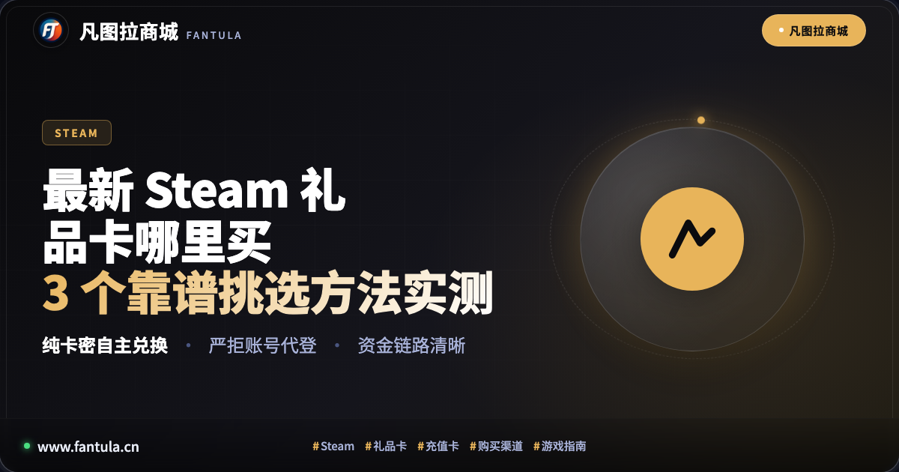
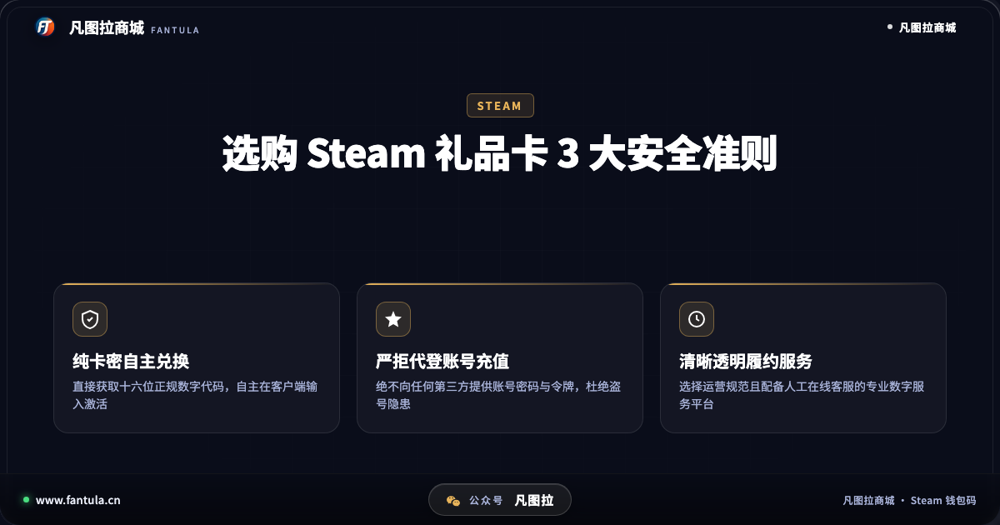
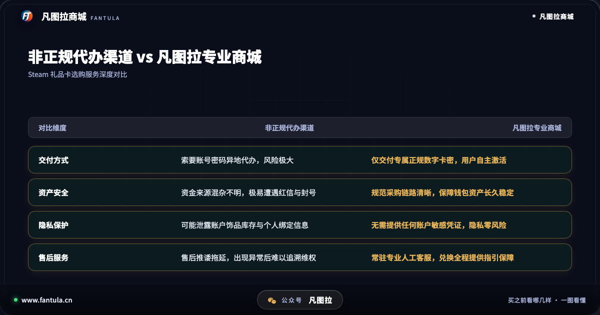
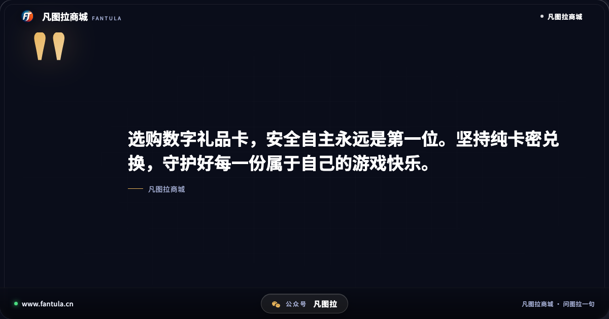
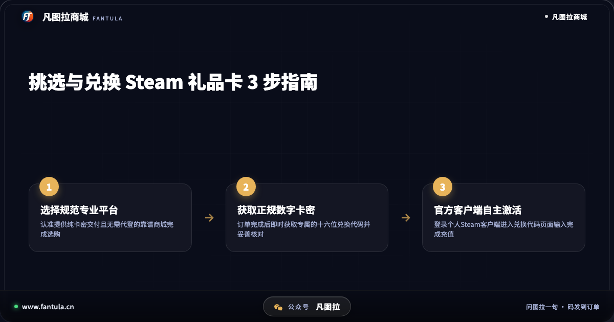

# 最新Steam礼品卡哪里买：3个靠谱挑选方法实测

**先说答案**：购买 Steam 礼品卡的核心原则是“认准纯卡密交付，严拒账号代登”。目前获取 Steam 礼品卡主要有 3 条可靠途径：第一，在 Steam 官方客户端内直接向好友赠送数字礼物卡，由官方系统直接清算；第二，在具备正规运营资质、支持卡密自动交付的专业数字服务商城（如凡图拉商城）选购，获取十六位官方代码后由本人在客户端内独立兑换；第三，在受官方支持的线下实体连锁零售店选购实体刮刮卡。无论通过何种渠道购买，切记凡是要求提供个人账号密码、手机令牌或通过异地代登协助充值的，均潜藏巨大风险，必须坚决远离。

## 开头

作为全球核心的数字游戏分发平台，Steam 汇聚了数以万计的精彩游戏作品。无论是逢年过节的季节特惠，还是心仪新游首发上线，使用 Steam 礼品卡为自己的钱包储备资金，都是广大玩家常用的充值途径。

然而面对网络上繁杂的礼品卡售卖渠道，不少玩家在搜索时常常感到困惑：Steam 礼品卡到底在哪里买才稳妥？各种售卖渠道之间有什么区别？怎样才能避开黑卡风控与盗号陷阱？

本文将为你深度梳理挑选 Steam 礼品卡的实用策略，帮助你在选购与兑换过程中稳妥避坑，守护个人游戏资产安全。

## 一、Steam 礼品卡购买的核心安全逻辑

在挑选购买渠道之前，先理解 Steam 礼品卡的安全运行机制至关重要。

Steam 官方发行的钱包充值卡与礼品卡，本质上是一串由十六位字母与数字组成的唯一兑换凭据。官方支持的标准充值逻辑非常纯粹：**平台负责生成并验证代码，用户在个人客户端输入代码，系统即刻将对应面额的资金注入当前登录的钱包账户**。

在这一标准逻辑中，完全不需要任何第三方的介入操作。任何试图介入用户账号登录环节的行为，都偏离了官方设计的初衷。因此，评估一个购买渠道是否靠谱，核心标准就在于它是否恪守“只交付数字代码、绝不触碰用户账号”的安全红线。

## 二、识别渠道风险：远离非正规代办隐患

在选购 Steam 礼品卡时，部分玩家容易被某些非正规渠道的宣传所误导，甚至轻信所谓的代登充值，最终导致账号陷入风险之中：

### 1. 异地登录极易触发风控防御
Steam 拥有严密的账户安全防御系统。如果将自己的账号密码甚至动态令牌透露给他人，异地 IP 的异常登录行为极易被官方判定为账号被盗或异常共享，从而引发账户限制，不仅影响正常游玩，申诉流程也十分繁琐。

### 2. 黑卡代码面临资金追回与红信惩戒
部分非正规店铺的代码来源缺乏规范审核，甚至夹杂着非法资金或恶意透支卡购买的黑卡。一旦发卡金融机构发起拒付，Steam 官方会迅速撤销该充值码并对接收账户下达欺诈警告（即红信），导致相关游戏被移除，严重者甚至可能面临永久封禁。

### 3. 个人隐私与库存资产的外泄隐患
将个人账户凭证透露给未知第三方，意味着个人游戏库存、交易记录及绑定的敏感信息完全处于暴露状态。防范此类风险最有效的手段，就是坚持由本人在官方界面自主兑换正规卡密。

## 三、专业商城的规范服务保障：以凡图拉商城为例

为了给广大玩家提供安全、便捷且透明的数字商品选购体验，凡图拉商城始终遵循合规规范标准，构建起稳妥的履约服务体系：

**第一，自主卡密交付，坚决不碰账号。** 凡图拉商城坚持纯数字卡密交付模式。用户在商城选购对应的礼品卡商品后，系统将专属卡密直接呈现在订单页面，由用户自行前往 Steam 官方客户端输入激活，绝不索要用户账号密码，全力保障隐私与账户安全。

**第二，采购链路清晰，保障资产稳定。** 商城严格把控数字商品供应链路，资金来源透明规范，确保每一张交付给用户的充值代码真实有效，让玩家充得踏实、用得安心。

**第三，常驻在线客服，履约流程顺畅。** 凡图拉商城配备了专业的人工客服团队，在用户兑换、查验或遇到客户端网络波动时，能够及时提供清晰明确的指引协助，保障良好的服务体验。

## 四、实操指引：挑选与兑换 Steam 礼品卡 3 步走

按照以下 3 个标准化步骤，即可轻松挑选靠谱渠道并顺利完成 Steam 礼品卡充值：

**第一步：选定规范渠道下单。** 挑选具备专业服务资质、明确承诺纯卡密交付的平台。选定所需面额并完成订单，确认无需提供任何个人账号敏感信息。

**第二步：获取并核对兑换代码。** 订单支付成功后，在商城个人订单中心即时查看十六位数字字母代码，建议仔细核对代码完整性。

**第三步：登录客户端自主兑换。** 打开电脑上的 Steam 客户端，点击右上角个人账户名称，选择“查看我的钱包”；在钱包页面右侧点击“兑换 Steam 钱包充值码或礼品卡”，将十六位代码输入文本框中，点击“继续”。系统将即刻提示兑换成功，资金实时注入账户钱包。

## 五、常见问题解答

在选购与使用 Steam 礼品卡的过程中，玩家经常提出以下疑问：

### steam礼品卡怎么兑换？
兑换 Steam 礼品卡只需在官方客户端登录个人账号，点击右上角用户名进入“查看我的钱包”，选择“兑换 Steam 钱包充值码或礼品卡”，在输入框中填入十六位卡密代码并点击“继续”即可完成充值。

### steam充值卡哪里买靠谱？
挑选充值卡渠道时，应优先选择支持纯卡密即时自动交付、不需要提供账号密码、且具备完善人工客服售后支持的专业数字平台。

### steam钱包码怎么用？
Steam 钱包码即为充值兑换代码。在官方客户端兑换成功后，面额资金会自动转入你的 Steam 钱包余额中，在商城购买游戏结算时可直接抵扣消费。

### 凡图拉是什么？
凡图拉是一个专注于海外正规数字商品与出海网络服务的综合平台，面向广大出海、留学及全球数字生活爱好者，提供包括境外流量 eSIM、正规应用点卡以及海外会员订阅等一站式正规服务。

---

> 原文：[最新Steam礼品卡哪里买：3个靠谱挑选方法实测](https://www.fantula.cn/blog/article/latest-steam-gift-card-purchase-channels-and-selection-guide)
