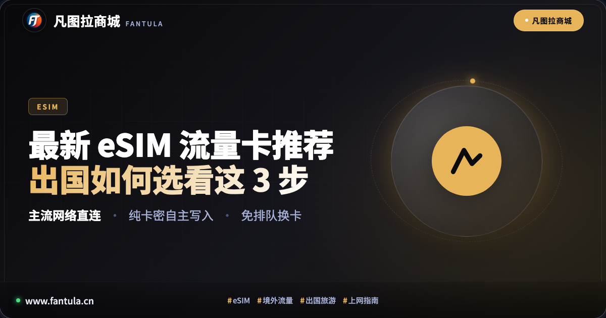
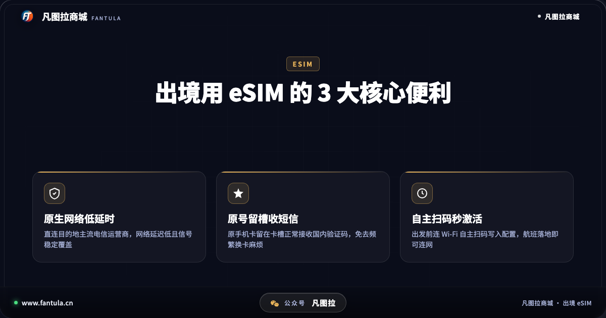
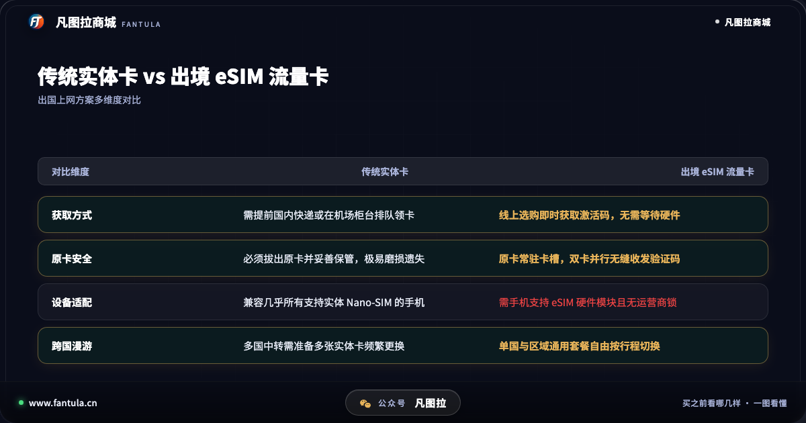
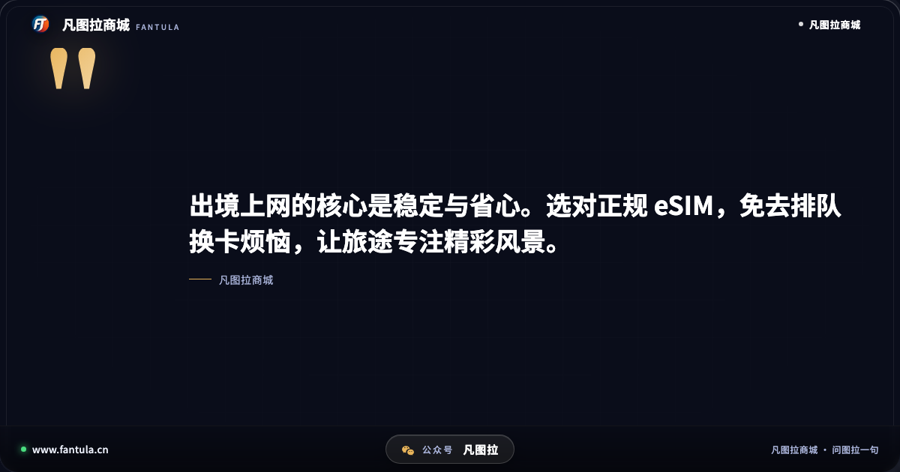
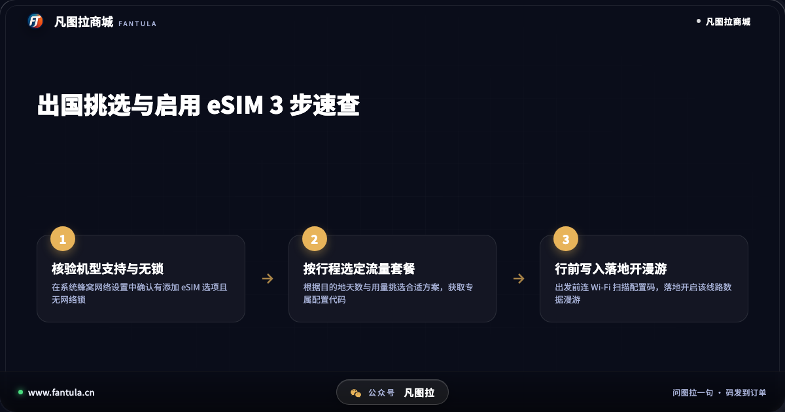

# 最新eSIM流量卡推荐：出国如何选看这3步

**先说答案**：出国挑选 eSIM 流量卡，核心只需看准 3 步：第一步，**核准手机支持与无网络锁状态**，在手机蜂窝网络设置中确认具备“添加 eSIM”选项，且手机为无运营商网络锁版本；第二步，**按行程匹配主流运营商原生网络**，根据出访国家、停留天数和每日预计用量挑选单国或区域通用流量套餐，认准纯卡密自主交付；第三步，**出发前连 Wi-Fi 写入配置，航班落地开启数据漫游**，原实体卡常驻卡槽正常接收验证码短信，无需排队换卡即可畅享高速境外网络。

## 开头

随着出境旅游与商务出差的持续回暖，境外网络连接成为了每一位出境旅客不可或缺的基础需求。在以往，许多人在出行前需要提前几天在网上购买实体上网卡等待快递，或者落地后在异国机场排着长队租用随身 Wi-Fi 设备并时刻注意充电与归还。

如今，伴随智能手机技术的快速普及，eSIM（嵌入式 SIM 卡）正逐渐成为出境上网的优选方式。只需通过线上获取一串数字代码或二维码，几分钟内即可将境外数据网络配置写入手机，免去了寻找取卡针和保管实体小卡的麻烦。

然而，面对市面上五花八门的境外 eSIM 流量套餐，不少新手旅客常常感到困惑：自己的手机到底能不能用 eSIM？应该怎么挑选适合自己行程的套餐？怎样才能避免买错或无法激活？

本文将为你详细梳理最新出境 eSIM 流量卡的挑选与启用技巧，手把手带你掌握实用的 3 步选卡流程。

## 一、出国用 eSIM 流量卡的核心优势

了解出境 eSIM 的基本工作原理与核心优势，有助于我们在出行前做出更为合理的通讯决策。

eSIM 是一种直接嵌入在手机主板上的微型芯片。相较于传统的可拆卸塑料卡片，它允许用户通过网络下载并激活运营商的配置文件。在出境场景中，使用 eSIM 具备三大突出优势：

首先，**原生网络直连，保障低延时与高稳定性**。优质的出境 eSIM 方案通常直连目的地主流电信运营商的网络基站，无论是导航查路线、翻译交流还是即时通讯，都能提供流畅稳定的连接体验。

其次，**原卡常驻卡槽，重要短信不错过**。使用 eSIM 时，原有的国内实体手机卡无需拔出，依然可以在卡槽中保持待机状态，随时接收银行动账通知或应用登录验证码，真正实现工作生活互不干扰。

再次，**纯数字化交付，出发前灵活随心配置**。无需等待快递寄送硬件，在线获取配置信息后，在有稳定网络的环境下扫码即可完成添加，极大提升了行程准备的效率。

## 二、出国上网方案对比：传统实体卡 vs 出境 eSIM

在规划海外行程时，旅客往往需要在传统实体 SIM 卡与出境 eSIM 之间进行权衡。两者的具体对比如下：

### 1. 获取方式与准备时间
传统实体卡需要提前数天网购并等待快递上门，若临近出发才做决定，往往只能在机场柜台支付较高溢价；而出境 eSIM 属于纯数字交付，出行前随时选购即可即时获取专属配置代码，出发前扫码添加即可完成准备。

### 2. 原卡安全与双卡体验
换用传统实体卡意味着必须将原有的主卡取下并随身携带，极易在旅途中磨损或丢失；使用出境 eSIM 则完全不存在丢失实物卡的隐患，主卡与境外流量卡在手机内并行运作，双卡双待体验十分顺畅。

### 3. 设备门槛与机型适配
实体卡几乎兼容市面上所有具备标准卡槽的手机；而 eSIM 则要求手机硬件本身内置 eSIM 模块，且设备属于非合约机（即无运营商限制的网络锁）。因此在挑选前，务必先在手机系统设置中完成兼容性确认。

### 4. 跨国多目的地切换
对于涉及多个国家或地区的连线行程，使用传统实体卡需要准备多张卡片逐一替换；而 eSIM 方案支持多国通用区域套餐，跨越国境时手机系统自动漫游至当地合作伙伴网络，免去繁琐插拔。

## 三、正规境外出行业务保障：以凡图拉商城为例

为了让出境旅客能够安心出行、省心上网，凡图拉商城在境外出行业务线中坚持严谨规范的服务原则，为用户提供周全的数字化保障：

**其一，主流网络直连，覆盖透明清晰。** 凡图拉商城提供的出境 eSIM 流量套餐覆盖日本、韩国、东南亚、欧美等多个热门旅行目的地，明确标示当地合作网络运营商与网络制式，拒绝虚标流量，让用户在出行前做到心中有数。

**其二，纯卡密自主交付，保护用户设备隐私。** 商城所有 eSIM 商品均以标准卡密和二维码方式即时交付至用户订单中，由用户在本人手机上独立操作配置，绝不索取任何账号密码与敏感权限，全方位守护隐私安全。

**其三，履约规范透明，常驻人工客服指引。** 商城制定了严格的订单交付标准，超时未出码退回账户余额，并配备专业人工客服在线解答激活步骤与网络设置问题，帮助旅客在旅途中随时解决网络疑虑。

## 四、实操指引：挑选与启用出境 eSIM 的 3 步流程

在确认出行计划后，按照以下 3 步即可轻松挑选并启用适合自己的出境 eSIM 流量卡：

**第一步：核验机型支持与无网络锁。** 在出发前，打开手机系统设置进入“蜂窝网络”或“移动网络”页面，查看是否存在“添加蜂窝号码”或“添加 eSIM”按钮。如果能正常进入该界面且手机并非特定运营商绑定的合约锁网机，即代表手机支持使用 eSIM。

**第二步：按行程选定流量套餐。** 根据自己的行程天数以及日常使用习惯挑选合适方案。例如对于短期休闲度假，可选择包含稳定高速日流量的套餐；若需频繁进行商务会议或多国中转，可挑选大容量的区域通用流量包。下单后妥善保存订单内的专属二维码与文本代码。

**第三步：行前写入配置，落地开启漫游。** 建议在出发前一天或起飞前，在机场或家中的稳定 Wi-Fi 环境下扫描二维码将 eSIM 配置文件添加到手机中。添加完成后暂时关闭该线路。等航班平稳落地目的地后，将蜂窝移动数据切换至该 eSIM 线路，并同步打开该线路的“数据漫游”开关，手机即可迅速注册并接入当地高速移动网络。

## 五、常见问题解答

针对初次尝试出境 eSIM 的旅客，以下是大家最为关心的几个实用问题：

### esim怎么用？
使用 eSIM 非常简单直观。用户在线获取运营商提供的二维码或激活码后，在手机蜂窝网络设置中选择“添加 eSIM”，通过扫描二维码或手动输入代码将网络配置文件安装至设备。在出发地连接 Wi-Fi 完成安装，到达目的地后打开该线路的数据漫游开关，手机便会自动连接当地网络开始上网。

### 境外流量包怎么购买？
购买境外流量包通常有两种方式：一是向国内运营商申请开通国际漫游流量包，但往往资费相对固定；二是通过正规第三方平台（如凡图拉商城）选购目的地专属的本地 eSIM 流量套餐，按天数和用量自主定制，不仅网络延时低，而且直接通过卡密交付，自主激活方便快捷。

### 日本esim卡怎么办理？
办理日本出境 eSIM 无需提供复杂的身份证明文件。在凡图拉商城选定出行天数与每日流量规格后直接下单，订单详情页会立即生成日本主流运营商线路的专属二维码。赴日旅客建议在出发前一天扫描二维码录入手机，落地日本各主要机场关闭飞行模式后开启该线路漫游，即可快速连网。

### 总结
出境上网不再需要受制于实体小卡与沉重的随身设备。挑选正规合规的 eSIM 流量卡，做好行前配置与兼容核查，只需简明 3 步，即可让你的每一次跨境旅途畅联无忧。

---

> 原文：[最新eSIM流量卡推荐：出国如何选看这3步](https://www.fantula.cn/blog/article/latest-travel-esim-card-recommendations-and-selection-guide)
